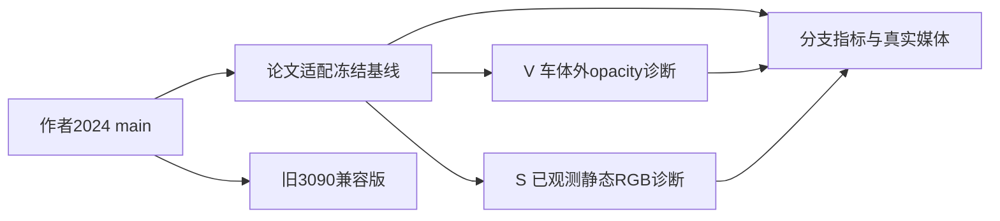

# DrivingEditor v8.2 源码差异归档

这些补丁记录已运行实现与未验收诊断的差异，不代表已修复论文复现。

作者起点：`WangXu-xxx/DrivingEditor@560d57c3825ed2bdbc6a6602e0011ad51e8da60e`。

| 补丁 | 应用基底 | 含义 |
| --- | --- | --- |
| `author2024_to_frozen_baseline.patch` | 作者起点 | 真正 vGPU 训练使用的冻结实现，包括严格 checkpoint helper |
| `author2024_to_legacy_compatibility.patch` | 作者起点 | 旧2024代码兼容工作副本；旧3090历史评价由原证据界定 |
| `author2024_to_paper_working_copy.patch` | 作者起点 | 当前论文适配工作副本，不冒充实际冻结执行源 |
| `frozen_baseline_to_V.patch` | 冻结基线 | 只加诊断车体外动态opacity项，系数由原配置固定为.05 |
| `frozen_baseline_to_S.patch` | 冻结基线 | 只加诊断已观测静态RGB项，系数由原配置固定为1 |

V、S分别应用于独立基线副本，不能连续叠加并称为既有实验。5份补丁已对对应原始字节进行 `git apply --check`；这只是交付可应用性检查，不是新的运行或效果验证。完整原始源码、配置、失败尝试和第三方来源保留在 `drivingeditor_v82_remote_code_evidence.tar.gz`，路径映射见[证据目录](../../docs/autoresearch/worldsim_v82/drivingeditor_debug_20261012/r1/evidence/)。

历史实现使用绝对路径、原始CUDA扩展和已固定环境。原计划的root receipt只授权当时那一次执行；在新环境直接重跑旧launcher并不属于此次交付授权。完整结果与限制见[调试交接](../../docs/v82/DRIVINGEDITOR_DEBUG_HANDOFF.md)。
