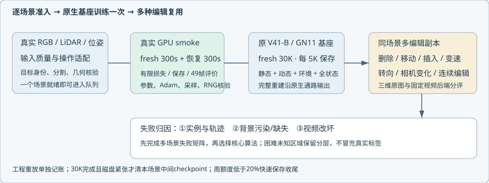
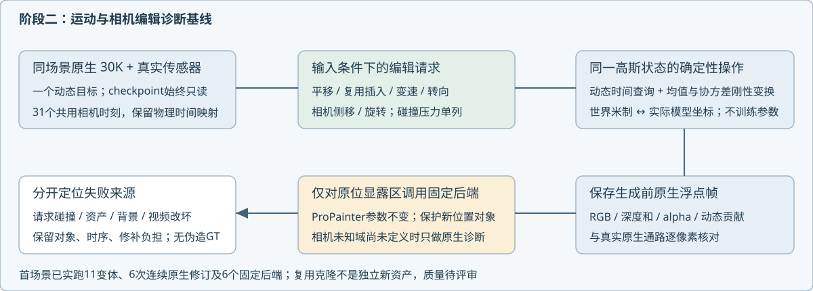

# 当前研究状态

更新：2026-10-27。Task：WS-V82-PERSISTENT-WORLD-20261027。分支research/worldsim-v8.2-drivingeditor-v42。

**阶段二：输入准入、操作适配和逐场景原生训练。** 阶段一最小编辑→三维修复→固定ProPainter已有实际输出，质量未接受；阶段三仅探索。固定①③的方法选择，先区分实例/轨迹、背景污染或缺失、视频改坏三种归因，再决定②算法。持久世界状态是框架目标，不预定为创新。

[计划](autoresearch/persistent_world_20261027/PLAN.md) · [评测合同](autoresearch/persistent_world_20261027/EVALUATION_PROTOCOL.md) · [输入准入规则](autoresearch/persistent_world_20261027/ADMISSION_POLICY.json)



最新用户授权：通过数据质量检查的场景立即优先训练，不等所有候选；每场景只fresh训练一次原生V41-B/GN11基座30K，多种编辑复用。每5K保存静态、动态、环境、优化器/RNG/采样状态四件与评价。smoke真实fresh≥300秒+完整恢复≥300秒，实跑保存/49帧评价/恢复/下一入口；额外更新单列，正式fresh30K不混smoke。bug自主修复、精确恢复或新目录重放，旧现场与成本保留。仅本场景30K完整成功、最终可恢复四件和评价验证后且磁盘紧张，才清本场景中间checkpoint产物；不清其他资产。

36个context/1764帧RGB与轨迹已准备，1原方法开发、2历史重建开发、10新诊断开发、23封存；216任务规格不是216完成实验，物理路段重叠仍待审计。自动原始检查34通过、2复核，完整正式基准就绪仍为0。准入v2检查清晰度/曝光、标定/位姿刚性、轨迹、极线及目标裁切。最大框原窗口只有1个普通运动候选、0个变速候选；按操作重选窗后33普通运动、21真实运动目标候选，仍须窗口/资产/几何检查。雨水镜头336353...归光学退化困难层；183975...低匹配率待LiDAR核验，不直接判标定坏。

3个新开发段各49帧真实1920×1280 RGB、五LiDAR双回波TOP运动补偿、位姿与标定提取完成，3段DEVA掩码完成。原最大框目标多被边缘裁切，已选择同窗完整可见运动目标，无需重提传感器。147053...SUV49帧DEVA166已逐帧检查，18147真实动态点；静态继承600000点RandomState(0)有放回采样，全部6967169源点可追溯。GT框只用于身份提案，不生成像素掩码或过滤训练点。天空沿原SegFormer真实推理；首场景原生Scene/SGCM守卫与真实smoke通过：fresh1000+恢复1000额外更新，合计965.23秒（含原生评价/保存），所有参数/Adam/RNG/采样恢复核对通过；正式fresh30K已启动，训练质量未接受。

当前控制器快照：
```json
{
  "14705303724557273004_3105_000_3125_000": {
    "context": "14705303724557273004_3105_000_3125_000",
    "pid": 32375,
    "start_ticks": "902980215",
    "formal_steps": 30000,
    "save_every": 5000,
    "per_edit_retraining": false,
    "phase": "formal30k",
    "command": [
      "/root/autodl-tmp/envs/drivingeditor/bin/python",
      "/root/autodl-tmp/drivingeditor_repro/campaign/persistent_world_20261027/code/native_scene_worker.py",
      "--scene",
      "/root/autodl-tmp/drivingeditor_repro/campaign/persistent_world_20261027/motion_scene_inputs_v1/14705303724557273004_3105_000_3125_000",
      "--output",
      "/root/autodl-tmp/drivingeditor_repro/campaign/persistent_world_20261027/native_scene_training_v1/14705303724557273004_3105_000_3125_000/formal30k"
    ],
    "child": {
      "pid": 35829,
      "start_ticks": "903090773"
    },
    "last_returncode": 0
  },
  "4295449061847708198_3769_000_3789_000": {
    "context": "4295449061847708198_3769_000_3789_000",
    "pid": 44539,
    "start_ticks": "903397702",
    "formal_steps": 30000,
    "save_every": 5000,
    "per_edit_retraining": false,
    "phase": "waiting_previous_scene_diagnostics",
    "child": null,
    "after_motion_context": "14705303724557273004_3105_000_3125_000",
    "previous_waiting_controller": {
      "context": "4295449061847708198_3769_000_3789_000",
      "pid": 34105,
      "start_ticks": "903032402",
      "formal_steps": 30000,
      "save_every": 5000,
      "per_edit_retraining": false,
      "phase": "waiting_gpu",
      "child": null
    },
    "dependency": "/root/autodl-tmp/drivingeditor_repro/campaign/persistent_world_20261027/motion_suite_execution_v1/14705303724557273004_3105_000_3125_000/status.json"
  },
  "473735159277431842_630_095_650_095": {
    "context": "473735159277431842_630_095_650_095",
    "pid": 44540,
    "start_ticks": "903397703",
    "formal_steps": 30000,
    "save_every": 5000,
    "per_edit_retraining": false,
    "phase": "waiting_previous_scene_diagnostics",
    "child": null,
    "after_motion_context": "4295449061847708198_3769_000_3789_000",
    "previous_waiting_controller": {
      "context": "473735159277431842_630_095_650_095",
      "pid": 34781,
      "start_ticks": "903048683",
      "formal_steps": 30000,
      "save_every": 5000,
      "per_edit_retraining": false,
      "phase": "waiting_gpu",
      "child": null
    },
    "dependency": "/root/autodl-tmp/drivingeditor_repro/campaign/persistent_world_20261027/motion_suite_execution_v1/4295449061847708198_3769_000_3789_000/status.json"
  }
}
```
权威native_scene_training_v1/*/status.json、native_scene_dispatch.json和最新native_scene_priority_dispatch.json；核对PID/start_ticks，健康进程不重复启动。新场景训练属于阶段二基础设施，不是新②算法训练。原V41-B完整重建不加道路或编辑hook；编辑在副本进行。新②训练仍禁启，③保持同权重ProPainter，不自动切DiffuEraser。

最新人类纠偏已落实：每场景30K完成后立即优先执行该场景多操作诊断，再训练下一场景，CPU质检、准备和失败分析异步。后续训练使用--after-motion在GPU锁之外等待前一场景11个原生变体及6个固定ProPainter对象编辑完成，不能让连续30K训练挤掉首轮诊断。scene_diagnostic_priority_v1/receipt.json记录仅替换两个零更新无child的等待父进程，首场景健康训练不动、丢失更新0。首轮诊断若工程失败且父/child退出，保留现场、标注待修复、释放后续训练，代理优先修复，不算已完成案例。尽快按①实例/轨迹资产、②背景、③后端建立失败证据，再决定阶段三，而非不断增加准备和训练。

两个其他历史开发路段scene0017/0029各6种整动态分支操作×49帧及固定视频完成，FP32适配差0；不冒充精确实例编辑。0017视频把部分正确背景变暗块；0029删除后暗色轮廓保留，移动/插入拖影。不同历史基座绝对分数不作方法增益。变速、转向、连续组合及同协议HorizonForge对比仍待补齐；封存无编辑成绩。



当前已为3个新增段准备同一中央31帧的物理编辑请求：删除、平移、复用插入、0.75/1.25倍速、±15°转向、0.5m侧移和3°相机旋转，另有连续修订协议。11单请求变体+1组合协议/场景均未冒充完成案例。变速查询均在原49帧时间支持内，无裁剪伪停顿或外推；模型时间与微秒物理时间分开。source request碰撞检查发现147053...和473735...的2m克隆插入与保留原车重叠，第三段3.5m插入也与其他车辆冲突，左转11/31帧冲突；保留为碰撞压力层，不能归为背景算法失败。原检查漏掉克隆与原车重叠的CPU草案已留档修复，未跑GPU编辑。三段动态源点世界坐标/时间逐点回放差0，99.55%/99.71%/99.91%在未扩张标注框内；只作几何一致性诊断，不证明语义纯度，不用GT框过滤训练点。

render_motion_suite.py已接原生模型只读载入、时间查询、世界/模型仿射和高斯协方差旋转；CPU四元数与相似变换核对通过，不替代GPU验证。motion_suite_controller.py已按场景排队：等同场景30K完整返回，真实GPU单帧原生通路核验，再运行31帧单请求与6个对象编辑的固定ProPainter。连续多请求实际执行仍待完成，相机未知域未定义时只做原生诊断，不伪称生成补全。该队列不追加训练，不更换①③方法，仅补操作测试入口。

首场景5K中间节点四件/49帧评价已确认；动态ROI PSNR21.24dB，已查看中帧，资产仍模糊且有残影，不能接受编辑质量，也不把未收敛5K当30K最终失败；继续健康原配置训练。完整benchmark准入仍待30K质量核对。

严格道路原始输入撤源v2完成两路段组件基线：49源RGB编码前遮挡、世界洞LiDAR初始化前移除，不输入已有高斯/潜特征，不是整个B撤源重训。真实最近LiDAR可见性和车辆排除定义稀疏地面参考，分边界/过渡/≥0.75m核心。0017核心9426累计帧像素，确定性平面+邻色MAE0.02752，固定ProPainter0.02418；0029核心4628，0.03863→0.02885。稀疏域不是全洞GT，视频不是3D；输入平面不读取隐藏目标点/教师平面。PNG量化口径对齐，旧分数保留。不据此提前扩②算法。

保背景原型fresh10K/49帧验收已完成，额外smoke4166；几何候选仅smoke3985、正式10K未启动。旧三父队列因阶段二优先停止，非工程失败，不恢复。保留用户选择保背景edit_smoke_preserve/full199/checkpoint1000_from0.pth，不追求道路贡献最大化。199参考来源曾进入初始化，不是独立GT；直接锚点解释大部分旧收益，不能宣称世界记忆创新。

资源停止线：周剩余严格<20%快速保存、禁启、取回必要结果、提交推送并关AutoDL，再暂停同一心跳。在此前持续研究，不因阶段结束/负结果/队列空关机。当前工具周剩余53%，至少30分钟复查。NVML每秒记录，历史31.09GiB采样峰与CUDA分配器峰分开。数据/模型/日志不入Git，保留用户桥接脚本修改。

本地报告outputs/4D_Editing_Evaluation_20261027/index.html。quality_accepted=false，human_verdict=null。
