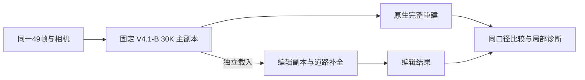

# 后续固定基线：V4.1-B 原生 30K

2026-10-25，按用户决定登记。**后续实验统一以 `V41_B_native_30K` 为完整重建基线，历史 V1 30K 只保留为历史参考。** B 是原 V1 方案的独立正式训练，原生更新 30,000 次、道路更新 0 次；不是 V4.1-R，也不是加入道路后的联合输出。

## 固定资产与训练身份

- B 目录：`/root/autodl-tmp/drivingeditor_repro/campaign/r15_gn11_stage1_v41_20261023/arms/B/run30k`。
- 30K 四件：`chkpnt30000.pth`、`dynamic_chkpnt30000.pth`、`env_light_chkpnt30000.pth`、`training_state30000.pth`；身份凭据 `v1_checkpoint30000.json` 与 `phase_0_30000_returned.json`。登记时四件均存在且非空；实际字节数保存在下述 `comparison.json`。
- B 的正式训练逐步日志为 1–30,000 完整序列，loss 全有限，10K/20K/30K 完整节点已验收。后续方法共享这个固定 checkpoint，不为每个编辑方法重新训练 B。
- 历史 V1 目录：`/root/autodl-tmp/drivingeditor_repro/campaign/r15_baseline_owner5_20261018/runs/scene0008_089_137_hybrid_30000_seed0_GN11_resume20k`；它由历史 20K 恢复到 30K。B 为本次独立 fresh 30K，二者不是逐位配对或严格单因素重跑。
- 完整重建沿 B 的原生静态＋动态＋环境通路；编辑副本独立载入、更新及验收。主副本的权重身份和通路隔离仍须检查，不能用下面的经验容差替代。

## 历史 V1 与 B 的实测差异

数字直接取自两组 `eval/train_30000_render/metrics.json` 与 `paper_region_metrics.json`，2026-10-25 再次只读核对；本次没有重新渲染或训练。两份区域记录的 49 帧 ID 及逐帧动态／静态 ROI 像素数逐项一致。

| 指标 | 历史 V1 30K | V4.1-B 30K | B − 历史 V1 |
|---|---:|---:|---:|
| 全图 PSNR ↑ | 36.6016 | 36.7909 | +0.1893 dB |
| 全图 SSIM ↑ | 0.969229 | 0.969602 | +0.000373 |
| 全图 LPIPS ↓ | 0.036823 | 0.035364 | −0.001459，降低 3.9634% |
| 车辆区域 PSNR ↑ | 36.1626 | 35.8888 | −0.2739 dB |
| 背景区域 PSNR ↑ | 36.7256 | 36.9827 | +0.2571 dB |

口径为 scene0008、raw89–137 共 49 帧、480×320；原生浮点预测和 GT clamp 到 [0,1]，逐帧指标算术平均，非保存图指标，非先合并全序列 MSE 再算 PSNR。SSIM 沿原 V1 的 11×11 定义；LPIPS 沿原 V1 的 VGG/version0.1、直接 [0,1] 输入定义。

这里的车辆区域取 `dynamic_psnr_star.psnr_roi_mean`，背景取完整合成图在其补集上的 `static_psnr_s.psnr_roi_mean`。使用原 actor 二值 mask 的 ROI 归一化，**不是**全图零填充 PSNR，也不是删车后的静态分支 PSNR。B 的“车身内部 40.0937／边缘 28.0496／正常背景 40.2653”属于另一套 V4.1 稠密诊断区域，不与本表混用。

## 后续判断采用的经验波动尺度

用户认可：上表这种幅度视为正常运行波动，后续同口径聚合指标在相近幅度内的变化可以忽略，不据此宣称算法提升或实质退化。采用双向变化量，经验参考约为：

| 指标 | 可忽略变化的经验尺度（绝对值） |
|---|---:|
| 全图 PSNR | 约 0.19 dB |
| SSIM | 约 0.000374 |
| LPIPS | 约 0.00146（本次约 4%） |
| 车辆区域 PSNR | 约 0.274 dB |
| 背景区域 PSNR | 约 0.257 dB |

这是当前项目的经验解释规则，依据为历史 V1 与 B 两次运行的差值；尚未用多随机种子估计统计方差、置信区间或显著性。B 的小幅全图改善、车辆区域小幅下降均按此处理，不包装成方法收益或失败。以后论文如需统计结论，再做相应重复实验，当前不因此增加实验预算。

上述尺度仅适用于相同帧、分辨率、clamp／感知指标定义、ROI 及聚合方式。仍如实列出原始差值；明显局部车身破坏、中心残影、道路空洞和逐车最差帧单独报告，不能由平均值抵消。删车补全收益继续用固定参考域、完整目标分母和实际道路贡献验收。这些任务也不能只靠“完整图接近 B”判为成功。

## 历史权重清理后的可追溯记录

两组原始小型指标 JSON、B 配置／场景绑定、30K manifest／返回凭据和正式训练完成审计已独立复制到：

`/root/autodl-tmp/drivingeditor_repro/campaign/r15_gn11_stage1_v41_20261023/baseline_reference_20261025/`

该目录有 9 份原记录及 `comparison.json`；后者保存未四舍五入数值、差值、原记录 SHA256、来源路径和 B 四件字节数。已取回当前本地 workspace 的 `work/v42/baseline_reference_20261025/evidence/`，可脱离历史 V1 权重读取。历史权重不再是后续方法比较的必需资产；原图、相机、训练源码和既有诊断资料仍按各自输入身份管理。

本次仅登记基线、保存指标证据与更新文档；没有删除任何权重，没有修改 B／R 或启动模型推理、训练。采用 B 为基线不等于道路编辑质量已通过，`quality_accepted=false`、`human_verdict=null` 保持原样。
