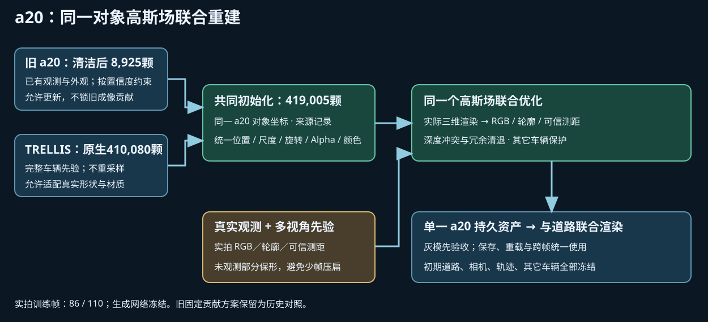

# a20：统一高斯场联合重建

本轮归档完成，车辆灰模与场景交接均未通过；正式材质与联合精修未启动。最终候选来自第三次独立几何训练40步和整场移除检验0步，不能把三次独立40步称作同一资产训练120步。

原始a20清理后8,925行与TRELLIS原生410,080行共同初始化一个a20对象坐标高斯场，两种来源均可学习，来源标签仅用于置信度和证据。最终总行数419,005，有效418,194行（原始源8,114、教师源410,080），累计移除原始源811行，教师未重采样。取回验真显示两种来源分别有8,014和310,240行位置改变，颜色在几何阶段保持冻结。

| 实际组 | 正式参数更新 | 工程与视觉结果 |
|---|---:|---|
| 共同初始化 | 0 | 提供真实86/110与六新视图基线 |
| 首轮几何重建（r1） | 40 | 测距数值改善；场景可见贡献不足，工程诊断未通过 |
| 监督分离后（r2） | 40 | 数值满足；灰模仍有明显重影 |
| 跨视角贡献清退后（r3） | 40 | 恢复与数值满足；前轮长杆、后窗及尾门异常未解决 |
| 整场移除检验 | 0 | 接受7个原始源移除候选；额外2次原生反事实渲染；灰模仍未通过 |
| 材质与联合精修 | 0 / 0 | 未启动 |

每次独立试验另有10步smoke、2次丢弃重放、1步丢弃材质探针和1步丢弃联合探针。三次合计正式120步、额外42步，总实际162次优化器更新。所选资产的正式几何更新仍为40步。道路、背景和其他车辆参数更新均为0。

246个不透明面返回点：渲染期望距离MAE由0.124615米降至0.006290米，最终P90为0.013866米。单对象可见区Alpha≥0.95覆盖为99.80% / 99.50%；场景内可见贡献仅15.50% / 34.38%，其他车辆RGB变化超过1/255的像素为171 / 359（真实86 / 110）。这些数值与灰模及场景验收分开记录。

最终灰模验收为REJECTED。外轮廓清退缓解了雾尾，但新视图01/02前轮长杆及03后窗、尾门异常仍在，车壳内部深度与大足迹冲突未解决。冻结场遮挡不足单列，不作为单对象灰模失败的替代解释。F06维持部分完成、场景未通过；人工用户分数未提供。

实际渲染、纯教师同算法对照、前后组与历史入口见[index.html](index.html)。图像通道分别为RGB、Alpha、期望深度灰模、期望深度法向和辅助灰影；法向由期望深度梯度计算。实际执行、资产SHA与完整Adam/RNG恢复证据见[恢复索引](restore_index.json)、[实际账目](actual_execution_ledger.json)、[最终收据](receipts/final_iteration_receipt.json)、[灰模验收](receipts/root_geometry_review.json)和[本地资产验真](receipts/assets/takeback_verification.json)。Git仅含轻量来源、收据和报告生成器，资产与checkpoint按指针恢复。

免责声明：渲染期望距离由原生depth_sum/alpha换算射线距离，离散多层可混合，不能称作整体几何精度。生成隐藏区域为先验；本轮仅使用批准的BUILD86/110，未打开封存帧。本轮失败不能推广为所有高斯重建方法的能力上限。
