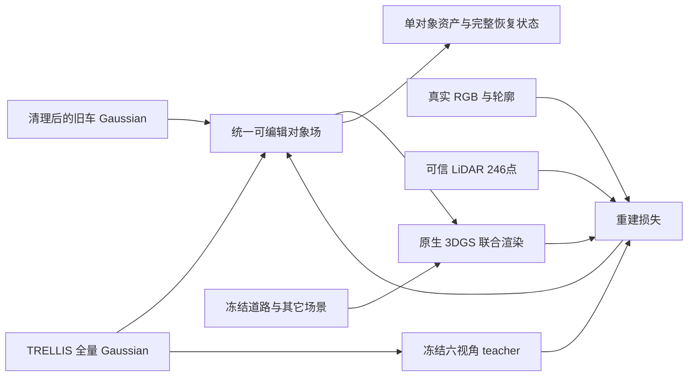

# 统一对象场联合重建

两类来源初始化同一个可编辑的 Gaussian 对象场。旧源 8,925 行与 TRELLIS 全部 410,080 行共同参与原生深度排序，所有真实监督仅使用 BUILD86/110。



`run_joint_reconstruction.py` 是唯一入口。`joint_core.py` 的 preflight 不导入 PyTorch；`joint_gpu.py` 只在 GPU 模式载入。旧融合脚本不在执行依赖中。

```bash
python runtime/run_joint_reconstruction.py \
  --mode smoke \
  --init initialization/joint_actor_init.npz \
  --manifest initialization/manifest.json \
  --source-manifest native_bindings.json \
  --context-plan context_plan.json \
  --path-map-file runtime/remote_path_map.json \
  --config runtime/training_contract.frozen.json \
  --prior-contract /root/autodl-tmp/drivingeditor_repro/campaign/a20_sd15_sameview_20261122_r1/student/contract.json \
  --output runs/smoke_r1
```

`--mode preflight` 执行 CPU 校验。`geometry` 从干净初始化运行 40 步；计划的 `appearance` 与 `joint` 分别为 80/40 步，要求 `--resume` 指向上一阶段 checkpoint，且 `--geometry-gate` 同时具有数值及灰模通过记录。`evaluate`、`reload` 使用 `--asset` 或 `--resume`。每次执行使用新输出目录。本轮灰模未通过，正式材质与联合阶段实际均为 0 步。

几何阶段训练 xyz、各轴 log-scale delta、单位 delta quaternion 和 activated opacity；颜色阶段训练 SH DC；联合阶段同时训练上述参数。Activated opacity 直接保存精确 1.0，步后投影至 [0,1]。源置信度进入软参数约束，两类来源均可由真实 RGB 与几何监督更新。

六视角 teacher 始终来自更新前的纯 TRELLIS 源；未知归属由冻结的来源权重定义，固定域要求 teacher alpha≥0.95 且未知贡献比例≥0.95。真实相机输出 1152×768，类别标签使用 NEAREST。真实可见 RGB 与正轮廓由单对象实际渲染监督；完整 K 保护仍在统一场景中进行。LiDAR 依据每个点的 source_raw 固定投影；训练覆盖全部 opaque246，使用 depth_sum/alpha.clamp_min(0.05) 并独立约束 alpha，不能由学生透明度缩小训练域。未知区域深度同样使用固定高置信 teacher 域。评价仅在 alpha≥0.95 计算原生相机射线距离，其余覆盖单列。1030 点全部保存，opaque246 与 source-eligible235 分别报告，glass 不作外壳目标。

上下文清退为 `mapped clean actor ∪ certified retire_DELETE`，与完整 K-positive1922 集合必须无交集。Actor cleanup 排除本身不删除原生背景。重复 Gaussian 的实际贡献由统一 raster feature VJP 归属；清退结果全局固定，保留来源行和清退记录。

Smoke 包含 10 步真实几何更新、贡献清退、checkpoint 保存、actor/Adam/RNG 精确恢复、同一步重放、评价、资产重载及丢弃的颜色/联合阶段入口检查。额外两次重放和两次阶段探针单列；正式 G40 从干净初始化开始。`entry.json`、`native_camera_matrices.json`、`context_plan.json`、`smoke_proof.json` 和 `resource_ledger.json` 记录执行口径。

三次独立 G40 分别记录初次接线、可见监督分离、跨视角贡献清退，不构成同一资产的 120 步训练。最后的 `post_geometry_ablation.py` 从第三次 G40 精确恢复，对固定排序候选执行整场移除检验；0 次优化器更新，另存 actor 与包含 Adam/RNG 的 checkpoint。最终资产仍为同一对象高斯场，共 419,005 行，其中 418,194 行活动；恢复与取回结果见 `../final_iteration_receipt.json` 和 `../assets/takeback_verification.json`。
