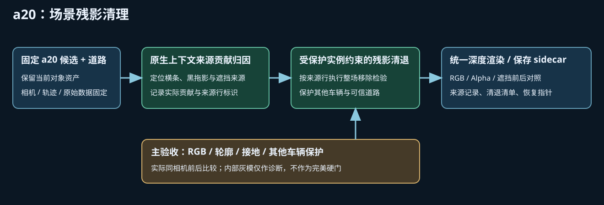

# a20：场景残影清理现状

本轮已停止追加并封存，结论为部分清理、未获最终场景验收（partial_cleanup_no_final_acceptance）。原a20及默认项保持；959行sidecar登记为保守新增清理候选，亮红条基本去除，冻结道路RGB参考诊断两帧小改善。其余阶段保留为失败或部分改善消融，不升级默认。

残影主要来自未归属静态背景，少量来自其他动态车辆外露杂散，并非当前a20主体。真实86的横条/拖影平均背景αT为0.672/0.492，当前a20两源合计为0.086/近0。硬删暗层暴露亮紫层，继续删亮紫层又暴露新黑拖影。灰条处道路Alpha约0.09，教师来源支撑不足；保护点不能全删。

| 实际阶段 | sidecar行数 | 结论 |
|---|---:|---|
| 局部清退 | 270 | 主要变淡 |
| 亮红条清退 | 959 | 保守新增候选；红条基本去除，整体仍未通过 |
| 静态残影清退 | 1468 | 部分改善 |
| 外露动态杂散清退 | 1500 | 1468静态＋32动态；暗雾仍在 |
| 暗残影清退 | 1754 | 改善很小，亮紫层更显露 |
| RGB残影清退 | 2006 | 1959静态＋47动态；紫雾去除，新黑拖影暴露 |

本任务实际优化器更新0。120步透明度控制已取消且未启动（CANCELLED_NOT_STARTED），实际0步。原7组重建历史及本轮7组来源/清退结果共14组保持。a20/道路字节不改，两帧保留车RGB/Alpha差0、真实可见误差增量0、无新增覆盖孔洞，sidecar重载差0；动态来源8/14实际可见区亦核验差0，未删除车辆主体。

相对冻结道路的诊断表明，原始→1754行方案暗残差像素在真实86为772→143、110为1096→168，亮残差像素反增至277→772、317→1187，RGB绝对差P95为0.237→0.233、0.252→0.283。数值与残影视觉结论并列保留。恢复与选中SHA见[恢复索引](restore_index.json)，完整历史见[同一报告](../a20_joint_reconstruction_20261122/index.html)。GPU保持开机。

免责声明：冻结道路float RGB、诊断圈和历史008经验用于相对诊断，不是地面真值。黑像素下降不能单独判定清理成功；内部灰模失败保留历史，不作为本轮场景清理的完美硬门。
