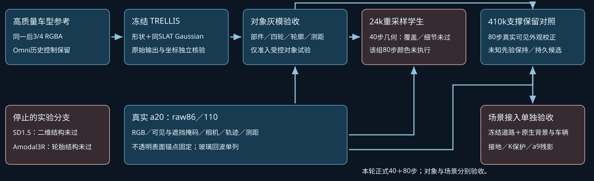

# a20 车辆教师与高斯资产轻量归档

任务 `A20-SD15-SAMEVIEW-20261122`。本归档保留实际执行源码、合同/批准、关键收据、报告与恢复指针；完整图片、NPZ、checkpoint、teacher cache和第三方仓库保留在实验目录，不进入Git。报告媒体与可下载actor使用原 `outputs/a20_sd15_sameview_20261122/` 交付目录。

正式120步由失败压缩学生的40几何与独立410080支撑保留控制的80可见DC校正组成；不是同一学生完整蒸馏。20+2+1与5+2的短程、重放和丢弃探针单列，合计150物理更新。baseline formal material为0；未知DC、几何、协方差和opacity逐位冻结。场景与道路优化为0，场景未过，人工最终质量判定保持null。

`source_manifest.json` 是明确来源与Git目标清单；`restore_index.json` 给出原目录、最终actor/checkpoint SHA、core与场景恢复入口及未重复复制诊断的SHA。Amodal执行源保留 `reconstructed` 文件名及 `source_execution_receipt.json`，不把后加hook版本冒称原执行版。旧HQ报告只增加前向导航，历史实验组保留。
