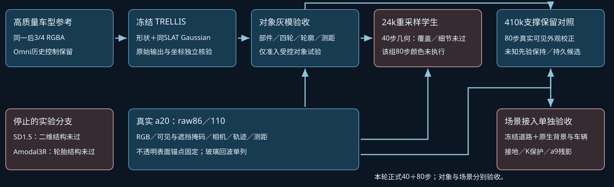

# a20：车辆教师与高斯资产对照

2026-11-22。TRELLIS-image-large是本轮更有用的粗车辆先验。保留原生410080高斯支撑可以避免24k重采样造成的明显细节损失；完整a20与场景交接尚未验收。

## 实验组与输入

| 组 | 实际执行 | 结果 |
| --- | --- | --- |
| SD1.5同视角补全 | 基础9通道inpainting，DDIM20、CFG3、seed101，1候选，0网络训练 | 后保险杠圆灯、轮胎和碎片失败；未送Omni |
| Omni高质量参考控制 | 复用上一轮正确框轴资产，本轮0新采样 | mean/P90 9.93/38.02cm，测距未过 |
| Amodal3R | 真实partial+官方可见/遮挡接口，seed101、12+12步 | 轮胎/锥状支撑失败，mean/P90 8.85/36.01cm |
| TRELLIS-image-large | 与Omni同RGBA，seed101、25+25步；同SLAT官方Gaussian头0.188s解码，无重采样 | 四轮/舱斗可辨；mean/P90 4.68/9.08cm |
| 24k独立重采样学生 | 24000表面点+235不透明测量锚点；20步smoke，正式40几何 | 高覆盖门失败，80颜色未跑 |
| 410k支撑保留控制 | 5步smoke，正式80可见外观校正 | 原生几何/协方差/opacity与未知DC逐位冻结，重载结果一致 |

SD仅生成a9遮挡guard与a20潜在投影交集。V=28384及单列近似可见边界R=3504像素从原图硬拷回，误差0；U=43045生成，非遮挡潜在域N=30058锁灰。原生RGB只裁片/pad到512，没有预先降到480；480类别掩码仅最近邻放大。旧整框U方案只有CPU准备，未推理。二维门拒绝在Torch/CUDA与Omni准备前真实阻断。

Omni/TRELLIS共用HQ后3/4 RGBA，SHA ac5f39fbb07029ec4018c56269f94949a4d9471a4c31d539d2a2e0e49b951399。Amodal输入不同，不能把三者解释为严格同输入排名。官方源码、模型与DINO权重、实际tokens及哈希均有记录。Amodal首次SLAT遇到同class导出位置兼容问题；原seed重放的SS coords逐元素相同，41.14秒及额外12步SS单列。执行源码启动hash未捕获，归档明确标为事后精确逆补丁重建；不把后增hook伪称已执行。

## 坐标与对象灰模门

独立看灰模确定语义轴：Amodal前方+Y、TRELLIS前方−Y，两者+Z向上。分别用proper R=[[0,1,0],[-1,0,0],[0,0,1]]和[[0,-1,0],[1,0,0],[0,0,1]]，det=+1。统一以5m长初始化，保留宽高比，不分轴拉伸。各做一次原边界/原12迭代有界yaw、统一scale和平移配准。TRELLIS scale=1.10触上界，最终LWH=5.49930×2.42789×2.03343m；原始/正反矩阵全保存。全部1030代理测距点与原阈值保留。

TRELLIS本体准入仅用于受控独立对象试验。四轮/两轴、驾驶舱/货厢关系成立，轮底高差约1.13cm；格栅与尾管仍粗。真实道路接地与场景遮挡单独设门。

## 独立学生与保真控制

独立学生：6固定512²合成视图+BUILD86/110的1152×768原生相机；几何/覆盖接受实际高斯光栅化梯度、几何正则与alpha/depth监督。测量不透明锚点固定，玻璃回波不做外壳。正式40从clean init起跑，未将smoke20接成正式训练。原生xyz/scale梯度非零，teacher到受保护分支梯度为0。恢复覆盖模型、Adam、Python/NumPy/Torch CPU和CUDA RNG、下一步重放、下一阶段丢弃探针。

正式40后，在固定teacher高置信域内，BUILD86/110的Alpha≥.95覆盖为95.543%/95.219%，低于99%入口；合成视图HF相关仅.028–.206，能量比.254–.321。该组80颜色保持关闭，DC从初始至40逐元素未变。

CPU同相机足迹诊断：正前主轴σ中位数教师1.084px、初始学生3.709px、40后3.698px；后视为1.060/3.349/3.348。共同包含0.3px²低通。初始取色混合约10–11有效源，含教师Σ与15mm采样足迹的投影二阶矩主轴约2.59–2.83px。初始0次optimizer时已见宽斑点。位置、密度、协方差和取色同时改变，不能把原因只归节点数；未执行80也不能据此证明颜色优化绝对上限。

控制组保留全部410080行xyz/scales/wxyz/opacity和高阶SH。12865行通过实际深度/alpha与真实V资格检查的DC从原RGB初始化并优化，397215未知DC永远不进入优化器。80步只用真实V RGB+0.1edge+0.1HF，未知新视图仅保真监测。它是教师初始化与观测校正，不能冒充完整压缩蒸馏。两组正式总预算为40+80=120；短程、重放和丢弃探针单列。

| 真实V阶段 | raw86 RGB L1/HF相关 | raw110 RGB L1/HF相关 |
| --- | --- | --- |
| 原生成教师 | .09180/.0915 | .08855/.00349 |
| 真实RGB初始化 | .03129/.3987 | .04033/.1047 |
| 正式80后 | .01880/.5053 | .03632/.2652 |

初始化收益与优化收益分开；未知HF≈1是原先验逐位保留，不是学出隐藏真值。raw110真实细节仍有差距。RGB/edge/HF训练使用固定中性背景的premultiplied合成色，不在低覆盖处除alpha；固定teacher95%域和真实V分别要求99%像素student alpha≥.95，不能用student自选mask缩小域。

## 场景接地与归属交接

同一固定道路不仅有Gaussian：base_atlas固定网格及测量平面支持均检查。原T前轮相对局部路面偏低约14–19cm。单次固定边界pitch/roll/Z诊断得到−2.21819°/−2.09377°/+0.08809m，保持原yaw/scale/XY/轮形与道路；全1030门仍过。真实固定surface查询仍显示后右缺可信支持、前右局部证据冲突，不能宣称四轮贴地。物理变体未烘入独立对象。

原native21不是纯净车辆包。4 baseline、feature-VJP将V、a9与全部保留K贡献分开；K_other有贡献的1922旧行全部保护，KEEP/DELETE分别退出14994/24449行。纯退出旧行的4次因果对照在K内RGB/alpha float逐像素完全相同。加入新对象后仍会遮挡K，不能用旧行归属错误解释全部差异，也未逐相机裁新GS掩盖问题。

冻结最终T控制只做6次原生场景raster、0更新。raw86右侧保留皮卡native11 RGB变化239/245像素（KEEP/DELETE）；raw110该车0，但全部K仍488。DELETE的原生a9 alpha为0，车底仍有红灰平面残留；原a9区域legacy覆盖不能单凭区域重叠判语义。道路/其它车/环境/轨迹/相机参数全冻结，无联合优化或场景晋升。

## 持久化与资源

最终标准actor SHA0dc65c4aa9fefbf73a1c2d482c0015915818c5bf0ac34d5d318e0784693da53a，410080行。完整mutable checkpoint绑定冻结完整base；独立重载8视图float及PNG最大差0。baseline40重载只出现3个8bit通道值差1LSB，未写逐位相同。

正式几何40训练段6.238s、正式控制80段4.538s，均不含Runtime加载；baseline20smoke4.783s，控制5smoke2.908s。正式运行远少于一小时，短程真实覆盖全部状态与阶段入口。生成模型无网络微调；scene/road更新均0。各运行完整进程与依赖开销按原receipt记录，不将runner段当完整SSH耗时。GPU按用户要求保持开机。

core只取必要source、最终状态/actor、关键图与证据并逐SHA验真；581MB完整float/失败现场保留远端immutable恢复指针，未为其阻塞交付。HTML保留历史报告导航，原实验组未删除。

## 结果入口

- result.json：主数值、实际阶段计数与媒体索引。
- a20_actor_candidate.json：单位、激活、来源、身份与未验收范围。
- alternatives/availability.md：两替换模型、权重、接口及工程重放。
- student/detail_footprint_cpu/detail_footprint.md：双低通/密度与初始图诊断。
- student/SMOKE_GEOMETRY_RESULT.md：失败压缩学生与恢复证明。
- student_native_support_control_r1/RESULT.md：独立控制与状态恢复。
- audit/T_native_scene_final80_r1/report.md：场景RGB/alpha、K和残留。
- audit/restore_index.json：完整恢复根；最终场景restore_index与control core另有精确SHA。

免责声明：参考图及生成隐藏车身属于车型先验，并非a20隐藏真值。1030点为对象框筛选的测距归属代理；部分后窗回波可能位于玻璃后，未认定为外壳。全部数字为BUILD86／110拟合集或合成教师保真；134／179／198未用于本轮模型、姿态或参数选择。不同模型输入协议及默认采样设置不同，单候选不能决定模型上限。Amodal一次兼容性工程重放及其事后重建的执行源码来源已透明记录。候选资产未通过完整车身真实性、场景接地、残影及保留车辆交接验收。
