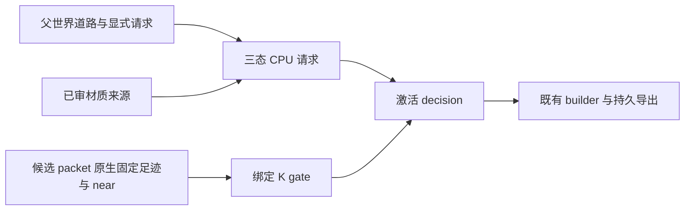

# 模块2：显式道路激活入口

本入口将**可信表面、材质资格、渲染激活**分开。只准备或消费已登记的世界道路请求；默认场景不接管、不晋升。导入模块不加载 Torch 或原生场景。



## 使用顺序

1. `prepare_request(...)` 接收完整世界行域的 `parent_render_active`、`geometry_support`、`material_qualified`、新 `requested` 和材质审查来源。材质资格由合法来源审查给出，不能用“RGB 有限”替代。新 `requested` 是本次显式激活意图，不能沿用旧生成 W 或旧 `coverage_requested` 作为表面存在门。
2. CPU 请求保留父 `render_active`；`candidate_world_rows` 只表示待审候选。旧活动行即使材质未知，也保留其父状态，不据此伪称材质已知。
3. 原生调用者对包含新增候选的完整 packet 计算 K 足迹与 near。保存 `module2_fresh_native_gate.v1`：绑定候选 road、mask 文件和 scene manifest 的 SHA256、候选 IDs、实际 packet 活动世界 IDs、帧集合、完整 K 分母。此 gate 仅覆盖 body 中当前固定的 geometry/Σ/opacity；不授权可训练尺度的最大包络。
4. `load_fresh_native_gate(...)` 验证文件绑定。CPU 桥接必须明确绑定真实原生生产者 receipt 及其 hash；`GPU_executed=False`，另记 `native_producer_GPU_executed=True`，不能冒称 API 新执行了原生渲染。
5. `apply_fresh_gate(...)` 拒绝旧活动 packet 的保护表、候选集合差异或帧/K 分母不符。只有本次候选中 geometry 与 material 均合格且不触 K/near 的节点进入 `accepted_new`。父活动行保持。
6. 调用方将 decision 交给既有 builder。实测初始化用 `road_activation_builder.build_activation_asset`；冻结教师伪来源用独立 `build_pseudo_activation`。旧 observed/source/known 台账保留；有效材质覆盖另记。导出后仍须公共 loader 重载、完整 K 和图像验收；本 API 不执行默认场景晋升。

## 已有证据的 CPU 消费

`bridge_existing_native_gate.py` 复用已完成的 `A1_beam95_native_r1` 原生生产者，输出 `refactor_existing_native_bridge_r1/`。它绑定当时的候选 body、95 IDs、151,956 个实际 packet 活动世界行、五帧及 K=77,266。新消费者接受的 95 行及完整活动集合与已保存资产逐值一致。

此桥接是 **CPU-only、0 新原生调用、0 更新**；原生产者的 25 次调用已计入原控制账。它验证消费关系，不把新 API 描述成重新跑过原生场景。`refactor_cpu_prepared_r1/` 另展示 892 个已审候选的纯 CPU 请求，新增激活仍为 0。

## 文件与验证

- 可复用源码：`code/module2_activation_state.py`。
- 独立 API 测试：`code/test_module2_activation_state.py`，6 项；含错误 mask、缺真实 producer 的 CPU 桥接、旧 packet、body/分母及三态分离检查。
- 研究原型构建器测试：`code/test_road_activation_builder.py`，7 项；包含只改 active、仅新行材质初始化及继承有效 coverage 请求。
- 桥接源码：`code/bridge_existing_native_gate.py`，随研究证据归档。

```bash
CUDA_VISIBLE_DEVICES= /root/autodl-tmp/envs/motionproj/bin/python -m unittest -q \
  test_module2_activation_state test_road_activation_builder
```

上述测试从 campaign 的 `code/` 目录执行。API 与测试可独立安装；场景构建、桥接和研究控制保留在归档中。GPU 保持开机，本入口无后台队列。
