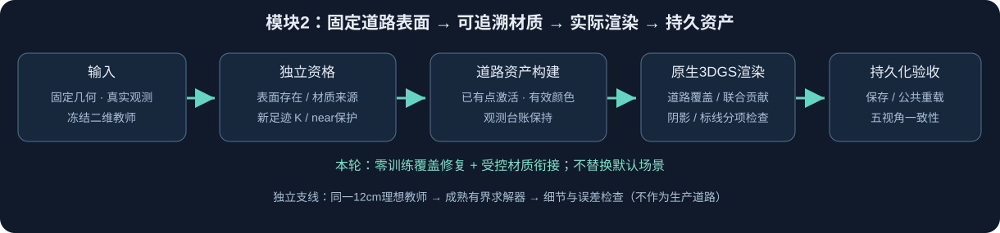

# 道路资产构建：激活覆盖、材质来源与实际渲染衔接

`MODULE2-ROAD-ACTIVATION-20261118 / road_activation_20261118_r1`；独立支线`MODULE2-MARKING-SOLVER-20261118 / road_marking_solver_20261118_r1`。用户要求在五帧探针中推进模块2，GPU保持开机。当前默认场景不替换，human_verdict/problem_solved=null。

## 主要结果

旧请求门控将一部分具有可信几何、真实材质来源的道路点留在inactive状态。通过独立核验来源、当前固定尺度渲染足迹及新点保护，原965个低覆盖像素中909个达到alpha>0.9，全部773个原gap关闭，余56个thin。固定完整阴影域3187中3131充分覆盖。整个覆盖修复零训练、零新增几何、位置/法向/尺度/不透明度不变；五帧77266个保留像素的联合RGB差0，公共加载器重载RGB/alpha/RGB8差0。

这证明激活与请求域错配是当前覆盖缺口的一个可操作原因。仍不能把覆盖通过写成材质、去影、标线细节或最终删除场景通过，也不说明已达到3DGS表示上限。

## 固定协议与控制

使用既有raw86/110二维教师，raw134/179/198作诊断。资产继承199帧BUILD观测，本轮未重跑199帧，也不称留出盲测。所有旧场景几何、动态车辆、环境、相机、预训练网络保持；不训练SD1.5、不引入TRELLIS、不新增共享网络theta或场景/逐帧潜变量。

分母保持：全S3187，旧低覆盖S965，原道路D38416，K像素帧77266。S为目标阴影区域，教师是冻结二维伪监督。原D充分覆盖仍37404/38416；不拿其97.37%替代新增S的覆盖指标。

| 控制 | 新增活动点 | gap | thin | supported / 3187 |
|---|---:|---:|---:|---:|
| 原阶段2基线 | 0 | 773 | 192 | 2222 |
| 仅激活765点；材质未合格 | 765 | 0 | 73 | 3114 |
| 765点 + 真实材质 | 765 | 0 | 73 | 3114 |
| 再加32点教师材质 | 797 | 0 | 58 | 3129 |
| 765 + 95个真实来源点 | 860 | 0 | 57 | 3130 |
| 860真实来源 + 32教师来源 | 892 | 0 | 56 | 3131 |
| 覆盖 + 上轮去影颜色（零更新） | 892 | 0 | 56 | 3131 |

首批765点是旧低S三角锚点中有既有known/source1观测来源的节点。A0只激活，保留历史占位RGB，仅用于机制控制；A1对同一节点消费不可变observed_reference_srgb。A0/A1的alpha逐像素相同，因此首轮覆盖收益来自激活，而非颜色。

118个被旧材质门挡住的锚点并非已证物理非法：旧legal条件混入active/requested，frozen_generation也先要求requested再查写入许可。重新独立校验世界几何、原生四邻域W/K、距离及视角后，113个具备教师许可；其余5个未过原视角门，未强行激活。本轮只使用与残余薄覆盖关联的32点，保持原known=false/source0/unknown=true，另记effective source3；双教师差异保留，不平均生成冲突、不称隐藏道路真值。

对剩余73个薄覆盖像素，先实际测alpha×透射率贡献，再做有限已知材质候选枚举。当前渲染器使用继承的negative-FoV协方差路径，均值投影与协方差焦距不能混用。三个隔离单高斯前向验证CPU固定尺度足迹，最大alpha误差3.47e-5；未修改渲染器或放宽校准门。近深度并列时，CUDA的FP32排序与CPU world-double排序不同，不能从后者反推单行raw-alpha来判定足迹失败。

95个新增真实来源点均来自既有inactive节点，其原生固定尺度足迹与原73残余像素相交，经过独立CPU来源审计及新packet K/near保护。不存在米制半径扩展、任意邻域补点或新增几何。该组仅额外使2个像素充分覆盖，不能把候选多当作效果大；其与32点教师组收益重叠。

## 材质与渲染交接

本轮另将新增覆盖与上一轮I0已执行的道路颜色修正作一次零更新组合；只复制原83388个许可旧活动行的有效RGB（实际83324行改变），新增892行颜色保持。原观测及source台账保持，学习颜色另记为override，不伪称真实观测或连续世界材质图。组合的原生K、覆盖与公共重载独立验收，旧I0细纹局限仍保留。

固定旧photo-S2222像素的预乘MAE：原基线0.170228，仅修覆盖0.170358，组合后0.006407；同域联合RGB误差0.169517→0.011137。全S3187的组合预乘MAE约0.030074，联合误差0.034128，覆盖与原N资产逐像素相同。新增909个充分覆盖像素的预乘MAE仍约0.088532，说明旧活动行的去影修正没有自动解决新行材质一致性；不能由旧域误差显著下降宣称全域道路材质完成。

材质验收固定旧photo-S2222与完整S3187，另列新增支持区域。预乘颜色残差与alpha覆盖分别报告；原零alpha区域不作为颜色好坏的优势，不进行不稳定的去预乘颜色训练。opaque误差、道路单独渲染与联合渲染分别评价；二维教师仅作伪监督。

A1已用真实联合成像贡献核验静态/动态/旧道路/新道路四组。完整S中静态alphaT质量raw86约61.91、raw110约28.72，动态质量分别0与约1.96e-5；原低覆盖区域新道路贡献分别约219.69/678.80。分组RGB与原联合渲染逐值相同，alphaT守恒最大误差1.55e-6。该贡献快照只针对A1，不冒充后续组合资产的分组复算。静态高斯本轮未训练或清退，因此仍可能遮挡新道路、形成旧车残影。

所有阶段保留原观测、材质来源和几何历史字段；原source UV中已有NaN保持原状。其历史构造对非生成来源并未保存像素UV，当前只主张frame/world-row/immutable RGB谱系，不虚构逐像素测量来源。

## 细标线能力：单次成熟求解器对照

对旧S2的同一12cm独立世界教师、D_color37206/RGB分母111618、五视角全部监督，使用SciPy1.13.1 Fortran L-BFGS-B；151096个活跃行×3颜色变量完整保留，不裁零列、不改目标或细节指标。初值fresh c0，颜色box[0,1]，geometry/opacity/scales/active/density保持。归一目标等比例缩放到halfSSE只为数值条件，不改变目标。

正式500次实际FG评价、486次accepted iteration、60.31秒；工程生命周期另3次FG。maxcor10、ftol1e-12、gtol1e-6、maxls20，上限500FG或300秒，不自动延长；实际停止原因是FG预算。目标f=0.0000643647，RGB RMSE=0.01134590，比旧投影谱求解器f下降7.5958%。两者预算单位不同，不称等算力速度比较。

raw86标线对比度由0.81691693升到0.82167930，仍低于0.9；边缘F1=1、中心最大误差0.4793px。4/255档RGB通过但细节失败，1/2/4三档联合可行见证均未获得。FW gap/f数值代理从约0.753降至0.114，但缺保守误差界，strict negative certificate=false；全局L2目标不等于指定标线核心对比度的可行性问题。不能因优化更接近L2最优而认定细节不可能。

raw86的12cm标线平顶核心约2.27–3.26px，其中25/53核心像素局部宽度不足3px，原生单锚足迹FWHM约1.75–2.25px。CPU局部一阶4×4近似提示采样敏感，但并非精确mesh supersampling教师或新GPU实验；原教师、原指标与旧结果不改。该对照为虚拟全活跃颜色oracle，不主张K或生产质量。

## 工程、资源与证据

覆盖主链原生前向169次，实际组合对照另25次，合计194<200，均0优化。逐项45+11+35+25+3+25+25+25；早期feature通道接线失败发生于首次raster之前，0调用/0更新保留现场。两次CPU足迹调试、三次GPU隔离校准及最大尺度/opacity端点独立记账；最大端点不采用为候选默认。

可复用入口`module2_activation_state.py`将geometry_support、material_qualified、render_active分别保存。prepare_request只产生新激活意图，不开启渲染；旧coverage_requested=false不等于表面不存在。apply_fresh_gate要求同一候选资产、完整新增行与实际packet、对应场景/固定尺度/五帧/K分母的实测保护记录；旧active-only保护表不被接受。该入口为显式使用的CPU资格层，现有默认scene不被接管。CPU桥接实际消费已记账的A1+95原生保护记录，accepted95与完整render_active均与实际保存资产相同；此桥接0新前向，不能写成新入口又执行了一轮native。

标线正式2570次原生forward/2510次backward，工程85/25，合计2655/2535。完整Fortran工作区、RNG、原生状态保存恢复及下一FG实际覆盖；恢复参数完全相同，下一proposal浮点微差单列，不冒称bitwise。五帧公共重载RGB/alpha/RGB8差0。实际单次求解约一分钟，未以重复优化凑十分钟；一小时级长实验的真实生命周期smoke规则仍保留。

来源及字段审计、所有新packet K/near与五帧真实K通过是机械验收；材质与最终可编辑场景质量另验。本轮不进入199帧训练、不扩大生成模型、不替换默认场景。下一步优先处理剩余56个薄覆盖的实际足迹与材料/静态遮挡问题，再决定固定几何材质先验是否需要扩大。11月12日TRELLIS单路块零样本负例仍仅是历史证据，不否定适配潜力，也未提供本轮切换的正面证据。

## 复现入口

远端覆盖campaign：`/root/autodl-tmp/drivingeditor_repro/campaign/road_activation_20261118_r1`；标线campaign：`/root/autodl-tmp/drivingeditor_repro/campaign/road_marking_solver_20261118_r1`。GPU Python：`/root/autodl-tmp/envs/drivingeditor/bin/python`，CPU Python：`/root/autodl-tmp/envs/motionproj/bin/python`。

覆盖执行协议分stage保存；`road_activation_builder.py`、`build_pseudo_activation.py`、`validate_observed_beam.py`与`compose_activation_I0.py`为主要入口。`scipy_box_lbfgsb.py`、`run_marking_lbfgsb.py`执行标线控制。所有native入口要求显式资格文件，重放应使用新目录，拒绝覆盖既有输出。完整输入、候选资产、精度数组和标线checkpoint保留远端，轻量HTML与Git源码不构成完整资产备份。

GPU按用户要求保持开机；本次队列结束后无待启动自有训练/评价控制器。failure_ledger_refs=[V82-F06]，更新既有卡，无新增失败ID。
