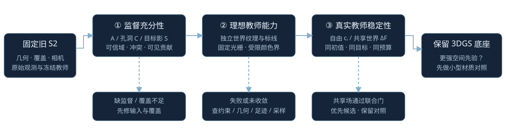

# 道路微调实用上限：CPU准备

`MODULE2-CAPACITY-CPU-20261117 / road_capacity_cpu_20261117_r1`。**CPU准备完成，停在GPU执行前；没有真实场景训练、原生光栅调用、新模型推理或后台GPU队列。** 原场景与历史结果保留。

## 当前证据与解释

原报告的固定F对照训练目标为旧世界材质投影，左侧二维教师用于评价；覆盖阶段冻结颜色，200→500步颜色不变是合同规定。旧目标影possible域1665/2980像素没有A/C/coverage监督，全部进入outside保持。因而阴影残留不能证明颜色表示已饱和；旧报告的参考标题已澄清角色。

已核目标身份、原教师写许可与保留边界，准备A、物理孔洞C、目标影S分域候选。S可信完整域1043/2144，颜色高覆盖域820/1402；未校准预测不称真实去影GT，其他车辆预测阴影单列保护。完整S仍有223/742像素覆盖不足，其中164/609几乎无道路层。需要实际覆盖可控性与S贡献资格验证，不能让颜色模型或生成先验承担无覆盖区域。

## 三道待GPU检查

| 检查 | CPU已准备 | GPU结论边界 |
|---|---|---|
| 监督充分性 | v4候选、A/C/S/q、关联身份、同世界冲突、覆盖与联合贡献表 | actual S_seen与可写行、coverage上界、K保持；缺教师/覆盖先修，不转大模型 |
| 理想教师能力 | 5类×5视角独立解析世界目标；known curve/宽度/周期/相位；bounded-ci证书toy | 原生线性/adjoint核验后才用误差界；未收敛不判上限；不能用alpha0的soft低误差冒充可见重建 |
| 真实教师稳定性 | 同旧S2 c0、I0自由RGB与W4=4cm共享修正、相同数据/预算/显式TV=0 | 200步每组先作颜色对照；同时检查教师误差、可辨细节、条纹、K与保存重载 |

基准为旧S2资产，固定480×320、151096活跃道路高斯及几何/opacity/sigma/密度/相机/原场景。三诊断帧134/179/198不进入真实教师训练；理想oracle全五视角监督只验证capacity，不叫泛化。共享场从0修正开始，K/near等与I0使用同一row override，不额外冻结相邻texel。两组修正系数均显式限制在[-1,1]；该界对逐行RGB可达性冗余，却可能缩小W4共享场的可达集合。因此W4失败仍需区分节点约束，不能称无界连续场的表示极限。

理想目标使用当前G_s的独立mesh ray hit，不用GS成像RGB作教师。38416主域持续报告；38198有精确表面，218的plane fallback单列，不能用其错位判颜色表示失败。可分辨层要求标线宽度、虚线on段与off段各≥3px；窄高频stress只作诊断。正负颜色能力证据统一使用D_color=主域∩精确表面∩(固定alpha>0.9)，f/g/FW_gap使用同一q和3*sum(q)分母；所有gap/thin和不透明目标的覆盖范围界另报。

固定颜色算子核验后，ci∈[0,1]的均方误差是凸目标。可行解满足画质门可证明“能表达”；负面证据须`max(0,f−FW_gap−1e−5)`仍超过预登记目标容差，且已保守核实原生目标及box梯度的合计数值误差≤1e−5；只有线性/伴随抽查通过还不够。小gap本身不是失败，RGB最优也不能单独否定任意非线性细节指标。具体参考误差曲线和待GPU预算见[母协议](protocol_cpu_prepared.json)。

## TRELLIS决策

11月12日`scene065_eval_012`的2805像素同域代理：TRELLIS.2 .15897056、道路LoRA .02499924，TRELLIS seed101，模型分辨率512、纹理1024，此次0适配更新；LoRA来自已600步适配的checkpoint，比较时未再训练。TRELLIS使用mesh+参考图，LoRA使用参考+上下文/孔洞条件，输入与训练预算均不等。固定几何逆变换误差7.46e−8m，出现错误方向标线。这是单样本零样本负例；两方法条件也不同，不能否定后训练潜力，更不能把此MAE与当前伪教师premult误差直接横比。

[官方材质入口](https://github.com/microsoft/TRELLIS.2/blob/main/trellis2/pipelines/trellis2_texturing.py)支持既有mesh+参考图；[官方训练说明](https://github.com/microsoft/TRELLIS.2#-training)包含材质flow及其数据准备。接口可用不等于道路收益。若前两门成立、当前受约束世界材质仍缺联合空间先验，才登记小型固定几何材质适配对照；只有独立留出路块的细节/一致性/成本/K均有正证据，才扩大投入。当前不启动TRELLIS。

## 入口与停止状态

远端根目录`/root/autodl-tmp/drivingeditor_repro/campaign/road_capacity_cpu_20261117_r1`。`protocol_cpu_prepared.json`为母协议；`check1_supervision_summary.json`、`check2/cpu_validation.json`、`check3/cpu_validation.json`及各README记录输入、CPU验证和待测项。候选NPZ与完整理想数据留在远端；轻量预览、代码、配置与验收取回，不以索引替代原资产。

CPU入口`code/road_capacity_cpu_entry.py --execute`会在加载backend前拒绝，退出码3；没有开机自动任务。需要用户开GPU并在后续对话明确继续后，重新核环境、输入、native梯度及生命周期。小时级实验仍须约10分钟真实GPU smoke，CPU测试不替代。human_verdict=null。
