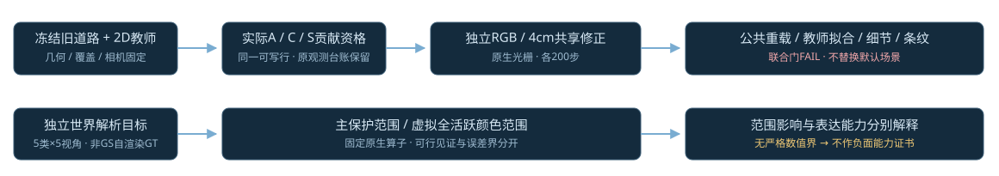

# 道路材质三道检查：实用边界与模型切换判断

`MODULE2-CAPACITY-GPU-20261118 / road_capacity_gpu_20261118_r1`。按2026-11-17母协议执行，2026-11-18用户恢复GPU并要求保持开机。三道检查已完成；本轮不替换默认场景，human_verdict/problem_solved=null。

## 结论

新增阴影监督能被现有道路高斯有效拟合；完整阴影区域仍有965像素覆盖不足，主要关联既有Gaussian激活/请求域与新增阴影区域不一致。4厘米有界共享修正未通过真实教师的拟合与条纹联合门。理想世界材质给出了限定的正面表达见证，但严格负证书未建立，不能宣布3DGS本体已达上限，也没有直接切换TRELLIS的正面依据。

## 实际监督与覆盖

真实可见道路A、物理孔洞C和目标阴影S分域独立归一化；C/S是冻结二维教师伪监督，不是隐藏道路或真实去影答案。当前S光度域仅raw86/110的820/1402充分覆盖像素。新增资格83388行，含3637个仅S可见的原已知材质行；两组均实际改变其有效RGB，公共加载器重载一致，原观测/来源台账保持。

| 帧 | 旧S2的S误差 | 独立RGB I0 | 4cm共享修正W4 |
|---|---:|---:|---:|
| raw86 | 0.163032 | 0.006330 | 0.010045 |
| raw110 | 0.174437 | 0.005030 | 0.009333 |

误差是固定alpha乘教师后的预乘sRGB MAE；不以RGB/alpha训练。完整S1043/2144保留分母；其低覆盖223/742合计965。允许的最大opacity与原R8绝对切向sigma端点仅使gap164→163、609→598，965中没有像素达到alpha>0.9。915像素含inactive三角锚点、876全加权锚点inactive、964缺原coverage请求；这些可交叠来源状态与真实低贡献质量共同支持域错配定位，不冒充逐像素因果证明。本轮未激活新行或补面。

## 真实教师参数化对照

固定旧S2共同c0、opacity、所有scale、xyz/normal/active/密度、相机、原静态层、车辆与环境。raw86/110各100次采样，两组trace相同；134/179/198仅诊断，继承199帧BUILD，不称盲测。各200步Adam lr=.01、seed101；A/C/S=1/.5/.5，edgeA/C/S=.1/.01/0，outside=1、K=4、有效行颜色修正平方=.001；两组TV=0。共享场为世界XY双线性4cm修正，系数[-1,1]，同一行保护覆盖。

I0共有250164个RGB参数，W4为76227；W4有132标量/67节点触界，因此该结果不能推广到无界共享场。raw110 A/S的W4−I0分别.00538281/.00430359，超过1/255；三个诊断帧的正条纹增量仅减少15.33%/14.29%/18.05%，未达预登记50%。训练帧I0增量非正，按合同N/A。五帧原生图像也仍有新增细条纹；不能把工程接线通过写成外观通过。

## 理想教师与误差包络

独立解析世界材质/已知曲线标线作用于固定G_s求交，未用GS成像RGB造教师。五视角全部监督，仅作能力oracle。完整域38416、精确表面38198、回退218分别报告；颜色证据统一D_color37206、q=1、RGB分母111618。已知标线宽度/on/off各≥3像素才评价细节。1/2/4除以255是预登记工程RMSE档位，不是感知等价或自动模型切换阈值。

| 范围 | 理想目标 | RMSE | RGB与既定细节共同通过档位 |
|---|---|---:|---|
| 主保护范围 | constant | 0.01353399 | 4/255 |
| 主保护范围 | lowfreq | 0.01345021 | 4/255 |
| 主保护范围 | marking_w120 | 0.01783081 | 未获得 |
| 主保护范围 | marking_w240 | 0.01877721 | 未获得 |
| 主保护范围 | stress_highfreq | 0.03069730 | 仅压力诊断 |
| 虚拟全活跃颜色范围 | constant | 0.00148292 | 1/255,2/255,4/255 |
| 虚拟全活跃颜色范围 | lowfreq | 0.00150731 | 1/255,2/255,4/255 |
| 虚拟全活跃颜色范围 | marking_w120 | 0.01180300 | 未获得 |
| 虚拟全活跃颜色范围 | marking_w240 | 0.01318887 | 4/255 |
| 虚拟全活跃颜色范围 | stress_highfreq | 0.02758666 | 仅压力诊断 |

主保护范围112058颜色候选，恒定材质最终误差约93.4%由固定颜色范围的数值底限解释，因此按母协议条件启动全151096活跃行颜色虚拟对照；仅资格变化，几何/覆盖/目标/五视角/每case500次或300秒上限保持。虚拟范围不主张K或生产晋升，不替换主组结果。

放开颜色保护后的常量与低频材质在1/255档已有可行见证；24cm标线在4/255档通过RGB与细节，2/255参考档仍未获得见证；12cm在4/255虽过RGB，raw86对比度保持.816917<.9，仍未获得联合见证。所有case到500次即停，不以平台或耗尽预算判不可能。

实际线性误差5.36e-7、伴随点积归一误差3.12e-9、P0/alpha绑定一致；但这些抽查不是保守的1e-5目标加box梯度总误差界。FW与范围底限仅作为数值代理，严格负证书始终false。端点数组漏存已用20次只读前向补齐，全部旧floor标量复现误差≤1.36e-20；原正式结果不改。

## 保持、恢复与预算

道路颜色正式更新400，生命周期工程更新8；理想主组2500次有界LS迭代、条件虚拟诊断另2500、工程LS另3；端点补证20次前向/0更新。约1小时长跑规则保留，本次原生正式求解每case20–23秒，实际短跑，不以重复更新凑时长。所有保存、评价、完整RNG/optimizer恢复、下一步与下一入口均实际覆盖；下一步浮点微差如实记录，不称bitwise。

真实两组与理想主组的每组五帧77266个K像素均浮点差0；50个理想case×view和真实两组公共重载RGB/alpha/RGB8差0。固定道路评价充分覆盖仍37404/38416，不能用此旧域97.37%掩盖新增S的965低覆盖。真实资产非RGB字段、原观测台账与域外颜色保持；所有原始/新资产、checkpoint及精度数组在远端，轻量报告不是完整模型备份。

## 决策与复现

下一步优先修复资产激活覆盖与监督域的一致性，并隔离细标线的足迹/采样与约束影响；有界4cm修正不作为已验收方案。只有覆盖/监督与固定光栅能力问题分清后，真实缺失材质仍需要更强空间先验，且独立固定几何材质适配小对照带来正收益，才扩大TRELLIS投入。11月12日单路块TRELLIS MAE .15897与LoRA .02500的历史负例条件/训练预算不等，不否定后训练；本轮没有新TRELLIS或扩散模型调用。

远端：`/root/autodl-tmp/drivingeditor_repro/campaign/road_capacity_gpu_20261118_r1`；Python：`/root/autodl-tmp/envs/drivingeditor/bin/python`。主要入口为`run_code/train_real_pair.py --arm I0|W4 --mode formal --steps 200`和`run_code/run_ideal_capacity.py`；输入、source快照和实际CLI在执行合同及run binding中。复现须显式设置单GPU执行资格，不覆盖现有输出。GPU按用户要求保持开机，无后续自动训练或关机队列。
