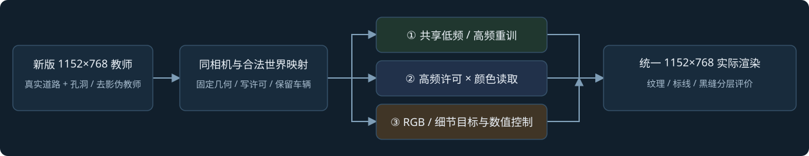

# 1152教师统一训练：三轮固定方法

本轮用用户采纳的1152×768二维教师重新训练三轮正式学生，并在同一1152×768相机下渲染、评价。执行和持久化检查完成，整体画质未获人工通过，默认场景未替换。不能将教师变化、分辨率变化与重新优化的联合效果全部归因于分辨率。

教师固定为SD1.5 inpainting、注意力LoRA T0 step600、历史提示词legacy、seed101。seed沿用原报告固定默认显示值，不根据学生误差选优；孔洞C和阴影S来自同张原始1152生成图，在各自合法域监督。A来自原始真实观测。训练帧为86、110，134、179、198只作诊断；既有199帧BUILD暴露保留，不称盲测。

正式端点共11个：共享场组的独立RGB、低频、低频加高频；读取与高频许可组M00/M10/M01/M11/M12；普通高斯细节组RGB/DETAIL/NUMERIC。历史快照、TRELLIS附加参考、旧QUERY/BUILD双套及合成控制未重跑。各组沿用固定配方和合法共享前缀，无学习率、步数、损失或密度搜索。

正式Adam更新合计8000次，NUMERIC按预定2000次函数/梯度预算执行。真实smoke覆盖完整状态恢复、下一步、分阶段入口、权威资产重载及数值控制workspace恢复；预计队列低于一小时，使用短生命周期smoke，工程更新和失败恢复在[计算账本](compute_ledger.json)单列。实际队列墙钟1051.58秒，不把smoke计入正式预算。

G_NUMERIC在固定父alpha≥0.95且具备canonical交点的域内，使用稳定道路颜色P/alpha评价；以下σ1为1152网格的一个像素，HF核心要求完整固定滤波支持。C/S仍为伪教师，不能视为车下真实道路GT。

| raw / 域 | RGB MAE | HF对应度 | HF能量比 | 颜色域像素 / HF核心 |
|---|---:|---:|---:|---:|
| 86 / C | 0.015680 | 0.5428 | 0.6212 | 22386 / 14440 |
| 86 / S | 0.010484 | 0.6945 | 0.3648 | 5761 / 1930 |
| 110 / C | 0.015501 | 0.4677 | 0.6288 | 45707 / 31902 |
| 110 / S | 0.010635 | 0.5387 | 0.4269 | 9953 / 3074 |

指标改善不能替代纹理与接缝验收。几何、激活、尺度与不透明度冻结，原覆盖黑缝仍在：完整C编辑域raw86/110中无支持7094/8789像素、低alpha2662/5643像素。canonical未命中、低覆盖与高alpha暗色分开记账；缺少实际联合贡献时静态遮挡统计为null，不能从道路alpha推断。完整分母保留，不因只显示稳定域而隐藏缺口。

75份五视角导出涵盖正式端点和共同起点；原生道路层及联合场景分别保存。像素读取继续依赖世界场、读取算子与实际原生basis；普通高斯端点保存每高斯RGB持久资产，二者不混称。原source/known/unknown和观测台账保留。机械、重载和保护通过不构成整体画质通过或表示上限证书。

完整结果见[固定合同](contract.json)、[评价协议](bench/protocol.json)、[指标](bench/metrics.json)、[完成收据](receipt.json)、[导出清单](export_manifest.json)与[精确来源清单](source_manifest.json)。本Git归档只含代码和轻量证据，原始图像、NPZ/PT模型与完整状态保留远端，并不由轻量索引替代备份。human_verdict/problem_solved保持null，GPU按用户要求保持开机。
