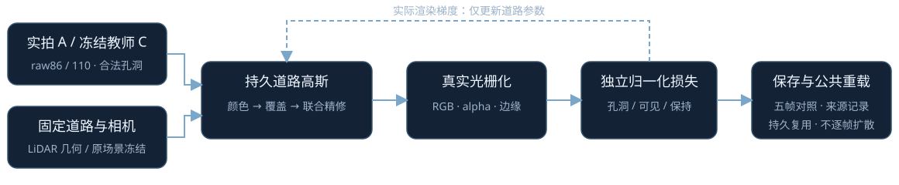

# Module2：二维教师到持久道路 Gaussian 的直接拟合

本轮检验冻结二维补全是否能通过真实三维道路光栅梯度改善持久资产。训练帧为 **raw86、raw110**；raw134、179、198仅诊断，不进入任何训练损失。既有原生重建、材质缓存和几何准备已使用199帧BUILD观测，因此本轮不宣称盲测或跨路段泛化。

**最终视觉验收失败。** 两个正式分支均在raw134、179、198加重水平细条纹；块状色差有所减弱，左侧标线仍断。训练域拟合、保护和持久化数值通过不能替代多视角道路质量，未默认替换生产scene；`human_verdict=null`。



## 参数职责与本轮例外

长期协议区分三类参数：

| 参数 | 职责与约束 |
|---|---|
| 共享先验θ | 只在声明的BUILD路段预训练；场景适配与评价期间冻结 |
| 场景状态z_s | 低维、有界的场景修正；不能以逐缺失像素自由RGB冒充学习到的跨路段规律 |
| 成像状态η_st | 曝光/白平衡等成像自由度；参考帧固定为恒等，z中去除重复全局颜色自由度，剩余η需受零均值等约束 |

材质以参考相机外观定义，不宣称可辨识的内在反射率。本轮θ使用既有冻结补全先验，**不引入z_s，也不估计η_st**。为验证梯度链，本轮采用直接道路Gaussian颜色`c_i`作为工程探针例外；不将其称为新的共享先验或低维场景模型。

`c_i`是最终native shader使用的sRGB外观，投影到[0,1]。原观测RGB、来源和置信度台账不可变；A_seen中的shader颜色可调，二者职责不同。道路XYZ、高度、法向、法向厚度、拓扑、原静态/门控、车辆/轨迹、环境、相机、SD/LoRA/影子/特征模型均冻结。

## A、C与保留域

- **A**：原始实拍道路，原生mask为`road_observed & C_mat & visible_support & ~H_B & ~K`。不使用decoder重建背景充当A。
- **C主hole**：冻结`raw_native`补全图，mask仅为`physical_unknown & W_guard & ~K`，再要求真实道路几何、保留物体排除与完整4×4原生像素足迹。`W_guard`中的appearance/shadow-only区独立记为`C_effect`，本轮不训练影子教师。
- **K**：保留车辆与对应受保护世界行。raw86上方pickup的生成扭曲不能作为道路颜色写入；原K与保留物体投影保护共同排除该区域。
- 1920×1280原图以整4×4足迹降至480×320。photo mask固定要求初始化道路α>0.9；完整物理hole、W、effect、teacher-only与弱覆盖分母另存，不随训练结果缩小。
- `q_A/q_C`为完整原生足迹与几何有效性，当前为二值资格，**不是校准的SD正确概率**。A/C独立归一化，伪教师信任程度由已声明的损失系数表达。

| 固定像素数 | raw86 | raw110 |
|---|---:|---:|
| 原生物理C / 完整W | 93,682 / 125,125 | 172,665 / 222,417 |
| 原生effect-only，不入hole loss | 31,443 | 49,752 |
| A photo / A完整coverage | 5,409 / 5,611 | 11,495 / 11,901 |
| 共同C photo / C完整coverage | 3,544 / 3,656 | 7,181 / 7,485 |
| teacher-only完整额外域 | 104 | 122 |

完整coverage独立于高αphoto门和F0颜色有效性：`coverage_A=A_visible`，`coverage_C=C_teacher`。`q_A_coverage/q_C_coverage`不含初始α门；`outside=~(coverage_A | coverage_C | K)`。190个共同C低α/薄像素及226个F0缺颜色的teacher-only几何核心均保留coverage权重，不被outside正则拉回旧α。

## 配对F对照与可识别性

主对照将C target替换为旧冻结`phase0/supervision_triangle_r8/target_rgb_srgb`。两run共用同一初始化、参数、A实拍、mask、q、优化器、seed和预算；共同C颜色域必须两种target均有效，F非法处不能拿零RGB作教师。teacher-only颜色额外域另报，不入主photo；两arm仍共享完整C几何coverage，不因F0缺颜色撤销alpha监督。

原C来源为历史AB实验的`B/raw_native.png`；目录名B仅是历史分支，本轮角色为C。当前C与F目标MAE为0.04470/0.05156，初始化premult C残差为0.04738/0.05451，具有实际监督信号。R2机制探针的真实贡献选集为A_seen 65,499、C_seen 48,587；颜色可调98,843行，其中可调A_seen 64,827、C-only非known 34,016；C-only known 10,103行冻结。

同世界点跨视角诊断仅报告冲突，不据此调权重或估计曝光。原相机投影、目标四邻同mask、世界插值误差≤5cm时，C86→110为2,606点、sRGB MAE 0.01993；反向4,329点、0.01709。真实A↔A为3,982/6,391点，MAE约0.0393。C→A仅5/81点，不足认证隐藏道路真值；这些差异包含视角、真实照明、曝光与有限像素采样影响。

**B边界**：本轮没有正式盲B。未来必须先在世界坐标选定B，再从所有native RGB重建、图集、检索供体、观测锚点、教师上下文、共享先验训练、特征缓存和颜色校准reader中排除其RGB；在B评分RGB开放前冻结reader allowlist与审计证据。仅把134/179/198从新loss移除，不能消除既有199帧缓存泄漏。

## 已锁定训练合同与复现

每个run为 **200颜色 + 300覆盖 + 300联合 = 800步**，direct-C与matched-F各一次，已完成共1,600正式更新。Seed 101。根协议`protocol_locked.json`、监督`supervision_r3`与训练源码在正式前冻结；两个run各自从原S2资产初始化。每个run每帧400次更新，分阶段分别为100/150/150次，完整采样序列相同。9次工程更新单列，不接续进入正式参数。

原始正式复现命令如下；输出目录必须不存在，已完成目录不会覆盖：

```bash
R=/root/autodl-tmp/motion_proj_v82_gn11_v42
C=/root/autodl-tmp/drivingeditor_repro/campaign/road_direct_teacher_20261116_r1
PYTHONPATH="$R/scripts/worldsim_v82" OMP_NUM_THREADS=2 OPENBLAS_NUM_THREADS=2 \
  /root/autodl-tmp/envs/drivingeditor/bin/python "$C/code/run_direct_formal_pair.py"
```

Wrapper依次运行`--mode formal --schedule 200,300,300 --role direct_C|matched_F_control`，绑定原S2 scene/proof、R8绝对scale上界、固定监督及协议文件内容。正式入口要求`formal_authorized=true`，拒绝从smoke参数继续。每阶段保存checkpoint、评价、完整joint K检查及公共持久资产，最终逐stage独立重载五视图。

| 阶段 | 可训练参数 | Adam学习率 |
|---|---|---|
| 颜色200步 | 直接`c_i` | 0.01 |
| 覆盖300步 | 有界opacity、面内scale | 0.05 / 0.005 |
| 联合300步 | 两类参数，显式分离梯度路径 | 颜色0.003；opacity/scale同上 |

Adam使用β=(0.9,0.999)、ε=1e-8、无weight decay；阶段切换保留矩状态，冻结组`grad=None`、lr=0。Opacity不低于初始化有效值，上限1−1e-5。Scale下界为当前S2值，绝对上界绑定原R8×1.15及实际支持表面足迹，禁止在已增大的σ上复利；法向scale不变。

Photo采用实际黑底native premult sRGB `P`对`stopgrad(α_photo)·T_sRGB`，不计算RGB/α，不对P作EOTF，不声称物理radiance。Photo分支传给光栅的opacity/scale也detach；coverage分支RGB detach。A/C分别除以自己的固定q权重和3通道数，edge仅使用同域有效相邻像素。

已锁定颜色目标为`L_A + 0.5L_C + 0.1(edge_A + 0.1edge_C) + outside_RGB + 4K_RGB + 0.001‖c−c0‖²`；覆盖目标为`alpha_A + 0.5alpha_C + outside_alpha + 4K_alpha`，A/C alpha各自独立归一化。Joint相加但梯度路径分离；保留参考只是原资产约束，不是道路真值。

## 持久资产与结果入口

保存后的`road.npz/reference_srgb`是有效Gaussian shader颜色。原atlas仅为不可变prior与来源台账，**不是更新后的effective field**；必须分别保存prior RGB、有效`c_i`、行scope与约束。公共加载器需重载真实RGB/alpha，检查known、K、背景、阶段切换、完整Adam/采样/RNG恢复和下一更新重放；数值与视觉结论分开，`human_verdict=null`。

## 正式配对结果

下表均为相同固定photo域、原生黑底预乘sRGB L1。C是冻结二维伪教师，不是真实隐藏道路真值。

| 固定域误差 | 原S2基线 | 直接C教师800步 | 匹配F对照800步 |
|---|---:|---:|---:|
| raw86 A实拍 | 0.04913073 | 0.01754632 | 0.01754735 |
| raw110 A实拍 | 0.06837978 | 0.02447173 | 0.02446960 |
| raw86 C伪教师 | 0.04738104 | 0.00901929 | 0.04567719 |
| raw110 C伪教师 | 0.05450987 | 0.01476357 | 0.05270298 |

直接C的伪教师误差分别下降 **80.96% / 72.92%**；同预算F对照仅下降 **3.60% / 3.31%**。两arm的A实拍拟合相近，支持将主要C误差差异归因于已隔离的C目标来源。该结论限于本场景固定二维教师到世界道路资产的蒸馏，不证明新的共享规律、可辨识反射率或未见道路泛化。

根与独立QA对正式公共加载渲染的实际检查给出 **视觉FAIL**：raw134/179/198两个分支均明显加重水平细条纹，左侧标线仍有断裂，因此本轮不接受为多视角质量改善。独立同曝光、无插值的native浮点crop确认颜色200阶段已经出现密集细纹，coverage阶段基本不改变，joint略加重。颜色200的opacity、全部scale与几何与初始资产逐值相同，已将退化触发定位到颜色适配阶段，符合逐Gaussian RGB与跨视角采样问题，不能解释为新增几何alpha洞。

在固定道路评价域与全部阶段α>0.99的支持内部，纵向RGB二阶差相对基线的描述性比值如下；该诊断不引入新的验收阈值。实际crop与统计入口为`qa/frequency_diagnostic_r1`。本轮方法和预算不据失败结果追改。

| 高频描述比值 | raw134 | raw179 | raw198 |
|---|---:|---:|---:|
| 直接C：color200 / 基线 | 2.960 | 3.146 | 3.195 |
| 直接C：final800 / 基线 | 3.146 | 3.333 | 3.405 |
| 匹配F：final800 / 基线 | 1.746 | 1.748 | 1.792 |

五帧原冻结道路域仍为38,416像素，α>0.9覆盖仍为 **37,404/38,416**，逐帧均无回退；本轮未增加该覆盖计数。六个正式阶段的77,266保留像素帧joint RGB均exact不变；最大opacity/原R8绝对scale包络与颜色0/1压力检查也通过。可训练资格为颜色78,421行、opacity87,368行、可继续增加的bounded scale235行；已到原绝对scale上界的行不再复利扩张。直接C最终实际改变颜色78,388行、opacity47,784行、面内scale143行。实际16×16 tile-expanded最大投影足迹与保留K相交的38,982个active行被保守冻结。

全部阶段对原road字段进行了CPU检查：XYZ、高度、法向、active、变换、normal sigma等非授权字段逐值相同；RGB/opacity/面内scale域外逐值相同，原观测prior台账保留。六阶段公共重载最差RGB浮点误差5.96e-8、alpha误差1.19e-7，RGB8差均为0，汇总见`results.json/validation`。这些数值通过与上述视觉FAIL分别记录；完整五帧渲染由最终报告提供，`human_verdict=null`。

工程账为R2/R3颜色机制探针各1次，加独立2/2/2生命周期的2+1恢复下一步+1同源重放+3后续阶段，共 **9次**。完整model、Adam状态/paramgroups、采样队列/trace与全部RNG恢复逐值一致；独立下一步重放非bitwise，opacity最大差7.45e-9、Adam矩最大差3.55e-15，元数据和RNG一致。真实A/C颜色梯度非零，photo→opacity/scale、coverage→RGB均exact0；112/304个非photo门C coverage像素有正权重和真实coverage梯度。

远端根目录为`/root/autodl-tmp/drivingeditor_repro/campaign/road_direct_teacher_20261116_r1`：

- `protocol_locked.json`：正式前锁定的参数语义、合同与验收边界；draft与smoke协议保留。
- `supervision_r3/{086,110}.npz`、`manifest.json`、`freeze.json`：A/C/F target、photo/coverage独立mask/q、K、outside与全量分母；r1/r2和失败日志保留。R3只扩完整几何coverage，主photo目标/mask/q与R2逐值一致。
- `source_inspection/sources.json`：原始教师、实拍、native roles、RGB背景偏置与来源pin；同目录保存源图crop。
- `supervision_r3/*_teacher_full.png`、`*_observed_full.png`、`*_A_C_K_overlay.png`：完整480×320预览，不作训练贴图或替代原始raw教师。
- `source_inspection/crossview_r2/{crossview.json,B_reader_boundary.json,*.npz}`：同世界点对应、颜色差和B读者边界。
- `phase0/color_probe_r2/{probe.json,row_scopes.npz,checkpoint000001.pt}`：真实光栅机制与选集证据；正式预算之外。
- `phase0/lifecycle_r4/{save_color,restore_next,replay_next,next_stage}`：最终监督与K包络下的完整真实GPU保存、恢复、双下一步重放、三个阶段入口和公共reload；`engineering_accounting.json`保存9次总账。
- `{direct_C,matched_F_control}/formal_r1`：各800正式更新、完整checkpoint/训练trace/冻结合同与三阶段评价；每个`stage_{color,coverage,joint}/asset/persistent/{scene,proof}.json`均为公共加载入口。
- `results.json`、`training_pair_receipt.json`：同初始化/输入/boolean scope/采样序列配对检查、完整阶段数值、字段冻结与公共重载误差；CPU复算入口`code/summarize_direct_teacher_pair.py`。
- 代码：`scripts/worldsim_v82/drivingeditor_dynamic_edit/road_asset_supervision.py`及`road_direct_teacher_training.py`；监督8项与训练6项测试见`tests/test_road_direct_teacher_supervision.py`、`tests/test_road_direct_teacher_training.py`。
