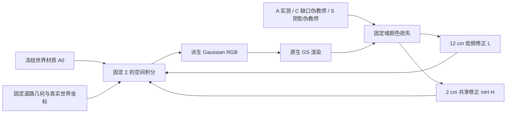

# 固定覆盖的多尺度世界材质

本实现只优化共享世界材质场。位置、法向、Gaussian 尺度、透明度、激活集合以及相机和其余场景参数保持不变。



A0 来自旧冻结 `base_atlas.npz`，单独加入 32 个已登记的冻结伪来源节点，不含独立 RGB 优化结果。所有来源、未知权重及只读回退保留。积分使用物理道路切平面协方差、精确三角世界坐标反查和已通过数值检查的 GH15×15；颜色在原生 sRGB 合成空间计算。高频项的来源门只允许真实观测，不将生成白色像素视为实测标线。低频与高频并非严格正交频段。

正式输入由 `execution_contract.json`、`method_scope_r1/scope.npz` 和 `stage0_native_r1/*_targets.npz` 冻结。监督包含 3,131 个高覆盖阴影像素；完整 3,187 个阴影像素及 56 个低覆盖像素始终另行统计。所有方法使用相同的 84,266 个可写 Gaussian 行，K 保护行使用父资产只读颜色。

正式入口：

```sh
/root/autodl-tmp/envs/drivingeditor/bin/python -u \
  /root/autodl-tmp/drivingeditor_repro/campaign/road_multiscale_material_20261118_r1/code/run_material_pair.py \
  --output /root/autodl-tmp/drivingeditor_repro/campaign/road_multiscale_material_20261118_r1/formal_r1 \
  --lease-owner road_asset
```

入口要求正式授权与真实生命周期收据均有效。正式从零修正开始，共用 A200 后分别运行低频续训 600 步、B300/C300；实际物理更新 1,400 步，每个比较方案累计 800 步。两分支共用 A200 的完整 Adam、RNG 和后续采样序列。失败恢复仅接受同源正式检查点；不接受 smoke 暖启动。

`world_field.pt` 是权威材质资产，保存 A0、L、H、mH、物理查询核及资格掩码。`road.npz` 中颜色只是派生缓存。`field_native_io.load_field_context` 是显式入口，会验证源文件哈希、从原几何重建查询、重载共享场重新求色，并核对原生渲染与缓存。默认场景入口不修改。

每阶段的 `rendered/*_native.npz` 包含 `road_rgb`、`road_alpha`、`joint_rgb` 和 `K`；五帧 K 共 77,266 像素要求精确保持，覆盖逐值保持。最终阶段同时保存 `field_public_reload.json`。外观验收仍需匹配独立颜色对照与实际图像检查，不由低损失或重载通过自动晋升。

生命周期工程开销独立保存。成功 smoke 与必要只读收尾合计 617.3216 秒；成功分支 360 次工程更新，旧失败分支另有 4 次更新。正式方法预算没有包含这些工程更新。

