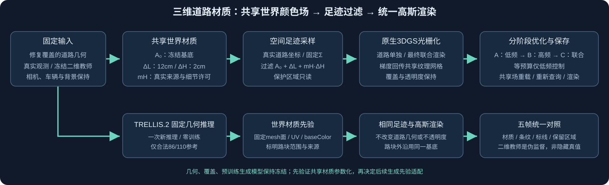

# 模块2：共享世界材质与三维道路微调

共享材质显著减少独立RGB引入的横纹，但未通过拟合非劣门；高频增益有限，不晋升。TRELLIS局部阴影伪教师改善而真实可见道路退化，不支持切换。

## 方法与合法监督

采用 `c_i = S_Σ[A₀ + ΔL + mHΔH]`。A₀来自原冻结世界材质图及32个冻结教师节点，未将旧独立高斯学习颜色作为基础图。低频网格12cm、高频网格2cm；幅度分别受限±0.30、±0.04。高频只许可真实观测来源，生成、检索、未知来源许可为0；用6cm尺度高通、幅度/能量/DC/泄漏正则约束，不是理想频率截断。几何、法向厚度、尺度、alpha、静态层、车辆、相机与所有生成模型冻结。

151988活动高斯中84266行可读共享场；其余67722行只读父资产颜色。1864个材质来源不可用活动点保留只读，未扩大许可。完整S域3187、充分覆盖3131（旧2222＋新909）、余56薄覆盖固定分账。全部6707个S贡献行均在许可内，未把难点从分母移除。fullpacket保留车辆保护优先。

raw86/110提供A实拍、C孔洞伪教师、S阴影伪教师；三域互斥且不含保留车辆。A16904、C10830、S3131；q=1，损失为实际预乘道路颜色的 A+0.5C+S 均值误差与各方法正则。不用低alpha去预乘颜色训练。raw134/179/198只作诊断；继承199帧BUILD，本轮五帧不是盲测，也没有重跑199帧。

## 实际链路与数值检查

根据固定道路真实三角形坐标反查材质UV，使用物理切向协方差的GH15×15空间积分；A₀、低频和高频均在核内采样。GH7高频响应不足已修复，坐标仿射近似也已替换。单位Nyquist响应最大误差2.07e-7；独立三角形定位世界误差≤9.09e-13m。固定数值抽样门通过，低来源核质量个别行仍显式保留不确定性，未声称全局误差证书。

阶段A低频200步；从同A200分叉：仅低频续600步，对照总800；或冻结低频训练高频300步，再联合300步，总800。主方法物理更新1400。另做相同过滤A₀初值、84266许可行、S3131、q=1、400/400采样轨迹的独立RGB800步。独立RGB正则为有效颜色残差平方×0.001，共享场用空间/频率正则；比较的是固定监督与预算的方法包，不是严格单变量或等计算消融。

## 定量结果

下表为两教师视角固定域的pooled预乘sRGB MAE，越小越好；C/S不是隐藏道路真值。

| 资产 | A实拍16904 | C孔洞伪教师10830 | S充分覆盖3131 | 新增S909 | 完整S3187 |
|---|---|---|---|---|---|
| 过滤A₀ · 零更新 | 0.04883 | 0.04943 | 0.16890 | 0.08883 | 0.16756 |
| 低频200步 | 0.03585 | 0.02105 | 0.02936 | 0.02100 | 0.02908 |
| 仅低频800步 | 0.03537 | 0.02013 | 0.02309 | 0.01822 | 0.02286 |
| 冻结低频+高频 · 500步 | 0.03514 | 0.02102 | 0.02857 | 0.02026 | 0.02829 |
| 低频+高频 · 800步 | 0.03447 | 0.02023 | 0.02299 | 0.01776 | 0.02276 |
| 同监督独立RGB · 800步 | 0.02167 | 0.01190 | 0.00423 | 0.00389 | 0.00454 |
| 同积分器A₀ · 零更新 | 0.04882 | 0.04943 | 0.16889 | 0.08878 | 0.16755 |
| TRELLIS.2 · 零训练 | 0.05279 | 0.06096 | 0.12014 | 0.05553 | 0.11901 |

诊断横纹相对独立RGB的正增量降低79.31%、77.74%、80.01%，全部通过50%减半门；A/C/S六项拟合非劣门全部失败（容差1/255）。真实A相对过滤A₀改善，两项初始保护门通过；联合门失败，不晋升默认场景。

相对等预算仅低频，联合A改善约0.00090、C恶化约0.00010、S改善约0.00010。有效高频场RMS约0.004426、最大约0.02322、低频泄漏RMS约0.000522，说明这版高频许可与过滤约束下的净收益很小；不在看到结果后放宽预算或频率门。

条纹诊断分解满足预乘二阶差分恒等式，重构误差2.22e-16。有效颜色二阶差分ABC约0.021、独立RGB约0.060，覆盖项约0.001，不能把剩余条纹全归因于低alpha或整体亮度。绝对值分项不是可直接相加的因果百分比。道路alpha均完全不变；五帧77266保留像素的实际联合RGB最大变化0。当前未导出联合层逐高斯alpha×透射率，不能由road alpha声称道路最终可见。

## TRELLIS.2实际高斯对照

官方固定几何纹理模型，新推理1次、seed101、512、12步、1024纹理，模型零训练。固定2.56m路块包含16384节点；参考只由86/110合法域构造，13109/16384有效，包含较多C/S伪教师，未知显式灰色。路块覆盖完整S2177/3187、新909/909。UV拆缝保持几何（世界误差5.27e-8m），使用无损baseColor PNG和真实面UV查询，不使用GLB有损纹理。

高分辨纹理的GH15/41/61积分未收敛后，改同物理Σ的midpoint积分，核心2.5mm、边界1.25mm；对0.625mm参考固定抽样p99误差0.000470、最大0.001375通过。保留相同积分器A₀列分离数值差异，0新推理或训练。

在同积分器下，路块完整阴影域误差0.13149→0.06676；同路块真实可见道路0.01799→0.07940，孔洞教师0.03864→0.07054。出现偏棕色块，未提供整体优于当前道路方法的证据。2177/3187是世界交点落入路块的像素域；跨边界核及投影混合还会影响点域外图像。写许可与保留车辆保护不扩张，577个A₀未知节点未因生成而获许可；它们与3275个未知参考像素不同。本次是冻结几何的零训练材质推理，不代表后训练能力；输出baseColor直接接当前成像规范，尚未分离光照或做材质适配。

这里的路块像素域按世界交点落入mesh划分，不是完整Gaussian核或全部最终影响域。材质坐标域外沿用A₀，但跨边界核与投影混合可改变点域外图像；fullS点域外1010像素的误差0.24529→0.23162也单列保留。仍使用相同84266行许可与保留车辆保护；patch内577个原A₀未知材质节点未因生成而获得资格，不能与3275个参考图未知像素混为一谈。

这里是当前渲染链可用先验评价，非独立物理PBR材质质量；输出alpha未用于改变高斯覆盖。没有真实白色标线可验证的路块位置，不编造标线方向真值。历史11月12日零样本单路块测试仍保留，不能据此否定后训练潜力。

## 持久化、工程验证与范围

共享场world_field.pt作为权威参数；road.npz是派生颜色缓存。显式读取器验证来源、许可和几何绑定，重新查询世界场再执行原生渲染。L800/ABC800保存重载实际road RGB、alpha、RGB8与缓存exact一致；可移植CPU读入实资产重查询最大误差5.96e-8，只读行exact。该入口是opt-in，默认场景加载器未替换。

真实smoke617.32秒、360更新，包含完整optimizer/RNG/sampler恢复、评价、下一阶段入口与权威场重载。首轮4更新失败因Adam恢复对CPU step张量别名污染内存快照；已用deepcopy修复，磁盘状态保留，失败开销单列。下一步回放误差约1.86e-9（非bitwise，沿用1e-6门）。字段台账448项和预算6项通过；新增可复用模块6项CPU测试通过，实际资产CPU加载验证通过。

正式共享1400更新/1490原生前向/38.59分钟；RGB正式800更新/840前向/24.72秒（不含构造）。工程共享364更新/558前向，RGB4更新/34前向；TRELLIS对照30前向、0更新，新推理56.33秒。总计2568次物理优化更新、2952次原生前向。完整计算台账见execution_accounting.json，不能把等更新步数写成等算力。

下一步不以增加步数或立即微调TRELLIS替代诊断。当前证明了“减少独立RGB横纹”与“逼近二维教师”的取舍，未证明3DGS表示上限；若继续，需固定监督比较材质来源、低频表达与渲染混合的耦合，单独验证高频许可是否足以承载所需细节。没有因本轮结果自动启动下一实验或替换默认资产。

human_verdict/problem_solved=null。GPU按用户要求保持开机。原始输入、模型、共享场和优化器保留远端；本地仅轻量报告、原生预览与证据，不是全量备份。

## 复核入口

- 远端：`/root/autodl-tmp/drivingeditor_repro/campaign/road_multiscale_material_20261118_r1`
- 独立评价：`qa/result_metrics.json`，协议：`quality_contract.json`
- 复用模块：`scripts/worldsim_v82/drivingeditor_dynamic_edit/road_multiscale_material.py`、`road_material_chart.py`、`road_multiscale_asset.py`
- CPU验证：`CUDA_VISIBLE_DEVICES= PYTHONPATH=scripts/worldsim_v82 /root/autodl-tmp/envs/motionproj/bin/python -m pytest -q tests/worldsim_v82/test_road_multiscale_material.py tests/worldsim_v82/test_road_multiscale_asset.py`
