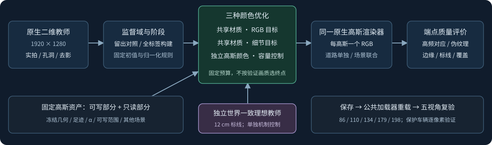

# 原生道路材质蒸馏与固定高斯容量

任务：`MODULE2-NATIVE-CAPACITY-20261120`。本波已完成，后续不追加实验，GPU保持开机。

保留原始留出对照、数值控制及全部负结果后，按同一固定配方完成全标签资产构建。中央彩色块的显著部分曾属于未给本轮标签的2m留出世界块，不能用该完整图直接判表示失败。BUILD现在合并全部合格教师标签；它是每街段拟合，不是留出验证。C/S始终为冻结伪教师，不是真实车下道路答案。

两帧教师原始分辨率1920×1280直接进入实际普通高斯光栅化损失。共享场保持12cm低频/2cm高频与GH31足迹读取，几何、尺度、不透明度、可写89887行及其余场景冻结。损失为同F0残差归一化的RGB、σ1/2/4带符号HF和Sobel；没有模型、频率、学习率或权重搜索。下表为全标签拟合域σ1结果，完整三尺度/尾部/保留区域数据见JSON和CSV。

| 帧 | 源 | 参数化 | RGB MAE | HF对应 | HF能量比 | HF相对RMSE |
|---|---|---|---:|---:|---:|---:|
| 86 | C | F0 | 0.02642 | -0.0134 | 8.182 | 3.043 |
| 86 | C | G_BUILD_FIELD | 0.02232 | 0.1198 | 2.425 | 1.747 |
| 86 | C | G_BUILD_NUMERIC | 0.02126 | 0.1901 | 2.238 | 1.634 |
| 86 | S | F0 | 0.03013 | -0.0059 | 2.206 | 1.795 |
| 86 | S | G_BUILD_FIELD | 0.01415 | 0.3252 | 0.356 | 0.984 |
| 86 | S | G_BUILD_NUMERIC | 0.01134 | 0.5300 | 0.437 | 0.858 |
| 110 | C | F0 | 0.02641 | -0.0014 | 4.434 | 2.332 |
| 110 | C | G_BUILD_FIELD | 0.02424 | 0.1551 | 1.610 | 1.489 |
| 110 | C | G_BUILD_NUMERIC | 0.02319 | 0.2485 | 1.560 | 1.393 |
| 110 | S | F0 | 0.03378 | 0.0030 | 1.368 | 1.537 |
| 110 | S | G_BUILD_FIELD | 0.01548 | 0.3066 | 0.226 | 0.967 |
| 110 | S | G_BUILD_NUMERIC | 0.01379 | 0.4236 | 0.395 | 0.929 |

已确认只读贡献构成RGB范围限制：原对照高覆盖孔洞训练域内，We/alpha<.05为4511/41490与6422/86720像素；逐像素颜色区间给出RGB MSE数值下界约.002981/.002903。该界不等于HF上限或语义残影检测，不能解释几乎全部可写的阴影域。完整监督和只读贡献定位见本地HTML中的固定监督/只读范围图。

全标签共享材质目标3.52753735，独立有界颜色控制给出3.06404161的更低可行点。但训练FW比例仍19.70%，未达预登记1%门，没有严格负容量证书，不能声称3DGS全局表示上限。原留出对照与全标签归一化域不同，不直接比较其目标数值。理想12cm控制的raw86/110对比度为.898992/.908429；采样工程资格不能当全局误差界。

所有候选均保存并通过五视角公共加载器重载，RGB/alpha/K变化验证通过；全覆盖、无表面与静态遮挡分母保持。道路改善不意味着联合画面的旧静态残影已清除。当前优先问题是可写范围/表面支持与静态交接，以及仍不足的真实细节对应；没有切换3D生成先验的正面证据。当前候选不晋升，human_verdict/problem_solved=null，failure_ledger_refs=[V82-F06]，failure_ledger_delta=updated:V82-F06。

本地交互报告 outputs/road_native_capacity_20261120_r1/index.html · [分阶段数据](evaluation/results.json) · [计算账目](resource_ledger.json) · [主合同](protocol.json) · [全标签合同](build_protocol.json)。原始packet、教师与中间checkpoint保留远端；必要资产与最终优化状态已打包取回，完整场景仍依赖原静态/动态/环境检查点。
