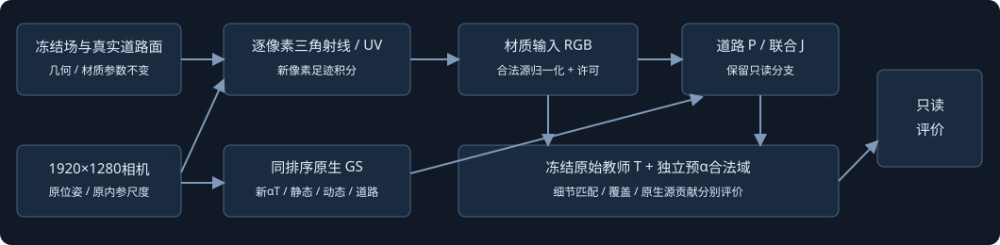

# 原生1920道路材质只读取证

raw110/86使用真实1920×1280相机重新计算原生排序、αT与世界像素足迹。未放大480图像，未训练、推理新教师、修改生产资产或旧租约。

`native_completed.json`：12/12次前向（两帧basis+非灰恒色8次、M10真实高斯平均4次），51.65秒；峰分配4.935GB、保留5.276GB。独立`gpu_lease.json`已inactive、owner=null，GPU保持开机。

`native_r1/{110,086}/{road,joint}_basis.npz`保存真实同排序贡献。joint侧含`static_rgb/dynamic_rgb/whole_road_rgb/env_rgb`及对应权重；按原生static/dynamic/provider拼接边界定义，未把owner0当作static。源RGB/alpha守恒误差最高1.43e-6/2.09e-6；非灰重放误差最高1.43e-6，不能称bit-exact。两帧K为251456/232112，eligible jointαT(K)与重放K变化均精确0。

`maps/{raw}.npz`为新逐像素三角射线命中和真实barycentric UV/局部像素Jacobian的compact缓存，非旧map插值。`pixel_ids`是排序的全图flat ID；世界坐标、UV与Jacobian按同一行对应。重投影最大3.3e-10像素。`pixel_reads`采用density2无cap各向异性box中点积分，并对共同合法材质源归一化。

`targets/{raw}.npz`：`T_A/T_C/T_S`为float32 CHW原始1920教师，未乘alpha；`A/C/S_pre_alpha`为原生源合法域，独立于surface/source/GS alpha。K_vehicle与teacher_guard分开；当前vehicle完全包含于teacher_guard，三类预α域与vehicle K均不交。旧480标签只作为legacy分域，不作新母域。

预α分母110：A558326/C168932/S36748；86：A640030/C90943/S18338。源A包含有限world-road chart外的整张合法可见道路，chart外A不是自动的本次修复失败；C/S任务域中的geometry/source/coverage缺口完整保留。

`rendered/{M01,M11,M10,initial,low_A200,M11_noH}/{raw}.npz`：道路P、联合J为float32 CHW；alpha/K为HW。M01/M11是持久世界场+真实原生αT的像素材质渲染，不能冒称普通每高斯RGB烘焙。M10是实际原生GS平均读取。`M11_noH`只在读取时清零最终H，L与基底保持；属于消融。initial未另存field，使用共同A200不可变buffers且L/H=0重建，两帧旧480初始RGB复核max0。

`package_qualification.json`核验12个包的shape、finite、同alpha、K；`freeze.json`绑定输入/输出SHA。工程首个CPU尝试因缺initial field失败，现场与修复前脚本保留，0新native。

`stream_480_qualification.json`直接AST提取实际CPU stream循环，在旧480每帧固定A/C/S/other各64行，对M01/M11重放：颜色与旧compiled算子差0、source mass差0，对保存roadRGB差≤1.19e-7。这是抽样读取一致性，不是高分辨率geometry全域证书。

`material_input_aux_r1`只做冻结指标辅助诊断。共同域为预αC/S ∩source_mass>0 ∩road_alpha≥.95；完整分母、排除和严格有限核core单列，主nativebench未改。M11材质输入在σ1已出现高能量、低教师对应：110 C能量比25.56/cos.0306，86 C46.08/.00413；S30.66/.0181与24.72/.0147。混合后的S几乎相同，不能把全部不匹配归因于GS只读混合。C中存在We0未生效查询，必须结合权重解释；误差分解保留signed cross项，不给虚假的非负因果比例。关H后材质输入仍不匹配，因此不能把全部问题归为H。

`previews`共48张唯一losslessWebP、54个角色引用，图像5,046,918bytes。原生裁片不重采样；overview来自真实1920输入的4×4均值，仅显示。ROI在GPU后仅按固定mask选取，非预测选取；静态图仅表示贡献，不是去静态重渲染。

入口：`run_native_highres.py`默认inspect；原12次GPU预算已用完，不再执行。`prepare_cpu_highres.py`、`qualify_cpu_package.py`、`verify_stream_480.py`、`diagnose_material_input.py`均有既存结果，重放必须使用新目录并保持源不变。
