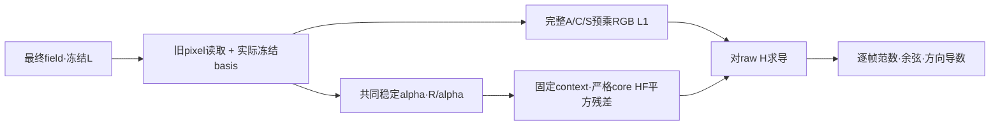

# RGB 与细节目标的端点梯度诊断

仅CPU、0优化更新、0参数步进、0native、0GPU。只读旧M01/M11最终field及冻结CSR/native basis；不读取或改动并行新二维任务。原指标实现与旧资产保持不变。



## 测量口径

旧RGB目标使用完整A+0.5C+S、每view每源独立归一化的预乘sRGB L1；这里不含正则项，上一轮端点审计已单列正则。HF诊断目标是在共同冻结道路alpha≥0.95处评价R/alpha，对C/S分别计算σ1/2当前480像素的有符号HF平方误差。context是固定full_v4该域coverage与共同stable mask交集，score为原C/S mask，有限核严格core与冻结benchmark一致。

可微HF使用同一mask归一化Gaussian、constant0边界和truncate3半径。先验证其数值及HF_RMSE对冻结报告，再求梯度。额外同core straight RGB L1用于区分域/色彩空间差异，不能把两种口径的差异全归为HF算子。

`relation`记录梯度L2、点积、余弦和两种一阶方向导数。沿负RGB梯度的HF导数为`-dot(g_HF,g_RGB)`；负值代表无穷小下降，正值代表无穷小上升。单位方向版本仅用于比较归一化。它们不是有限步试验或训练建议。0梯度、无core和反向情况均保留。

## 结果边界

- 实际CPU读出与保存RGB最大差1.19e-7；HF_RMSE与冻结报告最大差1.06e-9，L/H参数逐值不变。
- M11平衡双view的RGB/HF余弦：Cσ1/2为0.01731/0.01489，S为0.04965/0.03700。HF梯度非零，但方向与RGB不强一致。
- 逐view全部16组负RGB方向都使HF的一阶导数为负；不能声称RGB普遍损伤HF。平衡聚合中M01 Cσ2为极微弱反向，余弦-6.25e-5，保留原数值而不夸大。
- 跨view原RGB梯度余弦为M01 -0.4915、M11 -0.3178；M11 Sσ1 HF跨view也有-0.0684。这里只是当前端点局部冲突，不证明教师在全局不可协调。
- 严格core仅覆盖Cσ1=5625、σ2=2151（原10830）；Sσ1=1093、σ2=304（原3131）。alpha排除C44/S27，其余主要为有限核边界。不能用这些core替代全部C/S、影边界或原生1920细节。

结论是“缺少直接细节目标值得作为候选验证”，不是“缺少HF loss已被证明是唯一卡点”。本次没有选择loss权重、运行参数步或扩展训练预算。

## 复现与证据

- `code/hf_gradient_probe.py`：真实旧场与冻结benchmark的CPU求导。
- `code/test_hf_gradient_probe.py`：两个合成数值检查，包含显式线性HF矩阵伴随，无finite-step伪训练。
- `run_r1/results.json`：所有逐帧/来源/尺度、数值验证、方向和输入SHA。
- `run_r1/summary.json`：仅由结果整理，不重跑模型。

```sh
CUDA_VISIBLE_DEVICES= PYTHONDONTWRITEBYTECODE=1 OMP_NUM_THREADS=1 OPENBLAS_NUM_THREADS=1 MKL_NUM_THREADS=1 \
  /root/autodl-tmp/envs/motionproj/bin/python -B code/hf_gradient_probe.py \
  --bench <quality_bench_20261120_r1> --output <new_probe_output>
```

重复诊断须使用新输出目录，不能覆盖既有证据。指标、field、basis和teacher来源均绑定旧Q/P冻结路径。
