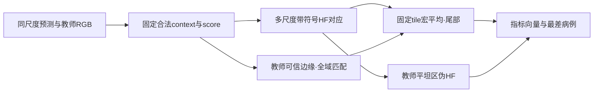

# 道路材质细节对应指标

纯 NumPy/SciPy CPU 实现，不导入 Torch、native renderer 或训练控制器。输出是可解释的指标向量，不生成总分、画质 PASS 或自动病例剔除规则。measurement cutoffs 只定义曲线和分层，不能当作未经登记的接受门。



## 接口

```python
from road_detail_metrics import (
    DetailConfig, ResolutionSpec, TileLayout, evaluate_detail, rank_cases,
)

report = evaluate_detail(
    predicted_material_rgb, frozen_teacher_rgb,  # HWC，float或uint8
    context_mask=common_stable_legal_road_mask,   # 固定上下文，不按预测选择
    score_mask=original_frozen_domain_mask,      # 保留完整原域及被条件排除计数
    resolution=ResolutionSpec(480, 320, 'render480', signal_space='srgb'),
    tile_layout=TileLayout(32, 32),              # 全图原点(0,0)，不按score裁框
    teacher_role='frozen_pseudo_teacher',
    color_space='stable_alpha_unpremult_srgb',
    input_conditioning={
        'common_road_alpha_min': .95,
        'frozen_common_mask': True,
        'evaluation_only': True,
    },
    config=DetailConfig(pixel_scales=(1., 2., 4.)),
)
```

模块不自行除 alpha、不曝光校正、不缩放图像。主材质评价由调用者在共同稳定道路 alpha≥0.95 处准备 R/alpha 与原教师 T；这是 evaluation 条件，不能用于训练去预乘。旧 R vs alpha*T 是另一辅助口径，必须单列。`score_mask` 可保留原完整域，`score_outside_context_pixels`、严格core与边界计数会显式报告被条件排除的位置；不能声称全域通过。

原1920像素与480渲染像素不是同一单位。native1920使用128×128 tile可对应480的32×32角度范围，但这须由调用者确认相同相机/视场。若要比较同一角频尺度，滤波sigma与匹配半径也需按已验证比例显式换算。模块从不自动换算；`assert_comparable`拒绝不同resolution、color_space、conditioning、config或tile_layout的静默合池。

## 统计口径

**HF对应。** 在独立合法道路context中做归一化Gaussian低通，再取有符号RGB残差。主报有限核完全落在context内的严格core；partial-context边界另报数值、质量分布和完整计数。context不等于窄标线score ROI，避免人为截断细线滤波上下文。域外黑、白、噪声和NaN均不能进入域内指标；context内非finite直接拒绝，不能悄悄删掉。

每尺度有HF MAE/RMSE、余弦、相对RMSE、预测/教师能量、过量/缺失能量及教师平坦区伪HF。等能量不代表相位正确；余弦保留符号。教师有HF而预测为零时明确标记缺失，余弦N/A、相对误差为1；教师无HF时用flat-spurious衡量伪纹理，不填虚假的满分余弦。

**边缘。** RGB结构张量与NMS提取教师外观边缘；阈值、像素容差和无向法线角度均给曲线。位置匹配在完整固定score域只做一次，再按预测/参考各自所属tile汇总，因此跨tile的正确1px匹配仍有效。距离缺失和未知法线都保留N/A计数。无向边缘方向不检测反色，必须与有符号HF对应并列。

默认只叫`teacher_appearance_edges`，其中可能包含纹理。缺少人工或可验证教师结构mask时，不提供lane几何真值结论。显式`edge_reference`须提供verified角色和固定edge mask，可选法线；没有可信法线时方向项可为N/A。冻结生成教师仍是pseudo teacher，不因图像中出现白线而变成实测标线。

**局部失败。** 所有固定tile都保留，包括空score和无core；逐像素micro、tile宏平均、尾部分位与worst tile同时报告。另列按教师HF能量分层和教师能量加权误差，避免大块平坦沥青稀释细线。分层只看教师，不看预测；所有病例、N/A和失败仍保留。`rank_cases`按显式单指标排序，N/A留在列表，不形成总分。

## 输出与验证

- `scales[]`：core、boundary_partial_context、teacher_flat_spurious、完整tiles与tile_aggregate。
- `edges.threshold_curves[]`：空间P/R、双向距离、方向曲线及固定tile汇总。
- `resolution/color_space/input_conditioning`：测量单位与固定条件。
- `fixed_score_pixels/score_outside_context_pixels/context_scored_pixels`：完整分母。

13项合成测试覆盖identity、抹细线、模糊、等能量错相、平坦教师伪纹理、域外污染、空core、方向错误、结构来源资格、变动alpha、单位保护、跨tile正确匹配与反色。它们验证指标行为，不是实际场景画质已通过。

```sh
CUDA_VISIBLE_DEVICES= PYTHONDONTWRITEBYTECODE=1 OMP_NUM_THREADS=1 OPENBLAS_NUM_THREADS=1 MKL_NUM_THREADS=1 PYTEST_DISABLE_PLUGIN_AUTOLOAD=1 \
  python -B -m pytest -q -p no:cacheprovider test_road_detail_metrics.py
```
