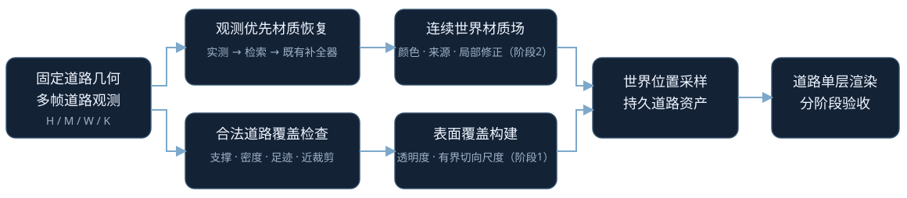

# Module2：持久道路资产五帧验证

本报告记录 Waymo scene-065 的道路资产构建、覆盖校准与局部材质校正。新增训练、评价和公共加载器渲染仅使用原始帧 **86、110、134、179、198**；准备阶段读取既存 **199 帧资产构建（BUILD）观测**与历史结果，无 held-out 验证。R8表示最终冻结的初始化版本。本次分阶段训练没有更新静态层；阶段3静态优化与199帧新渲染未启动。



## 输入与准备

- 原生30K场景、车辆、轨迹、环境、相机及既有静态门控作为冻结输入；道路几何与颜色来源分别记录。K表示保留车辆保护区，known表示实测颜色锚点。
- 世界道路材质场 `F(x,y)` 按观测优先、邻近实测沥青检索、既存冻结生成结果的顺序构建。它表示参考曝光下的外观，未分离光照与反射率；未知材料显式保留。
- 用道路测距观测拟合独立平面，通过有界测量三角面补全表面；监督采用实际相机像素中心的最近正深度三角面交点，保存面、世界行及插值权重。
- `coverage_requested` 定义有物理与材料依据的覆盖需求；生成颜色写回仍受原 `W` 限制。两者解耦后激活700个已有合法观测颜色、表面受支持的 inactive 节点，不扩生成区域。
- 通过真实同排序道路 `αT` 贡献建立3,165个世界行的保留车辆保护集合，持久保留完整父行状态。最大允许opacity与scale状态也重新检查该集合。
- 监督和原始材质场在训练前冻结。旧评价域的38,416个像素完整保留，无几何、未知材料及不可控边界均进入分母。

## 固定训练合同

| 阶段 | 正式更新 | 可训练项 | 冻结与监督 |
|---|---:|---|---|
| 0：准备 | 0 | 无 | 世界/相机对齐、真实梯度、覆盖上限、输入冻结与生命周期验证 |
| 1：覆盖校准 | 600 | 合法道路opacity；非可信补全面的有界面内scale | RGB、XYZ、高度、法向、法向厚度、保留行及全部原生场景冻结；road-only alpha MSE |
| 2：局部材质校正 | 1,200 | 合法非观测、非保护图格的线性RGB局部delta | 阶段1覆盖逐值冻结，观测锚点与保护行delta严格为0；真实grid sampler→sRGB→道路光栅梯度 |

Seed为101，五帧按打乱循环均匀采样；阶段1每帧120次，阶段2每帧240次。阶段1 Adam学习率为opacity 0.05、scale 0.005；scale仅扩张，倍率上限1.15，并受实际世界合法表面距离的最终3σ约束。范围外及K区bootstrap alpha仅作保留正则。

阶段2 Adam学习率0.02，线性RGB delta界为0.08；使用固定图集射线投影的置信度加权L1，并附delta幅度与空间TV正则。颜色有效域与完整评价分母分开报告，不使用旧joint车辆残影作为道路RGB目标，也不新增扩散推理。

额外smoke与重放共 **72次更新**：阶段1为6，阶段2为66，后者包含失败smoke已执行的更新，独立于600+1,200正式预算。两阶段均覆盖真实前后向、保存、评价、完整恢复、下一步重放和后续资产入口；旧现场与失败smoke保留。

## 结果与证据边界

| 同一冻结评价域 | α>0.9充分支撑 | α<0.05缺口 | 0.05≤α≤0.9薄覆盖 |
|---|---:|---:|---:|
| 旧基线 | 33,417 | 3,364 | 1,635 |
| R8初始化 | 37,364 | 85 | 967 |
| 阶段1：600步 | 37,404 | 83 | 929 |
| 阶段2：1,200步 | 37,404 | 83 | 929 |

充分支撑比例由86.9872%增至97.3657%。主体覆盖收益来自初始化修复；600步校准额外增加40个充分支撑像素。阶段2的覆盖与阶段1逐值相同。

阶段2五帧宏平均外观L1（photo）由 **0.01995994降至0.01492323（−25.2341%）**。这是固定图集投影的外观自一致指标，未使用隐藏道路真值；不能据此推断隐藏路面的真实恢复误差。43,986个图格允许校正，40,074个得到非零delta，最大线性delta为0.07989944；known与K的delta均为0。

最终阶段1/2资产均经公共加载器重新渲染五帧；77,266个保留车辆像素的RGB差全为0。技术检查包括46项pytest、阶段1独立22项、阶段2独立25项、监督100项和材质43项验收。

CPU烘焙与GPU shader的最大浮点RGB差为1.19×10⁻⁷；raw134仍有最大1个RGB8码值差，不宣称逐位一致。完整状态恢复精确；阶段2下一步重放的参数/Adam矩最大差分别为2.98×10⁻⁸、4.55×10⁻¹³，处于记录容差内，非bitwise。

物理请求域66,775格中仍有1,793格材料未知。25条实测标线片段仅记录端点、方向和宽度；虚线相位未知，强制绘制次数为0。实际道路单层仍见块状色差、边界接缝与标线不连续，本轮机械验收通过、道路画质未通过。整体标线与街景编辑质量无人工验收结论，`human_verdict=null`。运行结束时GPU保持开机。

## 代码与复现入口

核心实现位于 `scripts/worldsim_v82/drivingeditor_dynamic_edit/`：`road_asset.py`、`road_asset_supervision.py`、`road_coverage_training.py`、`road_texture_training.py`、`native_row_contribution.py` 与 `persistent_road_handoff.py`。正式运行参数分别固化在阶段1的 `contract.json` 与阶段2的 `frozen_contract.json`。

以下命令使用原冻结输入与保护集合；将`新运行名`替换为未使用的目录名，先完成对应真实smoke再执行正式预算。

```bash
set -euo pipefail
R=/root/autodl-tmp/motion_proj_v82_gn11_v42
C=/root/autodl-tmp/drivingeditor_repro/campaign/road_asset_20261116_r1
PY=/root/autodl-tmp/envs/drivingeditor/bin/python
export PYTHONPATH="$R/scripts/worldsim_v82"
S="$C/phase0/supervision_triangle_r8"
G="$C/phase1/maximum_state_K_r8/maximum_state_K_guard.npz"
O="$C/新运行名"
P1=(--asset "$C/asset_r8_guarded" --supervision "$S" --bounded-scale --extra-guard "$G")
"$PY" -u "$C/phase1/code/run_road_coverage.py" "${P1[@]}" --mode phase0 --output "$O/phase0"
"$PY" -u "$C/phase1/code/run_road_coverage.py" "${P1[@]}" --mode smoke --output "$O/smoke"
"$PY" -u "$C/phase1/code/run_road_coverage.py" "${P1[@]}" --mode formal --phase0-receipt "$O/phase0/phase0.json" --output "$O/phase1"
P2=(--manifest "$O/phase1/export/persistent/scene.json" --proof "$O/phase1/export/persistent/proof.json" --asset "$O/phase1/export" --supervision "$S")
"$PY" -u -m drivingeditor_dynamic_edit.road_texture_training "${P2[@]}" --steps 32 --mode smoke --output "$O/phase2_smoke"
"$PY" -u -m drivingeditor_dynamic_edit.road_texture_training "${P2[@]}" --steps 33 --mode restore --resume "$O/phase2_smoke/checkpoint000032.pt" --output "$O/phase2_restore"
"$PY" -u -m drivingeditor_dynamic_edit.road_texture_training "${P2[@]}" --steps 33 --mode replay --resume "$O/phase2_smoke/checkpoint000032.pt" --output "$O/phase2_replay"
"$PY" -u "$C/code/compare_texture_replay.py" --left "$O/phase2_restore/checkpoint000033.pt" --right "$O/phase2_replay/checkpoint000033.pt" --output "$O/phase2_replay_check.json"
"$PY" -u -m drivingeditor_dynamic_edit.road_texture_training "${P2[@]}" --steps 1200 --mode formal --output "$O/phase2"
```

阶段2的smoke、restore与replay使用同一模块的对应`--mode`和`--resume`入口，正式模式拒绝从smoke参数继续。精确恢复同时绑定输入文件、算法版本、Adam、采样队列及Torch/CUDA/NumPy/Python RNG。

## 完整远端证据

下列路径均相对于上面完整定义的`C`；模型、原图、浮点结果和checkpoint保留在远端，未以轻量索引替代。

- 总合同：`training_contract.json`；初始化：`asset_r8_guarded/{road,atlas,provenance}.npz`、`receipt.json`、`coverage_request_diff.npz`、`marking_structure.json`。
- 固定监督：`phase0/supervision_triangle_r8/{086,110,134,179,198}.npz`、`receipt.json`、`freeze.json`；最大足迹K证据：`phase1/maximum_state_K_r8/`。
- 阶段0控制：`phase1/phase0_r8_bounded/{phase0.json,gradient_scope.npz,scale_scope.npz,phase0_maps_*.npz}`。
- 阶段1：`phase1/formal_r1/{contract.json,checkpoint000600.pt,training.json,completed.json,resources.json,evaluation/}`；完整恢复与重放：`phase1/smoke_r8/`。
- 阶段2：`phase2/formal_r1/{frozen_contract.json,checkpoint001200.pt,evaluation_before.json,evaluation_after.json,training.json,completed.json}`；额外计算：`phase2/{smoke_r1,smoke_r2,restore_r2,replay_r2,next_step_replay.json}`。
- 最终加载入口：`phase2/formal_r1/asset/persistent/{scene.json,proof.json}`；材质与烘焙：同级`{road,atlas,base_atlas,texture_correction,provenance}.npz`、`bake_validation.json`、`receipt.json`。
- 公共加载器五帧：`phase1/formal_r1/rendered/`与`phase2/formal_r1/rendered/`；旧基线：`qa/baseline_pilot_r1/`；独立验收：`qa/phase1_formal_independent_r2/`、`qa/phase2_formal_independent/`、`qa/phase0_final_supervision_independent_r8/`、`qa/asset_r8_final_material/`。
