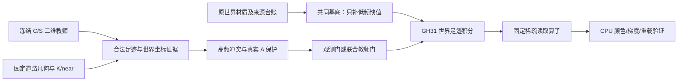

# 教师细节许可：CPU 准备接口

当前只完成 CPU 准备；GPU、原生渲染与优化器更新均为 0。

权威许可文件为远端 `permission/final_r1/teacher_evidence.npz`。原 `source/known/unknown` 与已存在的 A0 有效颜色不变；学习颜色不冒充观测。缺基底且具有合法教师足迹的节点，只以明确来源的 12cm Gaussian 低通颜色初始化，不把教师高频塞进 A0。

| 字段 | 形状 | 语义 |
|---|---|---|
| common_base_srgb | H×W×3 | 所有方案相同的冻结基底 |
| common_material_valid | H×W bool | 原有效材质或独立教师低频种子 |
| observed_H_prior | H×W | 历史观测高频门 |
| teacher_H_allow | H×W bool | 合法足迹、可靠 HF 冲突与真实 A-HF 保护后的许可 |
| mH_union | H×W | max(观测门, 教师布尔门) |
| common_latent_mask | H×W bool | 所有方案共同 raw-H 支撑及 halo |
| common_reg_support | H×W bool | 固定共同正则分母支撑 |
| common_write_active | 151988 bool | CPU 可写候选，89987 为真；原84266全保留 |
| active_world_rows | 151988 int64 | active 局部序号到原完整 topology 行号 |
| realA_support | H×W bool | 当前冻结 A 实拍足迹；不等于 prior source1 |
| prior_observed_support | H×W bool | 旧 source1/known，仅保留来源角色 |
| teacher_only_gate | H×W bool | 教师许可且不在当前真实 A 支撑；用于受限先验初始化 |

HF 门采用世界图上来源有效归一化的 σ6cm 高通差；4/255 底色 RGB 差只作诊断。局部 blur 有效质量不足 0.9 时标为单有效证据，不声称双视角一致。许可不是教师正确率证书。原 C/S 训练和评价分母保持，冲突点不会从损失或评价中删除。owner 字段只在对应 evidence/seed 有效掩码内有意义。

所有五方案共同 H 界为 ±0.34，原 P 的 ±0.04 只作历史审计。来源为两个域 p99 最大值的固定配方：2×max(p99_C,p99_S)+4/255，向上取整至 0.01。该界不证明所有教师细节均可实现；T2 初始有效 H 上限仍为 ±0.02，不增加先验损失。

GH15 与 GH21 在新界的轴向 Nyquist 压力样本上失败；GH31 在相同150行、相同门下通过，22行 GH61 独立抽查也通过。完整平均读取使用实际 chart 反查，世界单位为米；只为共同可写行生成，readonly 行保留原 shader RGB。Pixel 读取另有自己的 AA 准备，不能把两种 mode 混同。

稀疏算子是同一积分的数值编译：
`B + K_L·L + K_H·H`。其中 `K_H` 已包含逐点分别双线性采样的 valid×mH；运行时输入未乘 mH 的 H，禁止再乘一次门。没有独立可训练的 Gaussian RGB。

实际 CPU fixture 包含来源0/3、观测 S、检索 S、HF冲突、K readonly 和真未知七类。9项测试在 GH31 小包上通过；它们验证梯度与许可接线，不能替代未来真实 CUDA sparse ABI、原生 K/coverage 和生命周期 smoke。本轮没有建立待启动训练队列。

