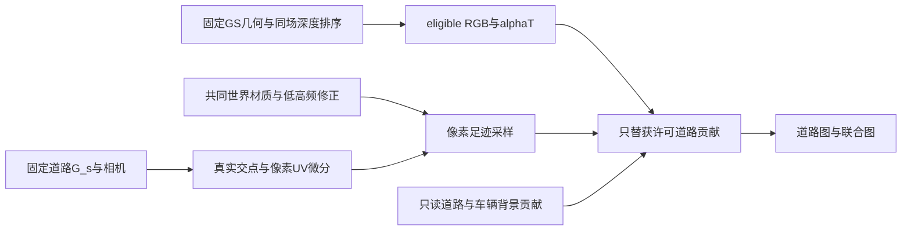

# 世界材质像素读取：CPU 准备与原生适配边界

本轮仅完成 CPU 参考、真实道路几何图和未来原生贡献导出源代码。没有 CUDA、原生渲染、优化器更新或电源操作。原生二进制等价、实际场景梯度、保护区与持久化仍须首次 GPU 短程验证；正式实验阻断。



## 为什么不再先平均完整高斯尺度

原路径先计算每个高斯的平均颜色 `c_i=S_Sigma[F]`，再由原生高斯光栅权重混合。新路径保持同一几何、尺度、不透明度与深度排序，只在每个像素的真实道路交点读取共同世界材质，使用像素 UV 微分形成足迹。像素采样不输入完整高斯 Sigma。

对任意明确获许可道路行集合 E，原生权重为 `w_i=alpha_i*T_i`：

```
W_e(p) = sum_{i in E} w_i(p)
RGB_e(p) = sum_{i in E} w_i(p)*c_i
P_pixel = P_base + [W_e*A(X(p)) - RGB_e]   # 仅材质/交点有效时
J_pixel = J_base + [W_e_joint*A(X(p)) - RGB_e_joint]
```

道路单独图与联合图必须分别导出权重。联合图的权重来自道路、车辆、静态物体共同排序后的透射率，不能替换成道路单独 alpha。其余只读道路行和全部非道路贡献原样保留。scope 是输入，不硬编码旧84,266行或当前89,887个CPU候选；新候选尚待原生资格核验。

这是所定义的延迟材质着色器的颜色线性分解，条件是同一像素的获许可道路片元共享同一有效 G_s 交点及过滤颜色。它不是多层道路/桥面的一般结论，也不证明材质与遮挡的连续子像素积分可分离。复杂几何、多交点和遮挡边界需要额外资格检验。

`baseline + valid_delta` 在无材质或无真实交点时精确加0，回退原 eligible 平均颜色贡献，不拿拟合平面补充几何。不复制保护区域的最终联合图。保护硬门是 **joint W_e[K]=0**；道路单独图在被车辆挡住的像素可有道路权重，应单独报告。

## 源码审计依据

- 当前 engine 的 `utils/v4_road_render.py:54` 直接返回原生 RGB 与 features，没有输出颜色截断。
- `deps/diff-gaussian-rasterization/cuda_rasterizer/forward.cu:356` 的 RGB 与 feature 使用同一 `alpha*T` 权重。alpha 截断、弱片元剔除与提前终止由同一原生过程执行。
- 道路采用 `colors_precomp`，绕过 SH 求值；其他分支的已求值 SH/非负投影为固定只读输入。
- 联合环境项 `(1-alpha)*environment` 保留在只读项。
- 现有 whole-road RGB/alphaT 没有隔离新 scope，不能直接充当新权重包。

因此可以先复用 24-feature ABI，增加 eligible RGB三通道和单位标记一通道，避免立即修改 CUDA。`native_basis_adapter.py` 还导出只读贡献、整个道路权重和深度质量作守恒诊断。源码证明不等于当前二进制/新scope验证通过。

## 真实 G_s 像素图

`prepare_cached_maps.py` 只读取旧缓存中的 XYZ、真正三角行/重心权重、相机、Jacobian、有效性、K 和固定域。不会读取其中的理想教师 RGB、12cm标签或旧前向RGB。

三角顶点对应真实世界 chart 节点，由重心权重直接重建中心 UV；像素微分由真实三角面与相机解析求出。160个点用全场 `StructuredRoadChart` 交叉核。没有遍历大网格，没有在真实图上调用合成 `PinholeCamera.plane_map`。

- 五帧中心图已生成。D38416中 exact38198、fallback218；218只保留分母及回退标记，不伪装成G_s。
- 两训练帧 A16904、C10830、S3131、完整S3187和新增909全部有真正canonical hit，fallback/miss均为0。
- XYZ重建误差精确0；相机投影最大误差约7.2e-11像素；ray对真实三角面的误差最大1.98e-8米；UV交叉核最大3.75e-11。
- 旧Jacobian轴是 `[pixel,worldXY]`，新图是 `[UV,pixel]`。转轴后与解析结果最大差4.72e-8；原始诊断收据保留。

这些是中心与局部面微分资格。局部UV box数值积分已按下述方式完成CPU准备；跨三角边界的几何一阶近似、原生二进制与CUDA仍须短程核验，不能写“GPU-ready”。

## 世界场、许可与 CPU 原型

权威输入为 `Q/permission/final_r1/teacher_evidence.npz` 与 `Q/protocol/bound_recipe.json`。

- 共同base/valid：`common_base_srgb`、`common_material_valid`。
- 对照许可：`observed_H_prior` 与 `mH_union`（原观测加合格教师）。
- 所有 arms 使用同一 `common_latent_mask`、`common_reg_support`，低频 mask 由共同支持的粗网格四邻基函数推导，不随 mH 改变。
- 原 source/known/unknown 只保留来源，不再次隐式清零新合法教师梯度。
- 中央已锁低频界0.30、高频界0.34；Q入口缺配方拒绝，历史P的0.04不作为新默认。TRELLIS高频先验种子上界0.02由中央额外管理。

CPU参考是 float64，设备通用 runtime 参数是 float32；二者小样本颜色最大差1.49e-8，高频梯度7.28e-9，低频梯度5.88e-8。CPU参考本身拒绝CUDA tensor，不能直接当作已接通的GPU训练器。

初始CPU小夹具的cap16在真实足迹上不足：A535、C1629、S88个像素超预算，原收据保留。最终采用无cap的各向异性box：`nx=ceil(2*||J[:,x]||)`、`ny=ceil(2*||J[:,y]||)`，不是maxn平方。完整5帧122,604个canonical像素合计6,093,288个积分点，138.93秒CPU一次编译，缓存30,675,050字节。

固定geometry/valid/mH后读取为 `B + K_L*L + K_H*H`。B是冻结base的积分；K_H保留`bilinear(valid)*bilinear(mH)*basisH`，不偷换成预乘mH纹理。H仍先在世界网格由非线性参数构成，再乘稀疏算子，梯度不变。每个pixel的完整分母只归一化一次，按(nx,ny)分组的完整pixel行分块；最坏463,884点的pixel独立处理，不拆成局部分母。

48个分层真实训练像素、三种base/Hstress，共144组density2→4对照，RGB p99=0.001311、max=0.001348；全量cache对已存粗采样值最大差1.81e-14，mass差2.22e-16。此为CPU数值资格与固定quadrature的精确降本，不是全局积分误差定理，也不是native验证。

完整C/S/fullS材料mass0均为0。A有7个材料mass0像素，固定全A16904分母保留，使用原eligible ci只读回退；另报qualified-A16897。未来smoke须测actual W_e、梯度和误差占比，不能用A改善掩盖回退优势。

## CPU 验收

运行 `python run_cpu_evidence.py`，10个单元测试通过：相机变化/解析微分、alias抑制、合法未知来源H梯度及有限差分、只读与联合透射率、K保护、冻结几何与旧basis拒绝、世界场保存重查、float64/32算子对照、native入口先阻断，以及可选baseline override拒绝修改readonly道路。

解析世界cosine的box积分误差：中心读取RMSE0.21512，自适应像素采样0.000986。合成固定一维GS权重下，12cm白带中心对比度平均颜色约0.9267、像素读取1.0；24cm分别约0.9976/1.0。这些是独立世界函数构造的**合成CPU夹具**，不是当前P高斯包或真实原生渲染结果，不用于改写旧capacity结论。

另提供两个合成相机上的120米曲率、3米虚线周期、0.45米相位及12/24cm宽度的世界一致纹理图。平面仅用于这些合成oracle；真实道路使用前述canonical三角图。

## 首次 GPU 短程必须完成的接线

`native_basis_adapter.export_native_basis(ctx, raw, eligible_active, output, authorization=...)` 仅接受未来单独登记的 `native_smoke` 合同及有效租约。当前缺授权时在访问ctx或导入native之前阻断；CLI没有formal模式或待启动队列。

首次短程必须验证：

1. 同颜色/常量场及RGB单位基与实际原生颜色路径一致，保存未截断浮点。
2. eligible RGB、只读 RGB、alpha/W守恒；joint W_e[K]精确0，禁止屏幕K修补。
3. 真实G_s/相机与像素足迹匹配；实际纹理和标线处的像素积分数值资格。
4. 合法teacher H的原生加权梯度非零；冻结几何、尺度、opacity、只读行与所有场景层。
5. 约10分钟真实生命周期：完整优化器/RNG/采样恢复、下一步与下一阶段、权威世界场保存重查、原生道路/联合图及公共加载入口。

像素资产必须保存 `renderer_mode`、世界材质、scope、几何和源证据。不能只烘焙每高斯平均RGB后宣称像素着色持久化通过。五帧W只是特定相机/编辑请求的派生缓存；新视角或编辑请求必须重新获取同场原生贡献与真实G_s图，并重核保护域。以上任一真实短程缺失时，formal仍为blocked。
