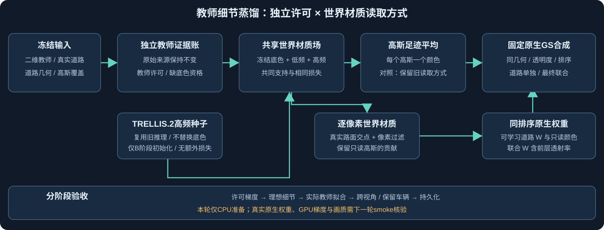

# 教师细节蒸馏：CPU准备与实验协议

已完成CPU数据、算子和实验准备，停在GPU执行前。主问题是教师细节能否进入世界材质，以及颜色平均是否消耗了本可复现的细节；不增加训练步数、不训练SD1.5或TRELLIS模型。

## 评估结果

1. 原始材质来源与训练许可承担不同职责。旧C域47886个成像贡献高斯中25103个足迹高频门完全为0；S域6707个中170个为0，不能概括成所有阴影都没有高频能力。按保存的行最大成像贡献加权，C/S平均许可为0.06675/0.23132；这是行级代理，不是逐像素或联合可见贡献。
2. 原±0.04幅度也限制细节。可信教师HF与基础HF残差的p99为C0.09683、S0.15835；超过0.04的比例约3.70%/36.13%。本轮在GPU结果之前按两域p99较大值与实际0.5高通系数，统一锁定五组H界±0.34。它不是全部纹理都可复现的证明。
3. 高斯均色与逐像素读取需要在同几何/覆盖下对照。逐像素方案为新的世界材质着色器：从真实G_s交点与像素足迹查询同一材质场，再用原生GS实际eligible权重合成；不使用整张road alpha后贴图，不修改只读高斯颜色贡献。
4. TRELLIS的棕偏在原PNG中已有，未发现可证UV翻转、通道或尺度错误。旧GH高分辨积分问题已独立修复。本次只复用旧推理的带限HF初始化，保留底色、去影教师和相同损失；编码中的过度侵蚀、混合边界与网格重建语义问题已修正并保留负例。

## 共同数据与参数

真实A、孔洞伪教师C、阴影伪教师S严格分域。训练raw86/110，诊断raw134/179/198；199帧仅继承BUILD，本轮未重跑199帧、不称盲测。

原source/known/unknown/观测RGB账本不改。独立teacher evidence决定新增高频许可；比较HF/结构冲突，底色RGB差只做诊断。新teacherH允许34269世界节点，其中25378旧门为0；147处HF冲突不新开教师路径。单有效来源不冒称双视角一致，原C/S损失与评估分母均保留。

所有组共用89887个候选可写高斯（原84266全保留＋5621新资格）、相同基础材质、同latent/halo/low mask及正则归一化。只有1267个合格缺底色节点填入冻结12cm低通教师底色，不偷渡教师HF。候选scope仍需真实native资格检查；无几何、无教师或受保护位置不因旧unknown标签而自动放行。

低频12cm、高频2cm；L界±0.30，H界±0.34；H仍采用0.5b(tanh−Gaussian6cm(tanh))及幅度/能量/DC/低频泄漏约束。H界按 `ceil((2*max(p99_C,p99_S)+4/255)/0.01)*0.01=0.34` 在CPU阶段锁定。相同geometry、normal、scale、opacity、active、相机、静态场、车辆、扩散/阴影/特征模型全部冻结。

## 实验矩阵

| 读取方式 | 高频许可 | B阶段H初始化 |
|---|---|---|
| 高斯均色 | 原观测许可 | 零 |
| 高斯均色 | 观测＋教师许可 | 零 |
| 逐像素世界材质 | 原观测许可 | 零 |
| 逐像素世界材质 | 观测＋教师许可 | 零 |
| 逐像素世界材质 | 观测＋教师许可 | TRELLIS.2部分投影HF |

每组仍为A低频200步 → B冻结低频/训练高频300步 → C联合300步。每种reader复用同一A200完整前缀；主四组2800物理更新，次要T2再600，合计最多3400（各组逻辑800）。同seed101、400/400采样轨迹、A+0.5C+S预乘L1与相同正则；T2只替换B入口H初值，A0/low/A200/AdamH零状态均不改，无额外prior loss。步数相同不代表GPU算力相同，实际速度留smoke测量。

旧P的±0.04/84266范围与独立RGB结果仅作历史参照，不能把新旧收益全归于单独修改许可；本轮2×2内部条件一致，分别识别许可和读取方式的影响。

## CPU验证与修复

- 9项真实数据梯度测试覆盖source0 unknown、source3 generated、observed S、retrieved S及冲突/保护位置；合格孔洞H可以产生梯度，真未知/教师冲突/保留位置不被隐式放行。
- 新幅度下GH15/GH21未过原数值门，确定性升为GH31；150真实行四类场与独立GH61抽查通过，门限未放宽。完整89887×961物理查询已准备，真实道路坐标反查误差≤9.09e-13m。
- 固定valid/mH/几何时，读取可严格写为 `B+K_L L+K_H H`；K_H已包含分别插值的valid和mH，不得再次乘门。平均读取缓存与同积分颜色最大差1.33e-15、CPU梯度差0。它是静态算子降本，仍只训练世界网格，不增加逐高斯或逐帧RGB参数。
- 五帧全部122604 canonical像素的逐轴自适应box积分已编译，共6093288点，无cap16、无缩域；代表性density2/4差p99=0.00131，缓存/原积分差1.81e-14。训练A/C/S/fullS全部有真实G_s交点；C/S材料质量均非0。A有7像素无材料支持，保留原eligible-ci回退，完整A16904与qualifiedA16897并列，不隐藏只读floor。
- 原D38416中218个几何fallback单列，不把拟合平面当真实G_s。准备仅使用旧缓存的几何字段，没有读取ideal RGB或理想标线作为真实监督。
- chunk分组后的pixel ID必须散射回图像；平均缓存ID是完整拓扑global world row，必须映到active位置。新增运行时防止误reshape或混用ID导致条纹/错位。

37项模块CPU测试通过，最终发布源另做隔离验收。CPU证据不能替代真实native权重、CUDA稀疏反传或最终视觉验收。

## TRELLIS次要对照的边界

复用同一次旧推理，零新推理/零模型训练。先按物理尺度带限到2cm网格，再提取6cm高通；仅对缺少可信干净材料的合法教师恢复域准备初始化，不用原known/source标签一刀切。纯已观测/纯域外受到约束，连续混合边界单列。

最终可实现HF初始化RMS0.003348、最大0.02；纯域外节点最大1.11e-5、quarter最大2.17e-5，基础材质保持。它只保留目标能量58.05%、cos0.828，未通过原cos≥0.9忠实传递门；作为**部分投影HF初始化探索对照**有效，不代表充分测试TRELLIS材质容量。主四组不依赖它，负结果不能否定TRELLIS后训练潜力。

节点目标、source、许可和均值固定；CPU编码的数值迭代及失败现场单独记账，未进行场景优化。局部先验节点的DC绝对值最大约3.11e-5、低频泄漏RMS约0.001115，不能声称严格正交或完全零低频。

## GPU开启后的执行顺序

先做真实短程smoke：同scope的eligible RGB＋unit weight导出、road/joint常量场、CUDA sparse前向/反向、未知孔洞H梯度、7A回退分层、全五帧K77266、保存/评价/完整Adam-RNG-sampler恢复、下一步/B/C入口与持久资产重查。若实测队列预计小时级，按项目规则完成约10分钟生命周期smoke，工程开销独立记账。

联合图的权重必须是真实同排序alpha×透射率；road-only K位置可有被车遮住的道路贡献，只有joint K是硬保护门。RGB/alpha/静态/车辆/原来源台账均须核验。新的pixel资产保存共享世界场、renderer_mode和geometry/scope；五帧权重缓存只是派生数据，新视角/编辑请求必须重新取原生权重与真实路面映射，不能只烘焙平均RGB后声称保留pixel细节。

smoke通过后再依次执行四组主对照及T2次要对照。分别评价教师拟合、可信细节、诊断条纹、跨视角、真实A保护、道路覆盖、联合可见贡献及持久化；不以单个loss或CPU理想图替代最终联合渲染。

## 当前停止点与入口

本轮场景优化0、native forward/backward 0、新模型推理0、GPU执行0、开关机操作0；没有待启动控制器，默认场景未改。GPU执行合同仍为false，human_verdict/problem_solved=null。

- 远端：`/root/autodl-tmp/drivingeditor_repro/campaign/road_teacher_detail_cpu_20261119_r1`
- 共同输入：`permission/final_r1/teacher_evidence.npz` 与 `recipe.json`
- 平均算子：`permission/avg_sparse_gh31_r1/operator`
- 像素算子：`pixel_render/read_operator_box_r1/{086,110,134,179,198}`
- T2初始化：`trellis_hf/seed_r5_nodal_b034/H_seed.npz::H_seed_latent`
- 检查入口：`CUDA_VISIBLE_DEVICES= /root/autodl-tmp/envs/motionproj/bin/python code/gpu_entry_guard.py --contract execution_contract.json --phase inspect`
- 完整协议：`protocol.json`；硬件状态与native结果不在本轮CPU结论内。
