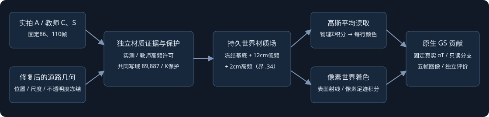

# 道路教师高频：固定覆盖下的读取方式与学习许可

教师高频许可改善孔洞与阴影的拟合，但诊断视角出现新增细横纹；本轮不晋升。

86/110帧用于优化；134/179/198仅诊断。既存199帧参与BUILD，不是盲测。A为实拍可见道路，C/S为冻结二维伪教师；车下没有真实道路GT。

每组逻辑800步（200+300+300），共享各读取方式的前200步，共3400次正式更新。几何、尺度、不透明度、激活和其他场景分支冻结。写域89,887；高频网格2cm、界0.34；低频网格12cm、界0.30。

| 方法 | 实拍 MAE | 孔洞 MAE | 阴影 MAE | 孔洞 HF1 MAE | 阴影 HF1 MAE | 孔洞 HF余弦 | 阴影 HF余弦 | 诊断 Ey×1000 | Ey/Ex |
|---|---:|---:|---:|---:|---:|---:|---:|---:|---:|
| 高斯平均 · 仅实测高频 (M00) | 0.03113 | 0.01295 | 0.01791 | 0.00580 | 0.00791 | 0.203 | 0.152 | 19.13 | 4.21 |
| 高斯平均 · 教师高频 (M10) | 0.03112 | 0.00949 | 0.01301 | 0.00475 | 0.00631 | 0.322 | 0.331 | 28.25 | 4.97 |
| 像素着色 · 仅实测高频 (M01) | 0.02939 | 0.01398 | 0.01681 | 0.00679 | 0.00873 | 0.186 | 0.141 | 22.20 | 2.43 |
| 像素着色 · 教师高频 (M11) | 0.02939 | 0.00918 | 0.01068 | 0.00493 | 0.00671 | 0.312 | 0.371 | 30.61 | 2.11 |
| 像素着色 · 教师高频 + TRELLIS种子 (T11) | 0.02939 | 0.00918 | 0.01068 | 0.00493 | 0.00671 | 0.313 | 0.371 | 30.66 | 2.11 |

同读取方式下，教师高频许可降低C/S高频误差；像素着色的教师组比高斯平均教师组颜色误差更低，但C/S高频误差略高。固定诊断裁片中的细横纹同步增强，不能将能量增加等同于细节恢复。

HF采用域内归一化高斯滤波（σ1/2像素），仅在固定域局部质量≥0.9处评价；边界不足单列，不改变完整A16904/C10830/S3131分母。完整阴影3187、新覆盖909、薄区56、原道路38416、K77266均保留。边缘F1与教师平坦区伪高频另外报告。

原生只读贡献会限制部分实拍拟合：A内2962像素实际可写αT为0；另7像素world reader无材质支持，属于上述集合。点像素颜色范围代理的A/C/S最低MAE约0.016136/0.001304/0；该代理不构成全局容量证书，也不能解释全部高频误差。

TRELLIS列只在B入口注入已有输出的受限、部分投影高频初值，之后损失与M11相同；没有新推理，没有替换底色。严格faithful-transfer门未通过，不能用该列否定TRELLIS容量。

高斯平均资产以世界场→物理Σ积分→每行颜色重放；像素资产需要世界场、读取算子与刷新后的真实原生basis，不冒充普通RGB烘焙GS。五组本次保存图像的K联合RGB及道路/联合α均精确不变；M11最终field在179帧以新原生basis重载，RGB/α/K差值0（2次前向、0更新）；双读取方式五帧生命周期重放另有收据。其余组不冒称逐组五帧fresh-basis重验。

可复现：`python -m evaluation.collect_evaluation --gpu-dir <Q/gpu_20261119> --out <new_evaluation_dir>`。输入固定在`evaluation/frozen_r2/manifest.json`；最终数据在`formal_r1/{arm}/C800`；本报告独立指标在`evaluation/results_r3`。评价只读CPU，0渲染、0优化更新。

ROI在首次读取本轮结果前，仅按冻结mask/teacher规则生成；文件落盘晚于GPU结果产出11秒，未宣称GPU前预注册。

零更新来源足迹滤波诊断使用教师像素Jbox中位尺度σUV=(0.822528,0.299986)，未扫参。诊断Ey约降15%，但孔洞/阴影HF误差上升至0.005340/0.007523，颜色误差亦变差；不作为已训练方法或自动晋升依据。原5组3400更新结论保持，后续有据分支另行记账。

单一预登记追加分支M12从共同像素A200状态重启B300+C300，将同一固定来源足迹滤波放入反传，不改学习率、损失、许可、界或采样。额外600正式+7工程；合计4000正式、24工程、4800逻辑步。孔洞/阴影MAE为0.010270/0.012811，HF1误差0.005411/0.007264，均劣于M11；三诊断帧Ey约降7–9%，仍高于M01。教师平坦区伪HF亦略增。该分支部分缓和频率能量，但没有同时解决细节拟合与条纹，不晋升。完整field重查五帧exact0及实际179新basis证明见独立分支收据；不重复计算原共享A200预算。

理想标线读取控制（30次真实原生前向、0更新）：独立12/24cm世界标线，经共同2cm源网格读取，原生标线减无标线沥青以消去只读分支。下表为道路层固定细节域对比度保持率。

| 帧 | 12cm 高斯平均 | 12cm 像素 | 24cm 高斯平均 | 24cm 像素 |
|---|---:|---:|---:|---:|
| 86 | 0.545 | 0.880 | 0.710 | 0.939 |
| 110 | 0.682 | 0.922 | 0.805 | 0.957 |
| 134 | 0.733 | 0.942 | 0.845 | 0.971 |
| 179 | 0.708 | 0.933 | 0.830 | 0.962 |
| 198 | 0.706 | 0.935 | 0.838 | 0.965 |

raw86的12cm像素保持率0.880仍未达旧0.90门。2cm源网格在像素中心约0.944，像素足迹平均再衰减；不通过更换真值隐藏这一差异。该合成读取控制不等于真实教师训练成功，也不是3DGS表示上限证书。
