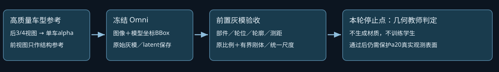

# Omni 高质量车型灰模教师试验

任务 `OMNI-HQ-VEHICLE-TEACHER-20261122`，run `omni_hq_vehicle_teacher_20261122_r1`。最终结论见[报告](report.md)、[HTML 报告源](index.html)与[灰模门结果](audits/grey_gate_result.json)。

用户提供的黑皮卡前后图仅为车型先验；Omni 实际只接入后侧单图，前侧图用于结构核对。输入裁切仅做 CPU matte，RGB 像素保持原值。

原始 `proposal/` 使用 bbox `[1,.416,.5]`，`proposal_bbox_frame_fixed/` 仅修正 actor 尺寸到 raw XYZ 的轴顺序为 `[.5,.416,1]`。两次均固定 seed101、50 步、CFG4.5、256 分辨率，原始现场保留，资源分别记录在两份 proposal_report 中。原 bbox 的坐标问题不作为模型能力上限证据。

灰模验证限 train86/110：先语义确定 proper rotation，再均匀缩放与有界注册，禁止独立 XYZ 拉伸。结构、轮位、可见轮廓与测距贴合按[预注册协议](audits/source/preregistered_gate.json)检查；[原始有界注册](audits/bounded_registration/bounded_registration.json)与[修正后有界注册](audits/bbox_frame_fixed_bounded_registration/bounded_registration.json)分别保存。注册指标属于拟合集，人工 verdict 保持 null。

`run_code/` 保存实际运行与审计源码，`publication_tools/` 保存隔离 index 的发布工具。[恢复索引](restore_index.json)指向保留的模型、输入图和变换。Git 仅保存轻量文本；模型、NPZ/PT、PNG、GLB/PLY/OBJ 随原远端现场及本地交付保留，HTML 的图片由本地 outputs 资产提供。

本轮在灰模阶段停止，材质与学生训练均为 0；GPU 实例保持开机。实验索引、三维状态和 V82-F06 只追加本轮证据，其他二维与道路任务保留。
