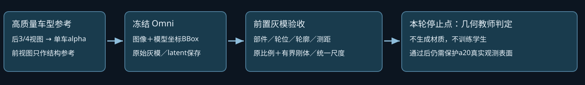

# Omni＋高质量参考：a20车辆灰模教师验收

2026-11-22。当前结论：**粗车型几何候选有改善，未通过a20教师准入。** 本轮止于灰模；材质生成0次，学生训练0步，GPU保持开机。

## 实际执行

输入为用户提供的1536×1024双视图参考。左侧后3/4原始RGB裁片754×516经CPU前景抠图后作为单张RGBA条件；模型推理前修正近侧后轮Alpha截断。原RGB不重绘、不缩放。右侧前3/4只作结构核对。官方图像列表接口展开为batch，未提供联合多视图条件。

冻结Hunyuan3D-Omni，seed101，50步，CFG4.5，形状解码256。初次错误传入raw XYZ框[1,.416,.5]；独立原始灰模检查确认前方−Z／上方+Y后，按车辆尺寸[5,2.5,2.08]的WHL传入[.5,.416,1]，仅作一次坐标修正重放。两次形状推理共100请求步、进程墙钟154.95秒、峰值分配显存7.68GiB。原始候选、修正候选及latent均保存。

模型原始XYZ跨度为[1.044659,.811535,1.991053]。采用det=+1的旋转矩阵[[0,0,-1],[-1,0,0],[0,1,0]]进入对象坐标，再仅按5米车长作统一尺度初始化，LWH=[5,2.623384,2.037955]米。没有分轴缩放。原始比例与全部变换可恢复。

## 灰模验收

一次固定12迭代有界配准：yaw±10°，统一尺度[.9,1.1]，平移边界±[.35,.35,.20]米。最终scale=.972044，yaw=−.201608°，平移[.046204,−.000947,−.136381]米。未作候选、角度或阈值扫描。

| 检查 | 结果 | 生成前固定门槛 | 状态 |
| --- | --- | --- | --- |
| 全部1030点至真实三角面的均值 | 9.93 cm | ≤7.5 cm | 未过 |
| P90 | 38.02 cm | ≤15 cm | 未过 |
| raw86可见核心召回／未知区排除IoU | 98.46%／98.46% | ≥95%／≥90% | 通过 |
| raw110可见核心召回／未知区排除IoU | 99.06%／99.06% | ≥95%／≥90% | 通过 |
| 两帧可靠背景溢出 | 0%／0% | ≤0.5% | 通过 |
| 配准后LWH | 4.861×2.550×1.981 m | 各轴比值0.8～1.25 | 通过 |

四轮和两轴存在，驾驶舱、货厢、保险杠可辨，车顶和双镜无早期明显漂块。后轮、轮拱与底盘局部熔连；细部部件关系仍未建立。额外约0.143平方米薄片位于前挡风下沿／引擎盖后缘，可能为雨刷／饰条，未仅按连通块数量判失败。人工质量评分保持null。

## 测距卡点

raw86为428点，均值9.78厘米、P90为37.55厘米；raw110为602点，均值10.03厘米、P90为39.67厘米。全部点均保留。尾部x∈[−2.5,−1.8]米的649点贴合较好，均值3.64厘米、P90为6.72厘米；驾驶舱后部x∈[−1,−.2]米的314点均值18.93厘米、P90为41.37厘米。后者147点残差超过15厘米，相对最近表面平均位移[+.0805,+.0051,−.2188]米。高度z∈[.26,.56]米的363点均值18.04厘米。不能把全部失败归为地面点，也不能靠全车整体下移修复。

保留未配准统一初始化、配准结果、精确正交六视、点叠加、逐点残差和最大100残差CSV。raw134／179／198未被用于本轮候选选择或配准。

## 教师准入结论

新候选能够提供车型级粗形状，但尚不具备整车替换或监督缺失a20表面的准入资格。下一步应保留真实可见车身，针对缺失部件建立受观测约束的修复，再重复灰模验收；通过后才进入材质和学生蒸馏。本轮没有把先验初始化或完整网格命名为完成蒸馏。

## 归档入口

- 输入与轴序：input_contract.json、input_contract_bbox_frame_fixed.json。
- 执行与取回：execution_summary.json、execution_takeback_receipt.json。
- 生成前门槛：audits/source/preregistered_gate.json。
- 主审计：audits/bbox_frame_fixed_registered_audit/audit.json。
- 完整变换与原始形状：proposal_bbox_frame_fixed/、audits/bbox_frame_fixed_uniform_initialization/、audits/bbox_frame_fixed_bounded_registration/。
- 代码与模型接口快照：code/、source/、evidence/。
- 远端现场：/root/autodl-tmp/drivingeditor_repro/campaign/omni_hq_vehicle_teacher_20261122_r1。

免责声明：参考图是车型先验，并非已证实的a20隐藏部分真值；1030个点按对象框和遮挡框保护筛选，属于实测几何归属代理，尚非语义核验的a20专属真值。轮廓来自保守可见核心掩码，不能验证遮挡部分。86／110用于有界配准，指标为拟合集指标；134／179／198未参与生成、配准或选择。门槛为本轮生成前固定的工程标准，人工质量分数留空。本次单候选试验不能据此判断Omni的能力上限。
