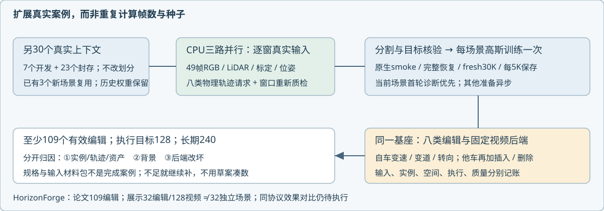

# 八类4D编辑：从真实输入准备到有效案例

本轮纠偏：除当前3个新场景，立即并行准备其他case，不能只调整已有训练队列。

## 规模合同

用户提供的HorizonForge论文完整HorizonSuite为109个编辑，展示页是8类任务×4例＝32个编辑、128个视频文件；后者不是32个独立场景，也不是完整评测规模。来源为用户材料`work/horizonforge_reference_20261026/43826_supp.pdf`和逐文件manifest。我们至少完成109个**有效编辑案例**，执行目标128，长期240例目标保留。八类为自车变速/变道/转向，以及他车变速/变道/转向/插入/删除。

一个case是固定场景、目标和物理编辑请求；不以帧、种子、checkpoint、多个方法或生成前后两个阶段增加数量。原有六类216份草案不与新八类重复累加。输入就绪、输入筛查通过、分割/实例关联、基座训练、操作空间准入、实际执行与质量评审分开记账。最终如果有效案例不足109，继续补输入与合理任务，不以草案补数。

## 已启动的实际工作

`prepare_benchmark_inputs.py`以3个CPU进程提取剩余30个上下文：7个新增开发、23个封存；已有3个新开发输入复用，三个历史路段保留原权重，不重复fresh训练。开发输入优先，封存只准备输入与固定请求，保持方法选择隔离。每段独立保存49帧真实RGB、五LiDAR/双回波TOP运动补偿、标定、位姿、原始微秒时间戳和逐帧标注；不是只复制任务名。目标/窗口优先选原始完整轨迹中的可靠运动候选，新窗口必须重新筛查。

`prepare_benchmark_cases.py`为每段落盘31时刻的米制请求。自车变速对相机轨迹连续插值，不等价于相机原地旋转；变道使用平滑位移，转向使用弯曲位置路径及姿态。车辆插入预先指定不同开发场景资产库，仍待源资产质量、尺度/朝向和新位置支撑核验，不能拿同车克隆冒充新资产完成。没有完整目标轨迹或目标不运动的片段，不计为变速输入合格。真实未观测背景不伪造反事实RGB标签。

`benchmark_scale_ledger.py --watch`每30秒更新`benchmark_cases_v1/scale_ledger.json`，按split和八类分别统计实际材料包、输入筛查、碰撞压力与正式完成。当前只读输入，不读取编辑效果选样；物理路段重叠尚未审计，不能把上下文数提前叫独立路段数。正式效果和HorizonForge同协议对比尚未完成。

`prepare_benchmark_masks.py`已接上真实DEVA/SAM处理；先让当前首场景完成首轮11原生/6固定后端诊断，再与后续训练通过GPU互斥排队，健康worker不重启。新窗口原始质检通过且目标49帧完整才进入分割，自动生成49帧关联contact。代理逐帧核验后立刻构建真实动态点、进入原生守卫和真实smoke＋fresh30K，每场景一次、多case复用，仍每5K完整保存。封存集不用于方法选择。

## 下一入口与尚未完成链路

1. 立即检查新开发关联contact，合格者接新场景训练，不等30个CPU包全部完成。
2. 首场景30K后多操作诊断继续优先；并行准备其他scene，不能回到只做删车/道路。
3. 将八类物理请求接入只读原生渲染；自车轨迹改变与跨场景插入的适配器仍须真实GPU通路核验，不能把输入请求说成效果已完成。
4. 按①实例/轨迹/资产、②背景污染或缺失、③后端改坏定位，固定①③方法选择后形成跨场景失败矩阵，再选择阶段三算法。
5. GPU/CPU资源停止线仍只有用户指定的Codex周剩余严格<20%；本轮数据准备也读取同一停止请求，不重置历史显存峰，不清他人资产。

所有模型、数据与运行日志留campaign；Git仅代码和合同。`quality_accepted=false`、`human_verdict=null`。
