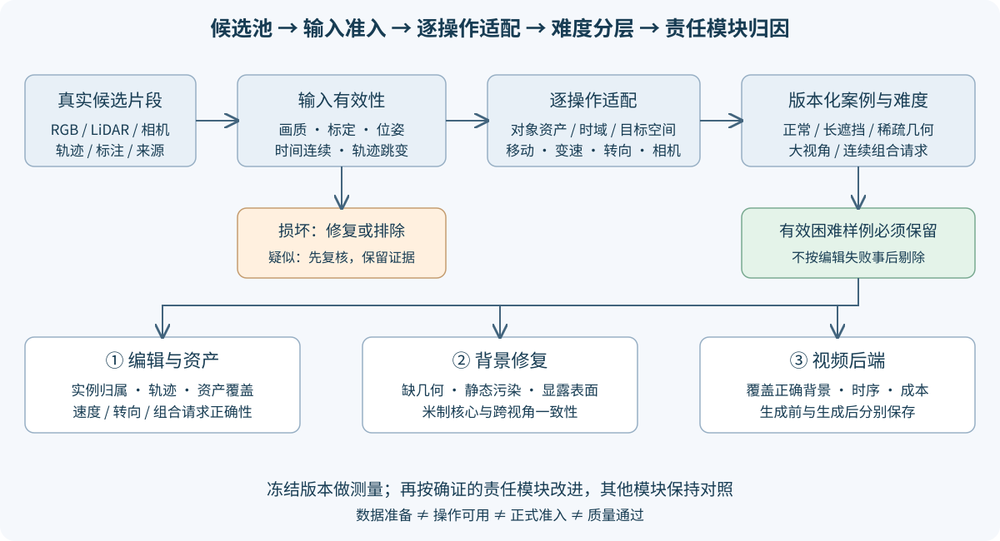
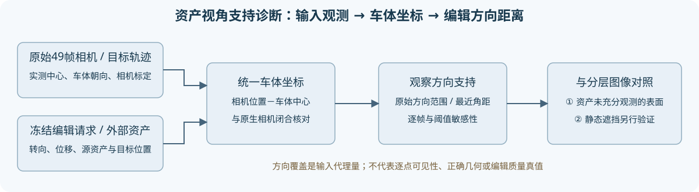

# 4D 编辑评测协议 v1

更新：2026-10-27。当前阶段：**阶段二，评测集与固定基线**。本版本用于发现跨场景重复失败；尚未构成完整论文 benchmark。

## 候选池准入：2026-10-27补齐

36段目前是候选池，不是正式评测集。`ADMISSION_POLICY.json`版本化结构门限、复核信号与逐操作要求；`screen_eval_inputs.py`只读输入，不读编辑输出。既有三个便利开发场景保留其开发身份，不根据已经看到的编辑失败事后剔除。当前自动筛查不等于人工质量接受。

输入分为结构不合法、需要复核、原始检查通过；画质的Laplacian/曝光、ORB标定一致性是复核信号，不单独构成损坏证明。位姿/标定结构和时间戳作硬检查，轨迹连续长度、跳变、边缘裁切、背景视差另记。低纹理、低视差、稀疏道路和长遮挡保留为难度标签，不统一排除。

每项操作分别检查原始数据、对象归属/资产、时间支持、目标/相机空间和参考域。v2显式检查目标是否接触图像边框，已裁切框不能因画面内比例高而放行：旧最大框窗口仅1个运动候选、0个变速候选。`plan_operation_windows.py`按操作从全片段重新提出33个普通运动窗口、21个运动目标变速窗口，仍须重筛窗口并检查资产和几何，不是正式可用数。不能给每段直接套相同任务。旧v1的17/6计数保留为被修正的输入诊断，不作为当前准入数。

正式准入还需可靠像素mask/对象关联、已观测区域原生重建QA、目标或相机空间支撑、明确显露/未知域。现阶段这些链路尚未全部满足，所以正式准入数保持0，不能把34段“原始自动检查通过”叫正式质量通过。

阶段二还须补变速、转向、相机旋转/侧移和连续请求。实例归属/轨迹错误记①，背景缺失/污染主要记②，视频覆盖正确内容记③。冻结①③是当前测量合同，**不是预设所有失败都必须由②解决**；后续按确证责任模块选改进、冻结其他模块做对照。

## 训练准入与评测准入分离

通过数据质量检查的场景可以优先开始原生逐场景训练，无须等其他场景。原始传感器、真实分割、目标身份、输入点云/标定及原生几何守卫通过才能进入smoke；完成训练后再检查原生资产和已观测背景质量，决定适合哪些编辑任务。首次训练不能循环依赖尚不存在的重建质量；训练就绪也不等于正式评测质量通过。

每个场景一次原V41-B/GN11 fresh30K，多编辑case复用。每5000步完整保存静态/动态/环境/完整训练状态四件和评价，禁止为不同编辑请求重复训练基座。工程smoke为真实GPU fresh≥300s+严格恢复≥300s，涵盖前后向、finite、保存、49帧评价、参数/Adam/RNG/采样恢复和下一入口，开销单列。bug修复/必要重放自主推进，新目录保现场。仅本场景完整30K成功并且磁盘紧张时清其精确登记的中间checkpoint产物，保留最终完整恢复状态和必要评价。

## 冻结合同

- **①编辑接口**：原生高斯、已有动态分支操作和米制相机操作。原始主副本不写回；实例归属不清必须列为失败，不能通过更换上游方法掩盖。
- **②当前对照**：原静态背景、已有保背景修复、直接真实参考锚点。只读评价已完成状态；此阶段不继续新几何方法正式训练。
- **③后端**：同一预训练 ProPainter、同一权重、seed=0、480×320、10fps、neighbor=10、subvideo=50、ref_stride=10、额外mask膨胀=0。最终视频与生成前3D帧都必须保存。DiffuEraser已下载，切换后端延后。
- 掩码由固定输入策略生成、登记散列；不同②在同一案例使用同一掩码。若修改了掩码，单独作为输入策略实验，不冒称②算法收益。
- 新方法必须先在开发路段完成；封存路段在方法选择前不运行，不看其编辑指标调参。输入适配、模型加载和数据检查可做，须记录。

## 数据划分和实际状态

`prepare_eval_set.py`逐记录核验TFRecord两项CRC，按真实context去重；先按context固定划分，随后选择49帧窗口及目标车辆，不根据编辑效果选例。

scene0008是原方法开发域；scene0017、scene0029曾用于重建研发，均属于历史开发场景。其他context通过固定SHA256规则分成新增诊断开发集和封存集。**不同context不等于已排除物理路段重叠**：GPS/地图重叠审计尚未完成，论文级无路段泄漏划分仍需补齐。

清单分别记录：原始数据就绪、RGB/标注就绪、像素掩码就绪、原生checkpoint就绪、参考域就绪、实际执行、人工评审。生成216份案例规格不等于运行216个案例；49帧不等于49个独立场景。新场景RGB不能替代其高斯重建。

## 六类测试与验收对象

| 类别 | 固定请求与对照 | 必须测什么 | 当前不可冒称的内容 |
|---|---|---|---|
| 无编辑保真 | 主副本原生渲染；编辑前后主副本复渲染 | FP32最大差、全图/车身/边缘/背景PSNR、SSIM、LPIPS | 仅同路径差0不等于重建准确 |
| 删除与显露 | 删指定车辆；删完整动态分支作为归属上界诊断；原静态/已有修复/直接参考同域比较 | 污染残留、真实参考覆盖分母、有标签区误差、未知核心、保留车辆损伤 | 遮挡区没有真实标签时不计算“正确补全率”；整动态分支删除不算实例编辑成功 |
| 已知道路撤源 | 从实际观测道路制造连通世界洞，边界/过渡/核心分别留出 | 表面/法线/颜色、留出视角、来源泄漏审计、距离分层 | 完整场景模型已见过洞内答案时只能叫module-only；严格组须初始化/编码/所有关联输入均撤源 |
| 移动与插入 | 独立请求移动1m；复用资产插入2m；指定对象与保留对象分开 | 原位残影、新位完整度、深度排序、碰撞、非目标车身/背景变化 | 同场景复用不是外部资产泛化；未归属行不能偷偷全部移动 |
| 自车视角变化 | 米制侧移0.5m及多时刻/多视角重访；可获得真实相机视角时单列 | 同一世界表面几何/外观一致性、新显露未知域、③修补负担 | 任意侧移没有GT时不报告伪PSNR；期望深度不是首交表面 |
| 重复世界编辑 | 删除→移动另一车→重访同一位置；独立修复/普通缓存/带来源状态对照 | 同表面跨请求一致性、重新生成次数、状态复用及冲突、累积损伤 | 同一checkpoint重复渲染差0仅为工程验收，不是记忆创新 |

## 来源和核心分层

世界区域区分：可靠实测、射线自由空间、真实未知、生成假设。参考图像必须登记来源帧和是否进入初始化/训练；不得使用本帧车身颜色当道路答案，不把生成输出升级为观测。

每个连通洞按到边界距离记录三层：0–0.25m边界、0.25–0.75m过渡、≥0.75m核心；同时给出归一化距离层，避免不同洞尺寸改变核心定义。优先在世界坐标计算；只有像素掩码的案例标为image-only，不能用像素距离冒充米制。若没有非空核心，该例不能支撑“中心补全”结论。所有层报告完整目标分母、可信参考分母和未知分母。

## 度量和因果归因

1. 原生浮点渲染为质量主口径，clamp[0,1]的PSNR/SSIM/LPIPS；PNG指标另标preview。逐场景先聚合，再跨场景平均，同时保存逐帧/逐车最差结果，不能用长视频压过短视频。
2. 参考域严格相同，比较原静态→修复原生→生成视频，并保留直接真实锚点这一强控制。单独统计改善/退化/不变比例。参考来源已进入初始化的结果只叫来源一致性诊断。
3. 真实几何参考与拟合参考分开。评估可靠点的米制深度/法线、自由空间违例、多视角重投影；期望深度作为附加诊断，不替代首交面或独立几何。
4. ③的负担报告生成掩码占比、掩码内实际RGB改动、原生与生成之间的差异、推理时间及GPU峰值。最终视频变好但原生3D仍错，不能计为②三维收益。
5. 增加人工盲评：几何可信、保留对象、时序一致、编辑意图、残影。自动指标与人工意见冲突时保留两者，不自动接受质量。

## 失败矩阵驱动下一轮

固定失败类别：`missing_support`、`static_contamination`、`instance_ambiguity`、`occlusion_order`、`view_inconsistency`、`generation_overwrite`、`repeat_state_conflict`、`source_leakage`、`unknown_without_gt`。一项失败必须链接原生帧、最终帧、空间/像素区域和来源证据；仅看一张图可标suspected，不能标confirmed。

先完成开发路段同合同基线与失败矩阵，再按跨路段重复性、实际质量影响和现有强控制解释程度选择下一项②改进。**持久世界状态是框架目标；创新由对照实验证明，不能先写死。** 每轮固定①③，仅改变一个有证据支撑的机制，保留负结果和计算账。

## 连续执行和唯一资源停止线

每次心跳首先查Codex周额度，持续工作至少每30分钟复核。周窗口剩余严格低于20%时快速保存可恢复现场、阻止新任务、取回必要结果、提交推送并关AutoDL，然后暂停同一心跳；当前阶段结束不得触发关机。额度未知不当作0，核实后记录。未触线继续推进评测和研究，不设置其他科学止损点。不得干预无关任务。

真实小时级训练仍须约10分钟smoke覆盖保存、评价、完整恢复及下一入口，smoke与正式更新分账。所有质量`quality_accepted=false`、`human_verdict=null`，由用户评审。

## 编辑时钟与空间检查补充

以[单实体时钟与空间合同](TIME_AND_SPACE_CONTRACT.md)区分ego-only speed和整体播放控制。世界时刻固定，单独重定时请求实体；源资产另记模型与物理时间。整体播放控制和修正版本不增加case数。三维框冲突单列压力层；相机中心未进车辆框不等于自车车身无碰撞或道路已支持。输入审计不消费编辑效果，不用框过滤训练点。

## 资产观察方向支持

使用实际原生相机中心、原始传感器标定和目标车体轨迹，检查训练49帧与冻结编辑请求的车体坐标观察方向。原始与原生相机先做世界坐标闭合；转向同时应用已登记的中心/朝向变换，跨场景插入必须与源资产自己的训练方向比较。输出逐帧最近方向角距和1/3/5/10°描述性敏感性，**这些不是准入或正确性门限**。

方向集中与转向缺陷可形成输入层面的关联证据，不能单独认定唯一原因。车体框是刚体代理而非高斯真实变形坐标，跨49时刻池化可高估单时刻支持；中心方向不测逐点遮挡、表面或像素可见性。相机原地yaw的方向量为0仍可能改变视野。保持未充分观测表面的困难层，不根据已经看到的编辑失败事后剔除案例，不以增加阈值伪造改进。该只读审计0训练更新、0新增编辑case。
