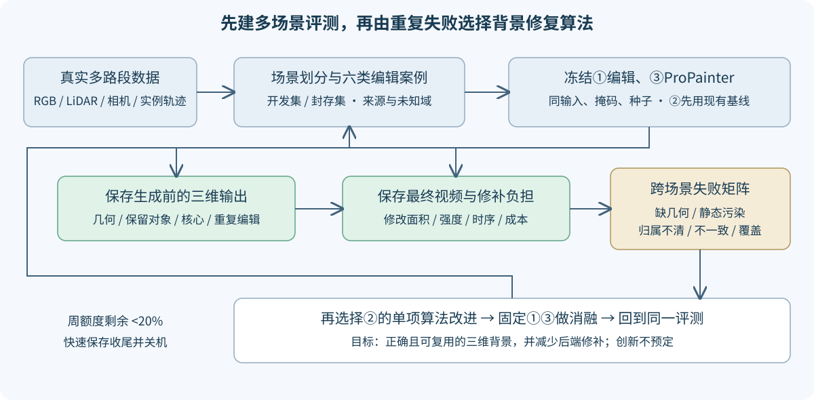

# 4D 编辑自主研究：当前执行计划

更新：2026-10-27。Task：`WS-V82-PERSISTENT-WORLD-20261027`。

**目前处于阶段二早期，先把评测做扎实，固定①编辑与③视频后端。** 阶段一已有编辑→三维修复→ProPainter视频实际输出。阶段三仅有候选探索，算法尚未确定；暂不继续新几何方法正式10K，也不切换DiffuEraser。持久世界状态是框架目标，不预定为论文创新。

## 三阶段与当前工作

新增实际CPU队列准备另外30段真实传感器输入，八类任务、至少109有效编辑的合同见[BENCHMARK_SCALE.md](BENCHMARK_SCALE.md)。先准备合格开发段，再准备封存输入；每段新窗口重新质检，数据/实例/训练/执行分别计数。不能只调整已有3场景训练顺序而不准备其他case。

1. 阶段一最小闭环已实现，质量未接受。V41-B完整重建主副本冻结，编辑副本独立；保留生成前3D与最终视频。
2. **阶段二是当前重点**：版本化多场景划分、六类案例、来源/未知域、固定基线与失败矩阵。先做开发集，封存集不参与方法选择。详见[评测合同](EVALUATION_PROTOCOL.md)。
3. 根据跨场景重复失败再改进②，固定①③做消融，证明背景能换视角、反复编辑并减少后端修补。不是预定三维记忆必然有用，也不能用视频掩盖三维错误。

## 权威路径与保护对象

campaign：`/root/autodl-tmp/drivingeditor_repro/campaign/persistent_world_20261027`。Git：`/root/autodl-tmp/motion_proj_v82_gn11_v42`，分支`research/worldsim-v8.2-drivingeditor-v42`。数据/模型/日志不入Git；保留用户无关修改`scripts/run_worldsim_v72_e3_render_bridge.py`。不使用subagent，GPU任务用`gpu_slot.py`互斥并避让其他任务。NVML采样与CUDA allocator峰分开记账。

保背景起点：`edit_smoke_preserve/full199/checkpoint1000_from0.pth`；不混强透射`edit_visibility`，不把提高道路贡献当研究目标。原生B主副本更新0。

## 已有证据及其局限

scene0008已有49帧原生隔离/状态重载、六项对象/相机操作与固定ProPainter控制。49帧源一致性MAE：原静态0.19592、原型0.08015、原静态整洞视频0.07302、原型整洞视频0.06722、证据路由0.01172、直接真实参考锚点0.01400。简单锚点解释大部分收益，不能归因于高斯修复或世界记忆创新。

来源138–169曾进入199初始化；三个原优化视图与46同片段视图均不是独立场景/独立GT。左车黑影、近处条带仍在；单对象编辑有残影，B无逐行实例ID，框投票未决867871/1030499行。贡献期望深度与受支持拟合曲面仍有米级差异，仅为诊断，不是首交GT。SQLite记录来源/修复/请求/生成假设，是工程能力，尚非已验证的记忆算法。

## 训练账与队列纠偏

| 项目 | 已执行 | 当前处理 |
|---|---|---|
| 保背景基线smoke | 100+4066=4166额外更新；恢复段600.799秒 | 全状态加载核对通过，不声称CUDA续步逐位一致 |
| 基线fresh10K | 严格10000更新完成，约1538.67秒 | 只读49帧与固定ProPainter评价 |
| 深度矩候选smoke | 100+3885=3985额外更新；恢复段600.680秒 | 正常保存完成，不延长 |
| 深度矩候选正式10K | **未启动** | 已撤下，阶段二不自动恢复 |
| 配对几何/后端切换调度 | 三个父控制器已停止，当前子smoke正常完成 | 研究优先级调整，不是工程失败；收据`phase2_reprioritization/receipt.json` |

`research_policy.json`禁启新修复训练和后端切换。新`phase2_eval_controller.py`仅做两个可复用其他开发路段的原生操作/固定ProPainter，以及已完成10K的只读验收。核对`phase2_eval_status.json`与dispatch的PID/start_ticks，不重复启动健康worker。

## 多场景评测的实际状态

`prepare_eval_set.py`从35个数据目录片段加另一个已下载片段逐条核验TFRecord双CRC，形成**36个context、1764帧PNG**。原方法开发1段、历史重建开发2段、新增诊断开发10段、封存23段；先划context，再按输入标注选49帧窗口，不根据编辑结果挑例。

216份任务规格**不是216项已完成编辑**。新路段像素掩码、可靠道路参考与高斯状态还需准备。不同context的物理路段重叠尚未审计，不能提前称论文级无泄漏测试。

现有scene0017与scene0029原生30K可只读复用；先验证适配器不改变原通路，再跑49帧。整动态分支删除/移动/复用插入是归属上界基线，不能冒充指定实例编辑成功；其历史配置不同，跨场景绝对指标不当成方法增益。

接续：收齐固定基线→逐场景/任务失败矩阵→新增开发路段掩码/几何/重建输入→严格道路撤源与重复多请求序列。撤源在初始化/编码前移除所有关联答案；已看过答案的基座只能标module-only。封存集不参与算法选择。固定③继续用预训练ProPainter；DiffuEraser完整下载、CPU导入通过，但GPU接入延后。

严格道路撤源v2、最近实测LiDAR可见性、车辆边缘排除与米制核心参考已完成两个历史路段。4×2.4m洞和0.3m保护带，49帧全源RGB/点云在编码/初始化前撤源，不输入旧高斯/潜特征；不是整个B无泄漏重训。input-only平面邻色与固定ProPainter核心MAE分别为0017的0.02752/0.02418、0029的0.03863/0.02885，稀疏累计帧像素不代表全洞GT或世界面积；v1近裁剪过保守的旧包与PNG对齐前分数保留。当前应推进运动、相机与连续请求测试，而非重复道路组件。

## 运动与相机协议接线

`motion_edit_suite_v1`已准备3场景各11种单请求变体与1条连续修订协议，首场景已完成11单请求原生/6固定后端；其余按状态排队。共同中央31帧使0.75/1.25倍速完全处于原49帧时间支持内，不通过时间裁剪伪造暂停；物理秒和模型时间分别保存。世界米制编辑经实际相似变换进入模型坐标，转向同时变换均值和协方差，SH外观仍继承原生世界系，未训练资产改进。

请求框碰撞层单列，不能把重叠的插入请求算作背景修复失败：第一、第三段2m复用克隆与原车碰撞；第三段3.5m插入/部分左转也冲突。原始CPU检查遗漏原车的草案已保留，修复前没有执行GPU编辑。动态源点逐索引/世界坐标/时间重放差0；框内一致率仅为几何检查，不作为语义纯度或GT过滤。

`motion_suite_controller.py`在同场景完整30K后立即优先进入GPU：先真实单帧入口与实际原生渲染差核验，再完整31帧单请求，6类对象变更调用相同ProPainter，仅原位显露区补图并保护新位置对象。首场景6次连续原生请求已完成，固定视频对照排队；相机未知mask未建立，先保留native-only，不伪称视频补完。

**调度按结果闭环交错，而非连续堆积训练：场景1训练→场景1多操作/固定后端诊断→场景2训练→场景2诊断。** 后续场景控制器以`--after-motion`在取得GPU锁之前等待前一场景的11个原生变体与6个固定后端案例。CPU输入质检、来源审计与准备异步进行，诊断GPU结束即可训练下一场景，CPU图像分析同时推进。2026-10-27队列调整只停止两个零更新、无child的等待父进程，首场景健康训练未动、丢失更新0；收据`scene_diagnostic_priority_v1/receipt.json`，新dispatch以`native_scene_priority_dispatch.json`为准。首轮诊断若工程失败且父/child均已退出，保留失败并显式标记待修复后释放给后续训练，不能算完成案例；代理优先修复，不让GPU因故障等待而持续空闲。

首轮结果立即按①实例/轨迹和资产、②背景污染/缺失、③后端改坏建立证据，保留生成前三维与生成后视频；不能以“又训练了一个场景”替代失败定位和阶段三方法选择。

当前首场景fresh30K已正常返回，30000条有限更新与六档5K保存/49帧评价核对通过，训练CUDA累计峰allocated约5.19GiB、reserved约6.59GiB，质量仍未接受。首轮只读入口发现Torch2.2的mmap不接受Path，已改为字符串并保留失败attempt，新attempt目录接续，不重训。连续请求原生基线已接6次修订×31帧，操作同一克隆并保留删除状态，普通状态缓存与相机回访作为工程控制，真实GPU结果以child summary为准，不能据此声明记忆创新。

其他30段真实传感器/八类请求已全部提取；33段合计178项输入筛查通过，其中开发53项、封存125项（前瞻剔除18项静态目标运动请求），仍非正式完成。为防分割被后续长训练饿死，下一个原生训练在首场景诊断后优先让出两个新mask/目标包。首入口兼容错误放行过一个分割：健康GPU子进程继续跑，边界监督器只暂停其CPU父调度，在真实退出状态0和49帧输出核验后重接“先完成已修复诊断”的门控；不重启健康GPU子进程。看`mask_rearm_completed_boundary_v1/receipt.json`及最新dispatch，不能擅自恢复已暂停旧父或重复启动。

## 新场景训练流水：最新用户授权

数据质量通过一个场景就接原生基座训练，不等全体质检结束。场景训练准入和正式编辑评测准入分开：前者检查真实传感器、标定/位姿、目标关联、分割、真实点云与原生几何守卫；后者还需训练后资产/背景质量、显露与未知域及操作空间。不能要求先有高斯重建质量才能开始首次训练，也不能把已开始训练当作评测质量通过。

每场景fresh原V41-B/GN11训练30K一次，5K/10K/15K/20K/25K/30K各保存静态、动态、环境、完整优化器/RNG/采样状态并评价。仅变输出、场景元数据及用户指定保存周期，损失、学习率、采样和增密预算保持基线。多种编辑从同场景checkpoint独立载入，不能每个case重训基座。

真实smoke采用fresh至少300秒和严格恢复至少300秒，保存、原生49帧评价、参数/Adam/采样/RNG恢复及下一入口都实跑，正式仍fresh30K，额外更新单列。`native_scene_controller.py`、`native_scene_worker.py`负责串行GPU训练，CPU质检/准备并行推进。失败自主定位修复，优先精确恢复，必要时新attempt目录重放并保留现场成本。

候选准入v2新增显式边框接触检查，避免已裁切框的“画面内比例”误判。34段原始自动检查通过、2段待复核；旧最大框窗口仅1运动/0变速候选，按操作重选33运动/21运动目标变速候选，均不是正式已完成案例。3段真实传感器/DEVA均准备，147053...49帧完整可见SUV已核验，真实动态18147点。其他目标继续独立关联和检查。

仅本场景30K完整成功且磁盘紧张，核对最终完整可恢复节点和必要评价后可清本场景中间checkpoint产物；删除前列精确文件清单和预计释放量，保存删除收据，不清其他资产。30K未完成不提前清中间恢复点。

## 唯一资源停止线

用户明确新增：每次心跳先查Codex周额度，持续工作至少每30分钟复核。**周剩余严格低于20%**即快速保存可恢复现场、阻止新任务、取回必要结果、提交推送并关闭AutoDL，然后暂停原心跳。不要等待完整长跑/扩展大报告。额度未知不当作0。

在此前持续自主研究，不因负结果、阶段结束或队列暂空停止/关机，不另设科学止损点。`resource_control.py`实现worker禁启/停止请求；未来训练收到SIGTERM或资源停止请求在步间保存完整参数/Adam/采样/RNG。必要工程修复自主进行，旧现场和成本保留。小时级新训练仍须真实约10分钟smoke覆盖保存、评价、完整恢复和下一入口。

`quality_accepted=false`、`human_verdict=null`，人工质量由用户评审。

## 当前接续：五场景与因果诊断

第二场景已通过真实smoke/恢复进入fresh30K；第三等待。新增100966（17273动态实点、DEVA62）和255598（46005点、DEVA31）均逐帧核验并排第4/5队列。135064关联63/65切换、原生主连通守卫未过，HOLD不训练。首场景11原生/6后端和6连续原生修订均有视频；固定后端连续3推理+2精确输入普通缓存控制排队，不宣称记忆收益。只读SH物体系旋转CPU等变验证通过，GPU控制待执行；旧世界系SH原始结果保留。下一步优先真实八类自车轨迹与跨场景插入GPU接口、跨场景失败矩阵，不再把输入准备数量当编辑成绩。
