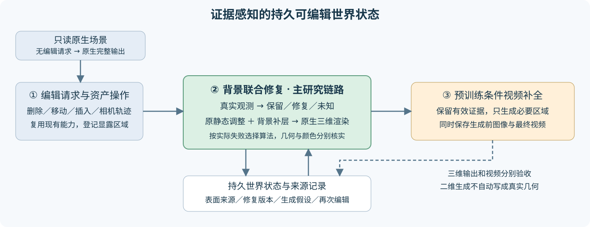

# 证据感知的持久可编辑世界状态：当前执行协议

Task：`WS-V82-PERSISTENT-WORLD-20261027`。用户2026-10-27授权代理按阶段一→阶段二→阶段三持续自主研究、安排实验并迭代；负结果应导向下一轮有效改进，不设置与科研问题无关的停止门槛。单次运行仍登记固定输入、方法、步数、资源与来源，便于控制变量和复现。训练/工程完成不等于质量通过，`quality_accepted=false`、`human_verdict=null`。

## 研究主线与三阶段

①复用重建、资产和轨迹操作；②以证据驱动的背景联合修复为核心；③先固定预训练视频后端。研究假设是：维护真实观测、修复版本和未知/生成假设的边界，能减少重复修补和错误覆盖，并提高跨编辑、跨视角一致性。普通缓存、掩码和置信度本身不预先作为创新。

1. **最小端到端基线。** 原生V41-B完整通路隔离；编辑副本从保背景原型出发；输出原生3D帧与最终视频。先接完整可用的ProPainter；补齐固定revision的DiffuEraser，之后检验显式三维prior，而非立即后训练大模型。
2. **针对性案例与失败发现。** 无编辑、删除两辆困难车辆、可靠道路整块撤源、移动/插入、自车变轨、重复编辑。所有案例保存生成前图像与中间状态；场景内多帧不计作多个独立场景。已人工诊断的scene0008是开发资源，不能称独立测试。
3. **固定①③改进②。** 根据实际失败选择几何补全、污染处理或持续状态复用。当前先做最简单证据保护强控制，查明全洞生成是否覆盖有效内容。对保留输入像素的误差改善不能冒称泛化，必须继续看其他视图、独立几何和真实未知区域。

## 当前可执行入口

- 远端campaign：`/root/autodl-tmp/drivingeditor_repro/campaign/persistent_world_20261027`。
- 代码与版本化协议：当前Git分支`research/worldsim-v8.2-drivingeditor-v42`；代码保存于同目录`code/`，发布到仓库对应`persistent_world_20261027/`。
- 原生适配器：复用已有`editor_common.Native`，当前只绑定Waymo scene0008；可配置跨场景适配仍未完成。默认完整输出不把编辑参数加入光栅化。
- 起点：`edit_smoke_preserve/full199/checkpoint1000_from0.pth`；强透射版本是未选对照，不能替换起点，也不能把提高道路贡献当任务目标。
- 生成：`inpaint_baseline.py`保留官方网络，PNG I/O避免有损视频读写影响度量；全洞掩码会丢弃洞内输入，已作为待检验的接口缺陷登记。
- 状态：`world_state.py`的SQLite记录主副本绑定、版本、世界表面来源帧、请求和二维生成假设。`observed_candidate`是来源支持候选，不等于核实三维真值；`repair_revision`与证据状态分开，生成不会升级为观测。

## 已执行的首轮与比较合同

- 49帧×5种原生输出；raw102独立重载精确复渲染，主通路前后最大差0。
- 49帧×两种上游输入×相同ProPainter，完整保存原生帧和视频。三个原型优化视图同口径PNG/clamp参考MAE：原静态0.22221，修复原生0.00769，原静态接视频0.09416，修复后整洞视频0.05012。这是开发域接口失效证据，不是新场景成绩。
- 最简单证据保护：只用闭环前已有三个视图的跨帧支持且与原生颜色一致的像素排除生成，阈值固定8/255、未调参。保留16342/920191累计目标像素；该数字不是世界面积、补全率或最终成功率。
- 六项49帧三维操作：保留对象、选择删除、侧移1m、同场景资产复用插入侧移2m、相机侧移0.5m及再显露。原B未保留逐Gaussian对象ID；七时刻框投票是当前可审查基线，未决行保留。未决867871/1030499行，不能称单对象分离已解决；要检验实际渲染贡献和保留对象影响。
- `prepare_reference49.py`补齐49帧两车参考。来源138–169已进入199帧初始化，角色是跨视图一致性诊断，不能当独立GT或留出测试。未知分母始终保留。

## 当前训练队列

在`train_controller.py`严格串行执行，`training_dispatch.json`及`training_status.json`核对PID/start_ticks，不重复启动：

1. 可配置修复基线100更新，实际保存和评价。
2. 独立进程恢复全部参数、Adam、采样器、Python/NumPy/TorchCPU/allCUDA RNG，继续真实训练至少600秒，保存、评价并记录实际smoke更新；不宣称CUDA续步逐位一致。
3. 从共同原始起点fresh 10000更新，作为可配置视图的修复基线。训练视图94/110/126，固定199道路初始化；继承原保背景目标、学习率和固定几何。原B更新0。

以上是工程/方法基线，并非最终②算法或创新成立。正式10K与smoke/必要重放单列，不能借用旧149秒原型充作本轮10分钟smoke。每个新小时级方法都实际覆盖这条短程接线；工程错误自主修复，旧输出保留，科研负结果继续驱动改进。

## 接续工作，按依赖主动推进

### 已由新证据安排的下一组②实验

49帧参考诊断已完成。共同ProPainter后端的49帧加权MAE：原静态0.19592，修复原生0.08015，原静态整洞视频0.07302，修复整洞视频0.06722，证据路由0.01172，直接参考锚点强控制0.01400。46个未参与旧原型优化的同片段视图分别为0.19443/0.08424/0.07183/0.06819/0.01196/0.01463。来源曾进入初始化，仍不能称独立GT。简单参考控制解释主要收益；剩余差异尚未隔离为三维算法收益。

新增深度统计显示，旧原型优化三视图中，贡献加权期望深度与道路参考面的平均绝对差仍为3.557m；差异小于0.3m的比例仅1.466%。46同片段视图为3.402m/2.032%。这是期望深度与受支持拟合曲面的诊断，不是首交GT或完整三维误差；但足以说明颜色正确尚不能证明几何成立。实际图像还保留左车黑色残留和近处条带，单对象操作出现未决动态残影，不能因MAE下降宣称编辑完成。

据此登记一个单变量原型：在现有背景联合修复中，仅对可靠参考域增加**分支无关的表面深度矩约束**。真实深度排序中累计一、二阶矩，以`log(1+E[(z-z_ref)^2]/(0.3m)^2)`同时约束深度位置和分布宽度，权重固定0.01，不扫参。原始颜色、外围保护、道路直接颜色与原软贡献项保留为共同合同；不会把增大道路贡献当目标，也不自动调位置/新增点。该约束属于待检验的简单几何基线，不预先宣称创新。

执行由`geometry_controller.py`等待健康的原10K结束，然后新方法独立100步保存/评价、完整恢复后至少600秒真实smoke，再fresh 10K。`paired_eval_controller.py`接续两个状态的同49帧原生评价与相同固定掩码/ProPainter视频评价。当前固定的路由掩码来自第一轮，避免把掩码变化混成几何收益。它们是接续任务，训练阶段结束后仍不能关机。

本轮原保背景基线smoke已实际结束：100＋4066＝4166更新，恢复段真实600.799秒；参数、Adam、采样器与各RNG加载核对通过，不声称续步CUDA逐位相同。fresh10K已启动，和smoke分账。

DiffuEraser固定revision依赖现已下载完整，CPU真实导入通过（Torch2.4.1/cu121、Diffusers0.31、Transformers4.46.3），尚未完成GPU权重加载/推理。`diffusion_controller.py`在两个10K及配对评价后继续四种固定PCM2视频控制：原静态、保背景修复、证据路由、直接参考锚点。`diffusion_baseline.py`显式将对应原生RGB作为prior，固定480×320、49帧、10fps、seed0、22帧窗口和2步；完整生成结果作为二维假设保存。它是第二个预训练后端的闭环，不把更换后端本身当作②收益。

1. 核对600秒smoke的完整状态恢复和10K进展；健康训练不改配置、不重启。收集NVML采样峰和CUDA allocator峰，分开解释。
2. 参考49帧齐全后，统一评价原生、全洞视频和证据路由，分开三优化视图/46转移视图、每车/未知域、目标外变化。证据路由使用过的标签不是独立验证。
3. 对修复10K做同49帧与新相机诊断；识别颜色已对但几何不对、未决对象归属、生成覆盖和重复显露等真正失败。不要强制每个路面像素由新道路负责。
4. 严格道路撤源测试要在初始化/编码前从全部输入移除洞内及跨界支撑，不能用已经看过答案的B参数或潜特征冒充撤源输入。可先独立评价道路补全模块，再接整体编辑。
5. 扩散下载完成后做完整权重加载/推理接线，固定后端比较相同上下游与种子；ProPainter与DiffuEraser是不同后端，不能用二者差异冒充②收益。
6. 重复编辑对照包含重新独立修复、普通缓存、带来源的世界状态；跨相机/时刻检查同一表面。仅同状态重渲染相同是工程验收，不是世界记忆算法贡献。
7. 单场景闭环稳定后接入更多真实路段，先场景级划分再切patch；原路线的240例是规模目标，尚未准备/运行，不作为已完成数据集。

持续推进，不因为一轮无收益就中止整个目标；每轮只改变有证据支持的一处主要机制。保留最强简单控制和失败，不无限扫seed/权重。所有远端依赖的评价、可视化、报告、取回、提交推送完成并核实后再考虑电源；当前队列未完成，不能关机。无卡模式闲置保持开机。

`failure_ledger_refs=[V82-F01,V82-F06]`。本轮首先登记工程接口与待研究失效，不因尚未收口的新结果自动创建失败卡或宣称质量接受。
