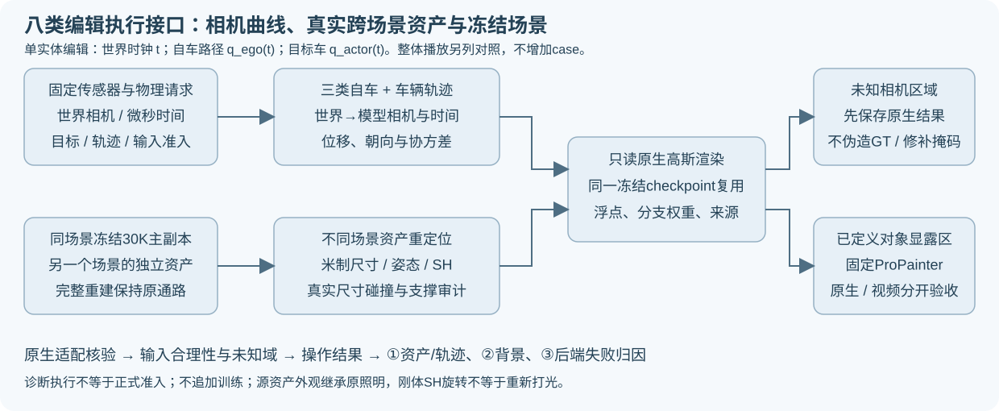

# 编辑实体、世界时钟与空间审计

版本：2026-10-27，阶段二输入与算子合同补充。没有修改训练算法、权重、损失或③后端。

## 单实体编辑与整体播放对照

输出视频时刻记为`t`，请求轨迹查询记为`q(t)`。对比单实体编辑时，不能把所有实体一起重定时。

| 请求 | 世界/未编辑对象时钟 | 相机路径查询 | 被编辑车辆查询 |
|---|---|---|---|
| 自车变速 | `t` | `q_ego(t)` | `t`，保留其他车辆 |
| 他车变速 | `t` | `t` | `q_actor(t)` |
| 自车变道/转向 | `t` | 修改后的空间路径，时钟`t` | `t` |
| 他车变道/转向 | `t` | `t` | 同时刻`t`的车辆做请求空间变换 |
| 跨场景插车 | `t` | `t` | 源资产受支持的时间映射，另记源物理秒 |
| 整体播放对照 | `q(t)` | `q(t)` | `q(t)`；不算自车单独变速 |

旧八类父进程67258的默认整体重放输出保留为`global_retime_control`；不停止健康进程、不覆盖旧场景。`ego_speed_clock_controller.py`在同一相机请求上增加`fixed_world`只读控制，**不新增case**。未来新controller默认`fixed_world`；失败恢复继承原stage的时钟策略，不混用已完成阶段。

CPU对8184条请求时钟核对通过；33段自车变速中990条非零时刻的世界时钟在两策略下不同。首场景raw109的其他车辆实测轨迹位置相差2.01m，说明不能把整体变速当作自车独立控制。该数值不是渲染质量或新算法收益。GPU控制仍须实际执行；代码/CPU检查不替代GPU。

新启动的单帧GPU入口选择中央31帧的索引23（从0计），避开`t=0`这个两种变速都恰好不变的锚点；已排旧入口保留，完整只读评价仍覆盖31帧。既有单请求11变体、训练预算和失败现场保留。

## 空间准入边界

`audit_request_space.py`对33段真实输入做三维标注框分离轴检查，车辆尺寸来自实测标注，跨场景插入使用源车尺寸。当前输入通过的请求中，插入7/26、变道3/16、转向1/16出现框冲突；他车变速0/16。

自车3类各26请求只检查相机中心是否进入车辆标注框，不能当自车车身碰撞检测。无标注框冲突不能证明道路支撑、自由空间或完整交通可行性。删除不产生新位置碰撞检查要求。

不读取编辑效果选样，不改变现有输入资格，不用框过滤训练点。框冲突保留为压力层，不能写成②背景方法失败。正式准入仍需实际资产/背景质量、可行空间与未知域；没有标签的道路中心不造真值。

整体播放、时钟控制、帧数、模型、种子与checkpoint不增加案例数量。`quality_accepted=false`、`human_verdict=null`。

## 资产多样性仍有缺口

26个输入通过的插车请求当前只使用2个源场景（25次来自147053、1次来自429544）。这不是任意新车型或外观的泛化证据。后续合格场景权重形成后，应冻结更均衡的资产库版本再执行最终封存比较；保留v1请求，不把协议版本重复累加为案例。
