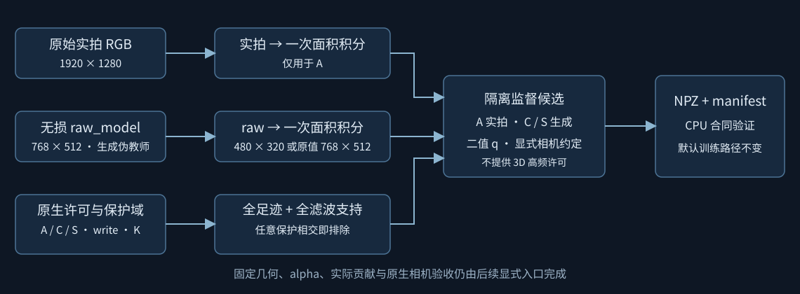

# 二维教师监督 CPU 接口与审查

任务 `ROAD-2D-TEACHER-HF-CPU-20261119`。这是独立、显式启用的二维监督候选；未改动原三维高斯渲染、训练器或已有监督，未启动 GPU、推理、训练或电源操作。

## 实际路径与分辨率

权威代码位于 `/root/autodl-tmp/motion_proj_v82_gn11_v42`；近期实际运行实现位于 `/root/autodl-tmp/drivingeditor_repro/campaign/road_multiscale_material_20261118_r1/code`。`/root/autodl-tmp/motion_proj` 的当前 checkout 不能替代该权威代码。

- 原二维模型输出是无损 `raw_model`，768×512。历史 `road_mask_decoupling_20261116_r1/code/run_fixed_inpainting.py:159` 生成模型图，`:167` 将其双线性放大为1920×1280 `raw_native`，此时尚未与实拍回贴。
- `scripts/worldsim_v82/drivingeditor_dynamic_edit/road_asset_supervision.py:189` 定义原生4×4整像素足迹均值；`:229` 从原生实拍构造 A，`:230` 从放大后的 `raw_native` 构造480×320 C。因此实际链是768×512 → 双线性1920×1280并量化uint8 → 4×4平均480×320。最后一级训练内没有再次resize。
- `road_capacity_cpu_20261117_r1/supervision_code/road_asset_supervision_v4.py:64` 在旧监督上更新A/C/S路由，`:78`—`:91` 从原生冻结阴影域到输出全足迹S；`target_S_srgb` 复制旧 `target_C_srgb`。因此共享材质高频分支没有得到768原始图监督。
- `road_multiscale_material_20261118_r1/code/probe_multiscale_native.py:25`—`:40` 读取候选监督，实际固定alpha>0.9后形成stage0包，并复制三个RGB目标。
- 同目录 `train_world_material.py:79`—`:83` 直接装载320×480目标；`:112`—`:115` 做实际预乘道路RGB相对于`fixed_alpha × teacher`的A+0.5C+S损失。固定几何和alpha、每域归一化均属于原合同。本接口不重解释这些合同。

这证明监督链在进入共享材质前已限制二维带宽，不能据此推导三维表示本身的高频上限。直接面积积分480仍有输出Nyquist上限；直接保留768原值才保存模型原始像素，不能保证生成内容正确，也不自动授权改变三维训练分辨率。

## 独立实现

`teacher_supervision_cpu.py` 只依赖NumPy和Pillow，不导入Torch、场景或renderer。

`build_supervision` 要求显式输入无损raw_model、原生实拍、同相机网格的A/C/S、teacher_write、K、protected，及相机K和调用方像素约定。原生C/S必须位于写许可内，A/C/S互斥且不得含保护像素；不从H_input或新生成内容推导新增许可。

RGB以精确非整数面积积分从源图直接到目标；768输出逐值保留raw_model/255，480直接由768积分得到。A始终由原生实拍直接得到。掩膜不进行阈值近似：目标足迹内每个相交原生像素必须获得许可，任意K/protected相交即排除；C/S还要求所有非零滤波权重涉及的raw_model源像素，其整个原生足迹均位于同一合法域。最后条件会额外缩小边缘，避免“目标足迹合法但滤波读入域外像素”。

输出中的`q_*_2d`仅表示二值像素监督资格，不是教师正确率，也不是材质高频H许可。A的来源是observed，C/S的来源是generated pseudo teacher。必须保留父资产高频政策；本包不增加任何三维高频授权。

### 相机合同

相同视场的像素索引映射统一为`u_out=s*(u_in+.5)-.5`。若调用方K定义在半整数中心，即射线使用`[x+.5,y+.5,1]`，则`K_out=diag(sx,sy,1)K`。若调用方K使用整数中心，则`cx_out=sx*(cx+.5)-.5`，cy同理，且焦距/斜切按对应行缩放。接口没有默认约定，x/y分别缩放。

实际四个候选包显式选择了**假定half_pixel**，来源是旧CPU `road_asset_supervision.camera_rays:35` 的x+.5实现，以及旧CPU相机行缩放。这个来源不能证明原生raster在新分辨率下的约定。manifest明确`camera_convention_assumed=true`、`actual_raster_camera_convention_verified=false`。CPU射线代数一致性只验证所声明的两种公式，不是GPU验收。

## 实际构建与计数

最新候选位于 `actual_packages_r2`，r1保留用于构建过程审计。原生S由原冻结shadow_field、routing policy及other_shadow_prediction精确重建，没有调整阈值：high=0.6，uncertainty gate=0.35，association gate=0.35，原教师W_guard保持原值。

| raw | 输出 | A候选像素 | C候选像素 | S候选像素 | C额外滤波支持剔除 | S额外滤波支持剔除 |
|---|---|---:|---:|---:|---:|---:|
| 86 | 480×320 | 39184 | 5444 | 971 | 104 | 72 |
| 110 | 480×320 | 34339 | 10245 | 2018 | 120 | 126 |
| 86 | 768×512 | 101170 | 14349 | 2780 | 0 | 0 |
| 110 | 768×512 | 88505 | 26654 | 5643 | 0 | 0 |

这是二维来源许可，尚未交固定世界几何、retained projection guard、alpha和实际renderer贡献。不能与旧训练A16904/C10830/S3131分母直接比较。新包没有fixed_alpha，也没有伪造原生行贡献证明，`training_ready=false`。

## 接入与验证

单包重建：`python teacher_supervision_cpu.py --config CONFIG.json --output NEW_DIRECTORY`。真实两帧四包构建器是`build_actual_cpu.py`，需显式提供教师报告`assets/readability_20261118`、`inputs`和新输出目录。上传远端后，重建配置的本地来源路径须改为真实可读的远端来源；不能把本地绝对路径当作远端可复用合同。

原480入口若后续显式比较新重采样，只能将新二维候选mask与原固定几何/保护/alpha资格取交集，并单列新的共同分母；不能以q_2d替换原资格。768包只准备监督，不能缩放旧alpha、scope、行贡献或retained guard伪造高分辨率资格。实际renderer和相机必须重新验收，三维渲染算法保持原实现。

CPU测试命令：`python -m unittest -v test_teacher_supervision_cpu.py`。7项测试通过，覆盖原值/面积均值、非整数滤波、filter-support越界反例、保护边界、A真实来源、两种像素坐标约定和预乘损失/空域处理。真实768两帧逐值等于原raw_model/255；两种相机公式的射线代数最大误差1.11e-16。另完成本地CLI构建重放，全部NPZ数组与API构建逐值一致。

远端隔离验证也已完成：在已有0.5CPU/2GB cgroup内、线程1且`CUDA_VISIBLE_DEVICES=`，7项测试通过；由远端历史predictions/prepared记录解析真实raw_model和observation路径，再通过CLI重建四个包。每个包全部数组逐值exact、最大绝对差0、域计数完全相同。远端证据位于当前隔离campaign的`supervision/cpu_remote_validation.json`，已取回本目录同名文件。`supervision/imported_r2`保留数值原包，其重建配置已改为真实远端来源；`supervision/cpu_rebuild_r1`保留重建包、配置与日志。

## teacher_pilot.py 只读审查

已对比`work/teacher_audit/teacher_pilot.py`与历史`run_fixed_inpainting.py`。模型载入精度、LoRA构造/装载、DDIM、20步、CFG3、eta0、种子与deterministic/TF32设置一致；旧模型调用未显式传strength，其默认值等于新调用的1。GPU行为仍须首个历史精确重放证明，当前没有声称通过。

审查发现并已由教师准备负责人修复执行前绑定检查遗漏：preflight补查了`legacy_predictions`、每case的`legacy_B_expected`三图，以及每个VAE control的`visible_native`，避免已知可见域度量或历史重放参照在prepare之后被替换而未被发现。已只读确认本地源码版本`348214149d3b`包含这三组检查；本审查未修改教师代码，仅检查CPU准备路径。实际GPU历史重放仍未执行，不能据此宣称GPU接线验收通过。
