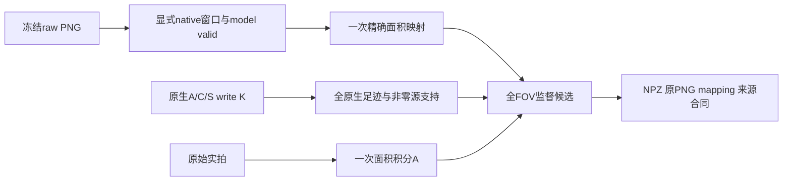

# 显式视图的二维监督适配器

新文件`teacher_supervision_view_cpu.py`复用未修改的`teacher_supervision_cpu.py`通用保存/相机工具，不修改旧CPU包、三维渲染或默认训练入口。模块只依赖NumPy与Pillow。实际包始终标记`candidate_only=true`、`training_ready=false`。

## 支持的固定视图

| 源视图 | 权威源尺寸 | 原生窗口 | 输出全FOV尺寸 |
|---|---|---|---|
| full768 | 768×512 | [0,0,1920,1280] | 768×512原值、480×320 |
| full1152 | 1152×768 | [0,0,1920,1280] | 1152×768原值、768×512、480×320 |
| crop768 | 768×272 | [0,600,1920,1280] | 最多768×512，以及480×320；crop外无效 |

`native_from_model`映射像素单元边界：`native_center=T@[model_index+.5,1]`。固定view的模型尺寸、窗口、矩阵三者必须一致。相机K仍是输出完整FOV的调用方显式约定；支持half_pixel和integer_center，实际raster资格不由该代数映射证明。

## 采样与许可

源模型像素和输出像素都视为原生相机坐标中的矩形单元。目标RGB为所有严格正交面积的权重和，权重=交面积/完整输出像素面积；边界与支持用整数有理区间计算，再以float64权重执行一次可分离面积积分，存float32。每档直接由原始源图生成，不能经768再生成480。源级输出逐值等于raw_model/255。

C/S候选要求：输出原生足迹完整位于同一授权域；所有非零滤波权重源像素的整个原生足迹也位于同一域及teacher_write；显式`source_model_valid`全部为真。任意K/protected足迹相交即排除。部分crop覆盖、crop外和invalid源支持均无监督资格；其RGB存零占位，`source_RGB_valid=false`，零值不代表预测。

A始终从原始完整相机实拍一次取源，允许在crop外保留合法A；不从教师生成A。q_A/C/S_2d仅是二值像素资格，绝不是教师正确率或世界材质H许可。原父资产高频政策、真实观测来源要求和所有世界许可保持不变。

## API 与保存

`build_view_supervision`必须显式提供`source_model_valid`、`native_window_xyxy`、`native_from_model`、原生domains和相机约定。`fixed_view_spec(name)`给出三种冻结view的矩阵与窗口。`save_view_package`保留NPZ、manifest、原PNG字节、原模型valid PNG及`source/view_mapping.json`，不会把补画布当原始模型输出。

CLI：`python teacher_supervision_view_cpu.py --config CONFIG.json --output NEW_DIRECTORY`。配置字段为raw_model、observation、native_domains、source_model_valid、source_kind=lossless_raw_model、output_wh，以及camera和view对象。每个实际包均保存可复用的`rebuild_config.json`。运行时同目录需有旧工具模块，或将其目录加入PYTHONPATH。

## CPU验证与实际包

本地与远端均通过8项合同测试，包括非整数面积、600原生偏移、部分crop足迹、invalid源孔洞、非零滤波支持、K任意相交、固定crop尺寸、拒绝crop上采样、1152源级identity、与旧全帧接口逐数组exact及CLI原PNG/mapping保留。

`verify_frozen_views_cpu.py`只读原生角色图与冻结manifest，没有读生成RGB或隐藏真值；6个任务×3视图全部W落入窗口，480/768及full1152源级共42项输出支持检查通过。证据为`frozen_six_W_cpu_validation.json`。该覆盖检查不等于世界几何/alpha/实际渲染贡献资格。

`build_gpu_supervision_paired.py`固定比较full768_T0与full1152_T0，raw86/110、seed101/202统一方法，不按每图/seed挑优。baseline的source级768与768档去重，产生20包。新1152原值档保留源级带宽；768和480只是各自降采样接口。包来源沿用原imported_r2的native_domains；共同资格像素数另列，不以分母变化宣称教师质量改善。baseline seed101四个包还要求与旧CPU r2全部原数组exact。

实际构建器只接受complete48冻结预测、6个历史精确重放通过的输入；构建过程不导入Torch，不启动GPU或原生三维前向。方法是否晋升由固定逐case/seed评分和原生图审查共同决定；本包本身不自动替换默认资产。
