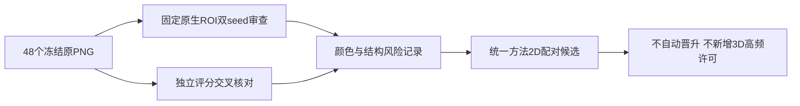

# GPU预测后的独立复核

已查看6case、两seed、四arm全部48个原始raw_native ROI PNG，未用WebP判断颗粒。审查拼图在`sheets/`，严格复用导出时固定的W bbox+96原生窗口，没有改变图像像素。逐case记录在`visual_observations.json`；该记录不代填human_verdict，也不自动替换资产。

直接由冻结`scores.json`重算得到：合成核心原生ΔE76均值2.357102→2.128535，8/8配对下降；共同三频带平均绝对log2功率比误差1.435787→1.106911，仅4/8配对下降。000_v1两seed的共同频谱误差都回退。数值与root摘要一致，没有把两张底图的四任务当独立n=4。

1152的关键限制仍然清楚：050_v1 seed101出现延长的斜白线，seed202出现一串新白色短划，与clean不同。050_v0 seed101则避免了baseline的大块假白标记。收益不能概括为所有case/seed的真实纹理恢复。base与crop在多个合成例出现额外条纹、矩形斑块或线形路面结构，这也是高频能量不能单独作为质量目标的直接图证。

真实086/110的生成道路仍有棕/粉色倾向和较大尺度色块，原生颗粒是否正确无法由无真值孔洞认证。raw110 base202可见白色涂写状结构，crop202出现黄/白线，显示强seed/方法不稳定风险。raw图中保留车也被模型重构，不能把其W外变化说成最终K破坏；已冻结最终回贴的W外/K保持是另一条明确工程证据。

现阶段保留uniform full1152_T0与full768_T0及两seed的20个配对包，作用是后续监督与传递诊断，不能按每图挑选“最好”的输出。source级1152原值、768与480直接采样档均保留；baseline源级768与同档去重。源图、valid、mapping和原始授权域都在包内/引用合同中保留，三维几何、alpha、实际贡献及高频材质许可没有因此获准。

适配器验证：本地/远端8项CPU合同通过；6W×3view、42个输出支持检查通过；20个实际包构建完成，8个源级目标与原PNG/255逐值exact，4个baseline seed101包与旧CPU r2全部原数组exact。2D许可因格点/全滤波支持而改变，既可能增也可能减；已单列共同分母，由pixel负责人只在全部方法/seed/输出共同完整tiles上分析传递。

源码与运行路径：`work/gpu_20261119/supervision`；实际20包位于远端campaign的`supervision_gpu_r1`，取回构建凭据为本地`supervision/gpu_pack_build_receipt.json`。本子任务没有额外GPU或三维调用。GPU主队列、追加VAE精度诊断、最终报告/Git/取回与资源收口由root统一记账。
