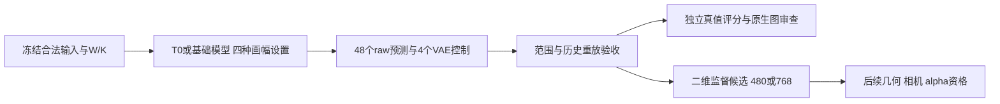

# 冻结教师 GPU 阶段独立审查

任务：`ROAD-2D-TEACHER-HF-CPU-20261119`。本审查只读已有源码和冻结manifest；GPU执行、工程修复、队列与收口由root负责。本文件不启动GPU、不改变三维渲染、方法或默认资产。

## 当前审查结果

`prepared_r2/pilot_manifest.json`冻结6个任务、seed101/202与4种arm，共48次扩散推理。前6个为全部case的`full768_T0 seed101`历史精确重放；4个VAE encode/decode控制单列，不调用UNet。模型、rank4注意力LoRA、DDIM20、CFG3、eta0、strength1、bfloat16及原W/K均固定。已确认CPU预检核验runner、来源、VAE参考/可见mask与历史三图绑定。未发现新的必修代码错误。

GT评分配置未进入生成manifest；VAE参考来自合法实拍，只进入VAE控制，实际UNet仍仅接I_geo/H_input。GPU结果在全部完成并通过像素范围与逆变换门之前，不进入独立隐藏真值评分。该隔离不使既用过的合成诊断集成为盲测。

## 公平性与归因

| 比较 | 实际改变 | 可以回答 | 不能回答 |
|---|---|---|---|
| full768 T0 / base | 开关当前已拟合adapter | 当前T0相对基础模型的作用 | 所有注意力LoRA是否适合纹理 |
| full768 / crop768 T0 | 画幅、全局上下文、latent高度；保持2.5 native px/model px | 固定原生像素尺度下的画幅设置效应 | 单独的遮罩面积因果、更多道路像素带来的收益 |
| full768 / full1152 T0 | native/model像素倍率2.5→5/3、latent尺寸、计算量 | 提高生成网格的总体结果 | 等计算收益、独立分离VAE/UNet/输入重采样贡献 |
| VAE 768 / 1152 mode | 合法已知道路的压缩/重建尺度 | VAE与重采样的已知区域误差 | 隐藏道路真值、完整扩散条件sample的表现 |

实际六case中，crop768与full768的W、H和C_mat模型像素计数相同；它们像素倍率和合法道路内容没有增加。不能把crop改善写成“更多道路上下文像素”。full1152模型像素数为full768的2.25倍，其潜在内存/时间按实际记录，不应叫等计算比较。同一数字seed在不同latent形状下不保证同一噪声场。

4个合成任务仅来自两个底图，seed是重复采样，不扩大独立场景样本量。真实065孔洞无真值，只记录相邻材质参照与已知可见道路保持。禁止选择单个好seed作主结论或按生成图重选texture mask/tile。

## 结果审查原则

先看完成性、历史像素重放、W外/K保持、候选valid和固定逆变换，再看画质。颜色用RGB/Lab同域误差与有符号偏移；纹理看固定物理图块的频段偏差，同时看假标线、周期条纹、斑块和透视方向。HP/PSD增加不能单独视为成功，RMS ratio接近1也不能证明真实材质或空间结构正确。

图像统一由无损raw_model/raw_native及固定原图窗口构建；禁止以回贴图的W外原图锐度评估生成清晰度。指标的合成核心、纹理安全域和边界域分开保留，不能混分母。GPU成功与任何二维监督包均不代表三维renderer、coverage或alpha资格通过。

## 当前接口边界

完整视场full768/full1152原图可用现独立监督接口直接生成480/768候选；A仍由原始实拍单次采样，C/S标为generated。现接口拒绝crop768×272与完整相机宽高比不一致的输入，这是必要保护，不能为复用接口而直接拉伸。

crop若后续需要监督包，必须显式携带原生窗口`[0,600,1920,1280]`、valid footprint与对应像素中心映射。不能把旧480监督放大为768，也不能无条件填充图像后冒充完整raw_model。任何新q_2d只表示像素监督资格；父资产mH/材质来源与高频写许可不扩张。

状态：源码/契约只读审查通过，等待本轮实际PNG和评分结果后做逐图审查；尚无GPU画质结论。
