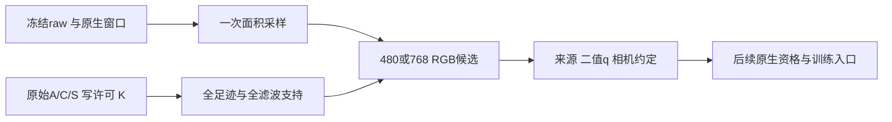

# 480 / 768 监督可用性提案

本提案不修改代码或默认三维入口；在冻结预测与独立质量审查后，才能选择是否构建新的隔离二维候选。

| 教师输出 | 当前接口 | 必须保留 |
|---|---|---|
| full768 768×512 | 可直接输出768原值或480面积积分 | 完整视场、原teacher_write、K和来源 |
| full1152 1152×768 | 可直接面积积分到768或480 | 原生像素中心、每轴尺度、滤波源支持与新的输出mask |
| crop768 768×272 | 当前必须拒绝作为完整视场输入 | 原生窗口[0,600,1920,1280]、有效范围、原始相机K及window偏移 |

现有两个分辨率包是二维来源许可，尚未与固定世界几何、retained projection guard、alpha或实际renderer行贡献取交集。任何新旧目标的480比较应在同一固定资格域取交集，单列共同像素数与剔除项；不能把扩大或改变分母得到的指标差解释为目标图质量提升。

若将crop结果用于监督，应增加显式window-aware接口：按source模型像素单元映射到原生窗口，再从其与目标像素的交集计算面积权重；目标RGB滤波支持必须完全落入source valid。许可同时在原生域及所有非零源像素支持验证。保留crop原文件为权威源，不能把拼接/填充画布标为原始完整raw_model。当前冻结模型网格与crop窗口在y方向对齐，但该特例不能替代显式坐标合同。

full1152→768也不能声称768具有1152完整带宽，两个候选必须从1152原图各自直接生成，不经768再到480。颜色统一沿用sRGB appearance，不拟合曝光或白平衡，不从低alpha预乘RGB除法获得监督。A始终取真实实拍；C/S始终是generated pseudo teacher。

q_2d不是生成正确率，更不是世界材质H许可。父资产的真实观测来源要求、mH、世界写许可、K保护与几何规则保持原合同；二维预测即使视觉更锐利也不会获得新增高频材质写许可。768监督资格不等于768原生raster相机、coverage或alpha已经通过。

本轮是否构建额外监督包由root结合固定48结果决定；不能在检查结果之前挑seed、扩张W或替换默认资产。
