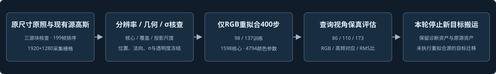

# 源块质量核查与源颜色修复对照

**来源纠正（ROAD-NATIVE-SOURCE-CORRECTION-20261122）**：本组主00／02路块来自加工道路`road_surface_residual_20261121_r2/appearance_fit/asset`。原始历史数据与数值保留为加工道路对照；不作为未编辑原生重建源迁移证据。[原生来源与可见集合历史诊断](../road_native_source_transfer_20261122/README.md)。

当前“直接搬运现成源高斯”的版本未成功。进一步固定几何、尺度与不透明度，只用真实照片重拟合源块颜色400步，仍未恢复跨视角细纹理。因此停止搬运这份修复候选，不增加目标区拟合步骤。

运行：`road_gaussian_source_quality_20261122_r1`；最终颜色诊断：`source_rgb_refit_qualified_r2`。原HTML同页增加“源块质量核查”，原58条阶段、55条历史记录与744条历史指标保留。所有原源资产保持原样，新扩散调用0，目标迁移0次，GPU保持开机。

## 源块为什么差

此前显示的是1152×768报告栅格中的188×56裁片，桌面主对照放大约2.43倍。新核查使用真实1920×1280相机和原照片，默认按100%显示，200%与400%使用最近邻并标注倍率。排除显示放大后，源高斯本身仍有问题。

源块00/02的中心间距约2厘米，两个切向σ均为1.3厘米；源00在1920相机的核FWHM长轴约6–8像素。源00相对诊断局部平面的高度残差RMS为1.44厘米，p95约3厘米，法向相对图表法向偏角p95为22.57度。这些是需要核验的几何起伏，不将局部平面自动当真值，也不据此直接压平源资产。

110帧源00的细频带相关很弱、能量却过量；隔离源块与完整道路在核心的颜色差约10⁻⁵。因此它既有细节受限，也有不对应的高频，不能靠锐化、缩小σ或调曝光自动解决。尺度应与真实采样频率相配；[Mip-Splatting的原论文](https://openaccess.thecvf.com/content/CVPR2024/html/Yu_Mip-Splatting_Alias-free_3D_Gaussian_Splatting_CVPR_2024_paper.html)讨论了这一采样约束，本实验未启用其滤波器或宣称完成复现。

## 原照片是否还有更好的参考

对当前3个候选完成199帧CPU扫描。源00合法原照131帧，核心最短投影轴最高58.46像素；源01/02的上限约35.26/33.08像素。源00的98/137帧基线约1.17米，137/173仅约8.43毫米；大量近重复帧不能当独立多基线信息。

原检索17→4→3来自约3.45平方米强合格世界网格，以及五个查询相机的缓存资格；原生核验只选00/02与86/110。它没有穷尽街段源库。更清晰照片与稠密测距支持分开记账：137帧源00只有12/339个独立4厘米格有旧严格见证。照片资格以核心为准，halo中的车辆边缘不进入洁净监督。

同一源块的原照经继承pinhole及源图表平面/原GS高度近似对齐后，137/173在5毫米UV频带的对应度也仅约0.05–0.06。当前尚未形成稳定的细纹理多帧对应；这项诊断没有分离几何、相机模型、采样与传感因素，不能把细高频全部归为真实颗粒或噪声。

## 固定源颜色400步

训练使用98/137原照；86/110/173为本次优化未使用的查询视角。全部属于历史BUILD资料，不把本轮查询角色写成独立场景测试。仅放开源核心1598个高斯的4794个RGB参数，halo颜色、XYZ、法向、σ与不透明度逐值冻结。Adam学习率0.01，原源RGB平方先验权重10⁻⁴；固定核心内缩5像素、初始α≥0.95，并与实际照片的道路/车辆/阴影代理资格取交集。

下表高频指标统一采用1920栅格σ=5/3像素，比较同一物理频带和冻结mask；数值为更新400次后的实际导出。

| 查询帧 | 颜色MAE：原源→修复 | 高频对应度：原源→修复 | 高频能量比：原源→修复 |
|---|---|---|---|
| 86 | 0.01542 → 0.03514 | 0.266 → 0.010 | 0.972 → 0.671 |
| 110 | 0.02177 → 0.00698 | 0.139 → 0.044 | 1.738 → 0.981 |
| 173 | 0.03357 → 0.01324 | 0.052 → −0.016 | 2.266 → 1.208 |

110帧颜色变近、能量变得接近1，纹理位置却没有对应上；三个查询视角高频对应度均下降。该控制未提供可搬运源材质改善的证据，不将训练误差下降或能量增加当作成功，也不把仅颜色重拟合称为完整源三维重建。

## 执行与恢复

采用的正式源更新400次，短程与恢复探针6次丢弃。较早一次406更新因没有完整相交照片合法mask而未采用，旧数据/状态保留；中间接线失败在1次前向后退出、更新0。总实际源更新812次，其中正式400、未采用412；原尺寸核验及源诊断累计1663次原生前向、1624次原生反向，新扩散0。这与前一轮目标区400步及其资源分别记账。

源颜色控制在短程中覆盖真实前反向、非空Adam保存与下一更新恢复，最大差5.96×10⁻⁸。最终完整状态、源块NPZ、实际PNG/float、199帧资格与独立CPU审计全部保存。原资产和默认场景未改动；最终采用目录由selected_run.json指定。远端根目录为`/root/autodl-tmp/drivingeditor_repro/campaign/road_gaussian_source_quality_20261122_r1/`。

复查入口：`python code/refit_source_rgb.py`是固定400步执行器，已有输出会拒绝覆盖；CPU审计脚本与本次精确输入、已执行状态随资产包保存。恢复时先按清单还原原父资产与继承渲染环境；既有最终记录用于读取，不重复训练。人工verdict与problem_solved保持null。failure_ledger_refs=[V82-F06]；failure_ledger_delta=updated:V82-F06。

后续只有先得到跨视角材质保真通过的源资产，才有理由重新测试相同搬运核。可研究的前提是更好的源库，或以真实多帧重新估计源块几何、尺度和材质；当前没有这两条路径已经奏效的结果。

免责声明：本轮否定的是当前现成源块及固定形状的颜色修复控制，不能据此物理否定全部相似材质迁移方法；原照片细纹理的几何/相机一致性与完整源资产重建尚未解决，目标隐藏道路没有独立真值。
