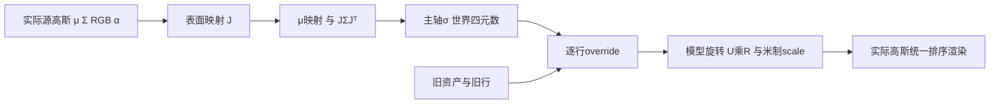

# 道路高斯显式旋转接口

共享实现：`/root/autodl-tmp/motion_proj_v82_gn11_v42/scripts/worldsim_v82/drivingeditor_dynamic_edit/v44_factory.py`。

新增可选字段：

- `gaussian_rotation_world_wxyz`：完整世界行顺序的 N×4 unit quaternion，wxyz。`gaussian_sigma_m` 是该旋转三主轴的米制标准差，第三轴与归一化 `normal_world` 同向。
- `gaussian_rotation_world_override`：可选 bool[N]。False 行仍按旧模型法向 shortest-arc 计算，保持既有 q 的数值路径；有 quaternion 但无 mask 时全部行启用显式旋转；无 quaternion 时不能单独提供 mask。

模型旋转为 `R_model = U_model_from_world @ R_world`，其中 `U=M[:3,:3]/meter_to_model`。尺度仍为 `sigma_m*meter_to_model`。实际引擎 `waymo_val065_allframes10k_20261109_r1/engine/utils/v4_road_render.py` 在预计算协方差分支和原生 scales/rotations 分支均读取这份旋转，不需要改 CUDA。

旧行完整世界旋转由 `_legacy_road_world_quaternions(normal_world, model_from_world, meter_to_model)` 构造。它先重放模型坐标 shortest-arc，再用 Uᵀ回世界；直接对世界法向做 shortest-arc 会改变各向异性行的切向基。逐行 override=False 用于避免 quaternion 往返舍入触及旧行。

表面迁移建议采用 `J = B_target @ blockdiag(A_2D,h_normal) @ B_source.T`，使切向和法向解耦；切向 2×2 协方差做特征分解，第三轴保留目标法向。当前资产有8982个active切向各向异性行；第三轴也不一定是最小特征值，不能用全3×3特征值排序猜法向。

CPU验收在 drivingeditor 环境通过：实际R2资产无字段及全False override时 xyz、scale、rotation、RGB、opacity、active逐 tensor exact；显式旋转往返最大误差2.95e-8，协方差相对误差4.38e-8，JΣJᵀ迁移相对误差5.76e-8。形状、NaN、非unit/零 quaternion、法向不符、非正sigma、错误override类型/长度和缺quaternion均有拒绝检查，空资产可加载。收据：远端新run `runtime/rotation_validation.json`。

安装前共享文件已核对与暂存一致；原文件备份为新run `runtime/v44_factory.remote_before.py`，仅局部上传该factory，`git diff --check`通过，未提交。

实际源块原照检查入口：新run `runtime/source_block_inspection_entries.json` 保存现有高斯世界行ID、源照片、原生UV/ROI和fresh证书路径。例如395个现有高斯可对照原照 `.../inputs/image/image_0/0065090.png` 的 `[1482,1129,1634,1181]` ROI。该块历史source1/2为180/215；当前颜色对历史观测MAE约.0973。R2全source1组当前RGB对历史观测MAE约.1224，来源标签不自动证明当前已优化颜色仍等于实拍。该JSON只建立实际高斯块与原照的检查入口，没有以低频均值替代块纹理。

免责声明：本项只进行了CPU ABI与协方差验收，未调用GPU、未新增扩散或训练、未改旧资产；原生零override渲染等价性由root的新smoke核验。一般三维shear若产生切向—法向交叉协方差，不符合本轮“第三主轴为表面法向”的接口合同。
