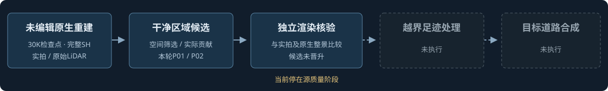

# Scene065原生源核验与来源纠正

此前00／02源块取自道路补全、外观拟合后的RoadRows组件。撤回用这些实验判断未编辑原生路块迁移可行性或失败的结论；历史数值保留为加工道路对照。R2另列的两组native_static诊断保持其原生来源身份。

本轮直接读取未编辑30K重建，从实拍重新选出P01／P02，并用原始LiDAR确定物理位置。实际渲染贡献取材能忠实复现原生重建；但两处原生重建相对实拍仍偏亮、细纹理不足，且供材核有显著跨区足迹。候选未晋升，未执行足迹加工或目标合成。

[唯一原HTML报告](http://127.0.0.1:18765/index.html#native-source-correction-results)。task=`ROAD-NATIVE-SOURCE-CORRECTION-20261122`，run=`road_native_source_transfer_20261122_r5`。

## 来源与取材

源为`waymo_val065_allframes10k_20261109_r1/continuation30k_20261109_r1/formal30k/chkpnt30000.pth`，静态Gaussian共1,558,011行。原训练记录明确editing_run=false、new_editing_allowed=false；模型及原生引擎与既有训练绑定一致。源加载不经过加工道路或编辑场景。

按原照片目视选出P01 raw110／P02 raw137清晰沥青；照片不改色。原Brown照片仅在比较时按相机模型重采样到针孔域，原照片另行保留。原生期望深度的定位对照产生错误倾斜平面，因此以原始LiDAR替代定位；源Gaussian仍直接来自原检查点，完整保留SH、参考时刻的几何、形状和opacity。

空间中心与3σ支持相交取材均会遗漏实际供材核，完整核心没有alpha≥0.95像素。唯一后续取材控制用原生渲染对颜色的梯度测量每行alpha×T贡献，保留99.95%贡献质量；只测量两次，不更新任何参数。source row ID可追溯到原检查点。

## 独立渲染结果

以下为两处参考视角、同一针孔域的内缩5像素评分。全部原生独立集合无二维遮图mask；完整集合足迹另列。

| 候选 | 原生行 | 保留贡献质量 | 源／原生整景MAE | 源／实拍MAE | 源／实拍HF幅度比／相关 |
|---|---:|---:|---:|---:|---:|
| P01／110 | 351 | 99.9507% | 0.0001252 | 0.040717 | 0.287／0.0128 |
| P02／137 | 3725 | 99.9500% | 0.0000542 | 0.045076 | 0.490／−0.00375 |

HF为σ=1针孔像素的高通。三视角110／115／137的贡献集合核心alpha≥0.95覆盖均为100%，NPZ实际重载RGBA完全一致。源／原生整景误差小，说明提取忠实；原生整景与实拍本身仍有亮度及细节差异，本轮未进行曝光、颜色或几何拟合。

P01的供材核中心范围为76.1×27.4×10.4米、最大标准差18.17米；P02为9.07×12.54×5.07米、最大标准差10.68米。完整图像内的alpha质量在物理核心之外占97.24%／91.66%。这些集合尚不能视为局部道路资产；局部像素重现与足迹局部化分别验收。

## 工程控制与资源

旧CUDA硬near=0.2模型单位，对本模型约为10.61米。直接入口漏接既有公制适配，导致近处原生行被剔除。本轮保持持久包不变，复用v44_metric_raster统一缩放Gaussian和相机读出；同尺度整景与源包配对，旧near可见行集合等价、SH方向和投影协方差均单独核验。原始尺度对照保留。

合计116F／2B；2B仅实际贡献测量，参数更新0、新扩散0、目标更新0。发现4F，期望深度定位控制30F，LiDAR旧尺度30F，公制与旧near配对34F，实际贡献取材18F／2B。两个CUDA入口前失败各0F，代码和现场保留。GPU保持开机。

所有原生源包、原始行ID、相机／LiDAR定位、独立核验及原生渲染记录保留。取回包含关键小资产和精确focus浮点；大量重复的完整裁片浮点原样留在远端并列出恢复入口。原生完整模型沿用已核验模型保留位置。

下一步仍在源质量阶段：先找到或修到足够忠实的原生源块，再处理越界足迹，最后与目标道路合成。人工verdict与problem_solved为null，沿用V82-F06。

免责声明：仅核验两处候选；结果不代表全部街段的源材质质量，也不构成原生高斯迁移方法的整体否定。
