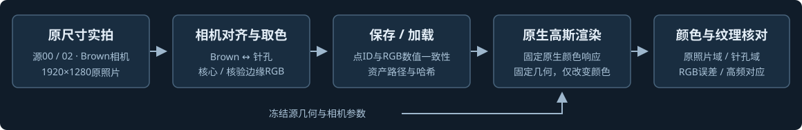

# 065源材质保真：00／02实拍与高斯颜色链路

**来源纠正（ROAD-NATIVE-SOURCE-CORRECTION-20261122）**：本组主00／02路块来自加工道路`road_surface_residual_20261121_r2/appearance_fit/asset`。原始历史数据与数值保留为加工道路对照；不作为未编辑原生重建源迁移证据。两组独立native_static直接来自formal30k静态checkpoint，保持原生静态对照身份。[原生来源与可见集合历史诊断](../road_native_source_transfer_20261122/README.md)。

本轮优先解决源材质，不进行目标迁移或融合。人工核验后，选择02／115作为较佳实拍参考，117复核；00／137保留对照。本轮固定几何的单参考取色和颜色算子求解能减轻偏色，但00／02未通过该设置下的多视图纹理保真检查，未晋升为可迁移材质。多帧参考池与随机采样400步训练另在r3对照验证。

任务 `ROAD-SOURCE-FIDELITY-20261122`，运行 `road_source_fidelity_20261122_r2`。原报告同页增加“源材质链路诊断”；58条阶段记录、55条历史记录、744条历史指标和旧源质量核查保留。人工verdict与problem_solved均为null。

## 实拍选择

00的物理核心为0.8米方形，02为0.6米方形。先按100%原生1920×1280像素显示，再在相同0.6米物理区域比较，避免由显示宽度或原生总像素数决定胜负。110帧02的高频标准差比00高约28%，Laplacian方差约高49%；两者均无曝光剪切，均为低对比沥青。02／115与117核心通过道路、动态物体及车辆阴影代理资格，117相对115约有9厘米相机基线。00／137与134仅约1.05厘米基线，不作为独立多基线证据。

该选择仅表示照片参考较好，不能直接证明对应高斯已合格。完整8条相机、核心掩码、资格与裁片见photo_audit；旧199帧扫描只覆盖现有候选，不宣称穷尽街段。

## 分段定位

1. **当前源RGB已是历史拟合结果。**00／02的packet颜色与当前road资产逐值一致；它们经历过此前外观拟合，不能把当前RGB当作未经改动的实拍取色。旧高斯逐行取材UV缺失，但另存的查询见证UV仍可重放；二者分别核验。
2. **本次写入与加载没有新增偏色。**直接取色保存、重新加载后的行RGB与实际渲染逐值一致。原生常色控制误差最大约4.2×10⁻⁷；渲染RGB按alpha归一化后评估，核心与halo分开显示。没有发现SH转换、NPZ精度或半像素约定不一致。
3. **原始照片与渲染相机模型不一致。**原Waymo FRONT JPEG解码与输入PNG逐像素相同，输入保留Brown畸变；原生相机使用针孔模型。两块源的投影差可接近1像素。校正对照保持所有高斯几何不变，将照片确定性映射到针孔域，并把原生渲染反映射回未插值的原始Brown照片域验收。
4. **直接写入点颜色仍有核混合损失。**照片在高斯中心取样后，实际渲染会混合邻近高斯；逐点颜色取样不等于逐像素纹理复现。固定形状的每高斯RGB能力通过实测原生线性响应进一步检查。

## 固定几何的颜色强控制

分别在02／115、00／137测量原生颜色响应算子：每次渲染以三个RGB通道测三行one-hot颜色，实际alpha、中心、法向、尺度、旋转、opacity及halo颜色全部冻结。算子对实际渲染的一致误差小于3×10⁻⁷。

求解约束为RGB∈[0,1]，目标为平均像素平方误差，加权10⁻⁵的直接取色RGB先验；使用SciPy有界线性最小二乘，固定tol=10⁻⁷、lsmr_tol=10⁻⁸、max_iter=100、lsmr_maxiter=2000。相机校正分支复用同一算子，未重新测量basis。它是颜色反演控制，不是追加Adam训练。参考以外的列出视角不进入该源的求解，全部影像仍属于历史BUILD资料。

原始Brown照片域、同一冻结合法域，颜色MAE与HF相关（σ=5/3原生像素）：

| 源与视角 | 角色 | 原源MAE→校正求解 | 原源HF→校正求解 |
|---|---|---:|---:|
| 02／115 | 参考拟合 | 0.03308→0.00442 | −0.0448→0.2654 |
| 02／117 | 本轮未拟合 | 0.03227→0.00764 | 0.0051→0.1691 |
| 02／110 | 本轮未拟合 | 0.03221→0.00868 | 0.0249→0.0393 |
| 02／86 | 本轮未拟合 | 0.00977→0.03553 | 0.1108→0.0667 |
| 00／137 | 参考拟合 | 0.03272→0.00362 | 0.0553→0.3602 |
| 00／134 | 本轮未拟合 | 0.03280→0.00600 | 0.0071→0.1430 |
| 00／110 | 本轮未拟合 | 0.02118→0.01287 | 0.1729→0.1580 |
| 00／86 | 本轮未拟合 | 0.01541→0.05000 | 0.2248→−0.0331 |

参考颜色明显改善不能作为可迁移源通过的依据；86回退、远视角纹理对应仍弱。进一步缩小高频滤波到完全位于合法核心的支撑域，会改善部分参考相关，但评分像素大幅减少，不能代表全块。全部尺度、mask分母及原始/针孔双域结果保留。

## 原生静态源的手工对照

同位置原生static也做只读核验。按中心位于路面附近筛出的107行不能独立覆盖核心，因此改用实际RGB梯度测量选取99.95%参考贡献的950行；无参数更新。冻结参考时刻的prepared几何、opacity和SH后跨视角渲染，未获得清晰纹理。该集合中心相对道路平面的中位偏离约0.32米，最大σ约10.68米，说明可见道路并不一定由中心位于道路上的局部路块表示。此结果仅针对该位置和该集合，不否定其他位置存在更好原生源。

## 状态、资源与恢复

七个实际分支累计918次原生前向、1次原生反向；唯一反向用于静态源贡献测量。源拟合共12个RGB通道有界求解，CPU精度审计另做6通道复解且不写回源资产；梯度优化器更新0、目标迁移0、目标融合0、新扩散0。全部新输出位于独立campaign目录，父资产、旧模型与共享checkout原改动保留；GPU按用户要求保持开机。

02相机校正已完成12F和四帧浮点/PNG，最终JSON因NumPy int64的bbox类型序列化失败；通过已保存浮点、求解状态及日志恢复收据，没有重渲染或重求解。故障代码版本、恢复脚本与recovery_trace同时保留。独立CPU核验包括算子乘积对原生输出、源包非RGB冻结、halo冻结、原图像素来源、相机映射、原生静态checkpoint来源以及恢复收据。

恢复入口见recovery/recovery_usage.json。完整包包含固定颜色算子、线性状态、原生浮点/PNG、全部候选源包、原生静态冻结包、照片资格/标定、源代码与审计。完整父场景/引擎仍通过上一轮归档和外部依赖清单定位，不重复下载。

交付备份分为两个包：主curated包保存本轮实验、恢复现场及报告新增补丁；完整report companion包保存当前原报告HTML与全部历史、本轮资源快照。两个包均逐成员验证，companion只作原报告恢复备份；查看入口沿用原HTTP与原HTML。旧375KB预览结果包不承担完整报告备份职责。

本轮结论：02是较佳实拍参考；本次颜色写入与存储链路正常，历史源RGB和相机模型均需区别处理；本轮单参考固定RGB控制能够改善色调，但目前没有得到通过该设置多视图纹理检查的源高斯。本轮未测试多帧参考池400步随机训练，该对照另在r3记录；源材质对照与迁移、融合分别核验。

免责声明：本轮未穷尽道路源库，也未调整高斯几何、密度或引入每高斯空间纹理表达；结果限定于00／02及同位置原生静态对照。隐藏目标道路没有独立真值，当前不能把参考视角拟合改善写成可迁移材质恢复成功。
