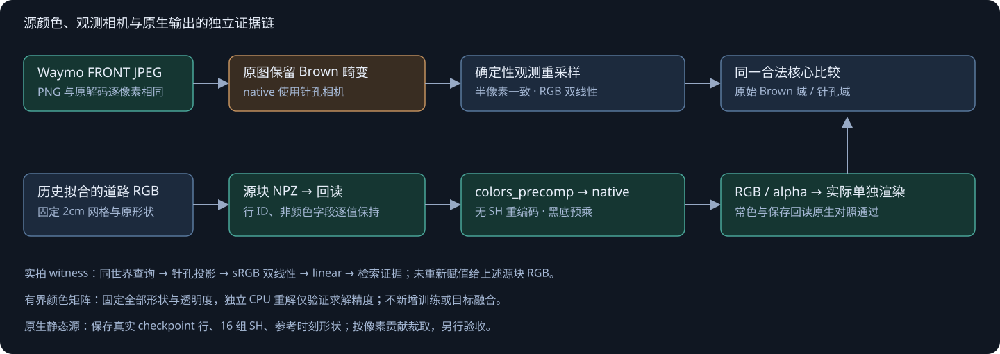

# 00 / 02 源颜色链独立 CPU 审计

颜色写入、NPZ 回读、直接 RGB 着色和半像素约定均未发现可解释当前误差的接线错误。已确认原照片保留 Brown 畸变，原生渲染使用针孔相机。02 的一致相机模型对照改善参考及近邻视角，较远视角仍未达到可用源块水平。整个审计未新增 GPU 调用或训练；唯一远端写入是由已保存浮点输出恢复验收 JSON。

## 颜色来源与写入

| 项目 | 00 | 02 |
|---|---:|---:|
| 核心 / 含 halo 高斯数 | 1598 / 2485 | 900 / 1587 |
| 源包 RGB 与当前父资产一致 | 全部逐值相同 | 全部逐值相同 |
| 当前 RGB 对旧 `row_rgb` MAE | 0.095631 | 0.043988 |
| 当前 RGB 对 `observed_reference_srgb` MAE | 0.099963 | 0.049983 |
| 核心 sigma / m | 0.013, 0.013, 0.003 | 0.013, 0.013, 0.003 |
| 核心最近中心距离中位数 / m | 0.020017 | 0.020017 |

`select_patches.py` 直接从 `road_surface_residual_20261121_r2/appearance_fit/asset/road.npz` 复制 `reference_srgb`。当前两块核心与 residual R2 coverage、adaptive R1 appearance 资产逐值相同；residual R2 未再修改它们。adaptive R1 appearance1200 相对 coverage 修改了 00 的 1530 行、02 的 344 行，RGB MAE 分别为 0.016555、0.007602。更早的 common1152/G_NUMERIC 已经对道路颜色进行拟合。

两块的每高斯 `source_uv_native` 均为 NaN；候选包另存的每世界查询 witness UV 完整。9 帧 witness 重投影最大误差 8.61e-5 像素，按保存的 float32 UV 重做“sRGB 双线性 → linear”与已存 `raw_linear` 最大差 1.27e-6。fresh witness 为检索证据，没有给旧高斯逐行重新赋色。旧账本与有效颜色的差异不能单独当成输出偏色的首因，因为高斯行颜色与混合后的像素颜色并非一一对应。

PIL 读取 RGB/255 不执行自动 ICC 或 gamma 变换；检查帧 PNG 没有 ICC、gamma、sRGB 元数据。`RoadRows` 直接把有效 `reference_srgb` 写入 `colors_precomp`，该分支不经 RGB2SH、SH 求值或额外 sigmoid。光栅输出是黑底预乘 RGB，核验显示使用 RGB/alpha。

主任务新生成的 00/02 × 86/110 四组原生浮点证据已独立重读：选中 ID、原颜色、直接取样到保存的核心 RGB、全部非颜色字段和 halo 均逐值一致；直接渲染与 NPZ 回读后渲染最大差为 0。常色 `[.18,.32,.70]` 的有效原生输出最大误差为 4.18e-7。

## 相机、原 JPEG 与 Brown 对照

CPU 重建的 saved model camera 与 bank calib/world 投影在 9 帧的最大差为 2.83e-10 像素；CPU float32 仿真最大差为 0.000423 像素。原生 CenterShift 投影和 `ndc2Pix` 对应 `fx*x/z+cx-.5`，与照片采样相同。

86、110、115、117、134、137 的原始 TFRecord FRONT JPEG 经 PIL RGB 解码，与 bank PNG **全部逐像素相同**，差异通道数 0。选帧的 Brown 参数也与原 protobuf calibration 逐值一致。直接来源：

- bank `source/prepare_cpu.py:93-94`：`Image.open(io.BytesIO(front.image))` 后直接 `convert('RGB').save(...)`。
- 同文件 `:103`：原 `cal.intrinsic` 存为 `observations/{raw:03d}.json:camera_intrinsic_Brown`。
- bank receipt 明示 official-format pinhole calibration 忽略 Brown；完整 Brown 和 image pose 单独保留。
- 原始数据为 `.../validation/segment-15021599536622641101_556_150_576_150_with_camera_labels.tfrecord`。

Brown 顺序为 `[fx,fy,cx,cy,k1,k2,p1,p2,k3]`。确定性校正由原生像素中心 `(x+.5,y+.5)` 得针孔归一化坐标，再应用 Brown，并在原图 `(fx*xd+cx-.5, fy*yd+cy-.5)` 双线性取样。合法掩码最近邻重采样。无需移动高斯或改变相机参数。

02 相机校正实测由主任务执行，本审计从保存的浮点输出重算。下表在**未重采样原照片的 Brown 域**比较，表项为 `MAE / HF cosine (σ=1.667px)`；三个方法使用同一行的合法评分域。

| 02 视角 | 原始道路 | 未校正颜色求解 | 相机校正颜色求解 |
|---|---:|---:|---:|
| 86 | .00977 / .1108 | .03505 / .1020 | .03553 / .0667 |
| 110 | .03221 / .0249 | .00785 / .1651 | .00868 / .0393 |
| 115，参考 | .03308 / -.0448 | .00575 / .2243 | .00442 / .2654 |
| 117 | .03227 / .0051 | .00807 / .1364 | .00764 / .1691 |

Brown 对应确实影响细纹理；现有校正没有解决较远视角的外观不一致。原相机误差导致的取样变化通常小于当前 0.03 左右的颜色误差，不能把它认作全部偏色的充分解释。

00 的最终相机校正已正常完成，独立 CPU 重算的原始 Brown 域结果如下：

| 00 视角 | 原始道路 | 未校正颜色求解 | 相机校正颜色求解 |
|---|---:|---:|---:|
| 86 | .01541 / .2248 | .05019 / -.0195 | .05000 / -.0331 |
| 110 | .02118 / .1729 | .01302 / .1273 | .01287 / .1580 |
| 134 | .03280 / .0071 | .00600 / .1726 | .00600 / .1430 |
| 137，参考 | .03272 / .0553 | .00452 / .2660 | .00362 / .3602 |

`aggregate_cpu_audit.json` 最终验收通过：两块新源包全部非颜色字段、halo、保存 RGB 与线性状态一致；8个视角 alpha 与原算子测量所在运行逐值相同，raw 观测 crop 与原 PNG 逐像素相同。复用算子对校正后实际原生输出的最大误差为 1.46e-7。00 receipt 正常完成，02 receipt 保留 CPU 恢复标记。7个实际 native context 的 receipt 与 session log 合计918F/1B、12通道源颜色求解、0梯度参数更新；额外6通道 CPU 求解精度诊断单列，不改源资产。

## 固定颜色矩阵与求解精度

02 的矩阵为 2584×900，其中 162 列在评分域为零；00 为 7501×1598，其中 278 列为零。独立按 `A @ fitted + fixed_halo` 重建已存实际原生图像，最大差分别为 1.52e-7 / 1.56e-7；评分像素 y/x 顺序一致，目标加固定项与照片最大差 1.49e-8。

`prior*m/n` 正确实现“平均像素平方误差 + 1e-5×平均先验平方误差”。02 蓝通道原 solver 因 cost tolerance 退出，optimality=1.54e-5；独立 CPU L-BFGS-B 精度重解仅降低归一化目标 1.03e-10，参考 MAE 降低 4.01e-8，预测最大变化 3.89e-5。该退出条件不足以解释当前纹理失败。CPU 重解仅检查求解精度，未写回源资产或生成新原生输出。

## 纹理指标边界

全部已存 crop 对原评分域都留足 σ≤3px、truncate=4 的滤波支撑，因此 crop 边界反射不影响复算。但原评分域只对核心腐蚀 5px；高通窗口仍可能跨越合法核心或 alpha 边界。

σ=1.667px 要求整个 15×15 支撑都在评分域后，02 参考 HF 从 .3097 增至 .6384，像素仅剩 205/2584；117 从 .1878 增至 .3742，剩 240/2671；110 从 .0198 增至 .0516，剩 155/2324；86 的严格域为空。00 参考137从 .3800 增至 .6089，剩972/7501；86仍为 -.0663。报告应同时保留完整域与严格内核指标，不能把小内核的改善扩展到整块。

## 原生静态来源与冻结源包

道路源包的 2cm 中心网格与 1.3cm 切向 sigma 属于显式新建道路表示。`v44_road.py` 写明 `cell=.02`，sigma 为 `[cell*.65,cell*.65,.003]`，不是直接裁出原 `scene.static` 的训练后形状。

按实际像素贡献选出的原生静态源包含 950 行。直接 mmap 原 `chkpnt30000.pth` 在 CPU 恢复选中行的参考115状态：16 组 SH 逐值相同；位置、尺度、旋转、不透明度分别最大差 2.98e-8、1.49e-8、1.20e-7、8.95e-8；活动 mask 相同，世界坐标映射相同。选中 VJP mass 与参考 `sum(alpha)/3` 独立重算的保留比为 0.999501702，对应 receipt 的 0.999501407。

按真实源平面修正高度原点后，距平面10cm内的高斯仅承载约23.49%参考像素贡献，解释了按中心高度裁取107行却没有高覆盖的现象。950行源包确实保留了原 checkpoint 外观和形状；其纹理质量仍应由已存实际单独渲染验收。

## 02 JSON 验收恢复

`camera_corrected_02_115` 的12次前向、3通道求解和四帧浮点证据已执行完成，最终验收 JSON 因 `bbox_xyxy=list(v['bbox'])` 保留 NumPy int64 而序列化失败。本审计只从保存的 `camera_float.npz` 恢复 `receipt.json`，并写 `recovery_trace.json`。恢复标记为 `recovered_from_saved_float_after_json_type_failure=true`。

非颜色字段与 halo 逐值保持；四帧 alpha 与 prior 原生输出逐值相同。3通道 objective cost 从保存的 float32 状态独立重算，与实际 stdout 最大差 4.4e-12。计数保持 F12/B0/linear solves3/gradient updates0；恢复新增 GPU 调用、求解和更新均为0。脚本不覆写已有 receipt，模型及线性状态保持原文件。

## 文件与复现

| 检查 | CPU 脚本 | 输出 |
|---|---|---|
| 颜色、NPZ、相机、witness、原生回读 | `audit_color_chain_cpu.py` | `audit_results.json` |
| 矩阵、solver、HF 支撑 | `audit_fixed_operator_cpu.py` | `solver_matrix_cpu_results.json` |
| 原始 JPEG 逐像素来源 | `verify_raw_photo_provenance_cpu.py` | `raw_jpeg_provenance_results.json` |
| 固定原生输出的 Brown 观测对照 | `audit_brown_observation_cpu.py` | `brown_observation_cpu_results.json` |
| checkpoint 与950行源包 | `audit_static_origin_pack_cpu.py` | `static_origin_pack_cpu_results.json` |
| 02 JSON 恢复 | `recover_camera02_receipt_cpu.py` | `camera02_recovered_receipt_and_trace.json` |
| 00/02最终相机校正资产、原像素、alpha与计数汇总 | `aggregate_final_cpu_audit.py` | `aggregate_cpu_audit.json` |

前五个脚本仅输出 JSON，可用 UTF-8 SSH stdin 在 `CUDA_VISIBLE_DEVICES=`、CPU单线程环境运行。最后一个脚本仅恢复缺失的验收元数据。代码证据保存在 `source_snapshots/`；本地与远端 `render_source1920.py`、`refit_source_rgb.py` 规范化换行后完全相同。

免责声明：CPU 相机与 checkpoint 重建、源码推导和已存原生输出重读已分别标注；本审计不把 CPU 计算当作新增原生实测。原生 GPU 证据由主任务生成。现有结果只覆盖列出的源块和视角，不代表所有道路或原生静态源均不可用；本审计未执行目标融合。
