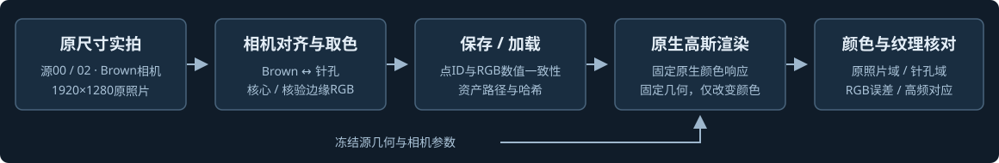

# 源材质链路诊断接入

唯一交付仍为 `C:/Users/dengyunlong/Documents/Codex/2026-11-16/xian/outputs/road_material_three_rounds_20261121/index.html`。本目录只保存适配器、组件脚本、数据合同与QA，不另建HTML。

新节标题为“源材质链路诊断”，紧接既有“源块质量核查”。新数据使用独立JSON脚本 `source-fidelity-chain-data`，界面使用 `sfc-*` ID。原 `D` 字面量、58条实验记录、历史55条及744行指标保持原样；既有 `SOURCE_QUALITY_AUDIT` 区块也完整保留。

人工实拍审计完成后，默认主参考改为02/115、117复核，00/137为对照；两者均显示且各有帧选择。统一显示100%采集像素，可切200%/400%整数最近邻。所有图片均来自1920×1280原生栅格，以准确裁剪框和像素尺寸显示。实拍提供“核心”“核心＋核验边缘”“相同0.6m物理方形”三种真实裁片。渲染的“核心/完整诊断裁片”仅改变显示掩码，实际渲染始终包含固定核验边缘贡献，并明确记录在合同中。

当前真实产物包含八组实拍、四组零更新链路控制，以及02/115和00/137的固定原生颜色算子求解。零更新链路按实拍→原源渲染→同帧直接取色渲染→NPZ重载渲染→常色控制展示，数值核验覆盖取样→保存→加载。正式求解按实拍→原源→参考帧直接取色→有界颜色求解展示。现有产物没有点投影预览，不将渲染图改名为点颜色图。

指标在同一表内并列显示颜色MAE、通道偏差、HF对应度和RMS比，并明确固定评价域、像素数、σ。未定义的点级HF保留空值；不填虚构分数。原源/修复源的渲染比较必须使用相同评价掩码。保存/加载核验另列点ID、RGB最大差和平均差、几何冻结、颜色编码与路径。

实际结论、人工筛选结果、保存/加载误差、冻结证明和资源账均由结果JSON提供。不会把旧源00的400步诊断改写为本轮结果。新节不包含目标融合。

## 输入合同

当前实际入口为 `build_actual_snapshot.py`，直接读取照片审计、零更新探针receipt以及通过`--solver`指定的正式求解目录。默认只输出payload/资源计划；加`--apply`才原位追加。每次写入前自动备份，写后复核旧D与源质量核查区块完全相同。`prepare_report.py --manifest`与`result_contract.md`保留为后续完整点投影链路的通用接口，当前不生成缺失阶段。

最终追加两组`--camera`控制，默认在未插值原照片的Brown域评价，可切针孔域；每域各自固定掩码，原源/未校正颜色/校正颜色并列。两组`--static-control`仅在负结果折叠区展示。02相机控制末尾的JSON序列化恢复另记为CPU工程恢复，复用既有12次F，无新增渲染或求解。最终资源为918F、1次VJP测量B、12个RGB通道线性求解、0梯度更新、0扩散、0目标迁移。

用户随后明确要求另run验证02在相同init/400steps/Adam下的两帧池与8–16有效帧池。当前七臂作为历史源链路诊断保留，主结论为“多帧参考池尚未验证”；现有单参考查询结果不构成固定几何表达能力的否定。后续配对结果同页独立追加，保持旧证据。

## QA

`qa_source_fidelity.mjs --preflight` 检查原页面与旧计数；正式接入后不带该参数检查00/02、两个核心变体、全部帧、100/200/400%像素尺度、图片完整性、固定域指标、390px布局、58/55/744记录和JavaScript异常。检查复用真实Chrome CDP；不创建测试HTML。

最终完整QA使用`--require-camera`，通过72个照片状态、48个未校正求解状态、8个零更新状态、96个相机控制状态，共224个状态。新增黑色掩码图例后仅使用`--mask-legend-only`检查图例、上下文切换、100%与直接URL锚点；完整QA记录独立保留。
