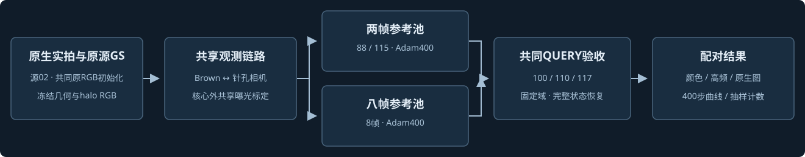

# 065源02：两帧与八帧参考池的400步配对实验

八帧参考池对本轮主查询有收益：平均原始照片域颜色MAE从0.008283降至0.007765，HF相关从0.1250升至0.1977。收益以100帧最明显，117略有回退；八帧结果更平滑，纹理能量仍低于照片。该结果支持参考观测数量与均衡采样确实影响源材质拟合，不能用此前单／双帧控制提前否定多帧参考池。

task=`ROAD-SOURCE-MULTIFRAME-20261122`；run=`road_source_multiframe_20261122_r3/paired400_seed0`。本轮仅源02颜色修复，不进行目标迁移、融合或新扩散。原报告同页增加两帧／八帧实验组；人工verdict与problem_solved保持null。

## 冻结照片池与共享预处理

人工按原生1920×1280照片复核，训练八帧为88、90、92、94、96、99、104、115；两帧控制为同池端点88／115。最小训练相机位置间距0.283342米，端点基线2.452050米，视线角度跨度约3.5度，均来自同一FRONT轨迹。训练核心短投影轴20.01–32.42像素，不以近重复帧凑16张。主QUERY为100／110／117，86单列为低分辨率stress；它们均不进入本次源RGB拟合。

两组使用相同Brown→针孔校正，以及同一套固定曝光gain。gain在源核心外扩20厘米之外、±1.5米范围内的真实同世界道路对应上估计，8厘米世界格等权；bias固定0，按encoded-sRGB进行canonical=gain×raw、raw=canonical/gain。原图不修改，源核心RGB不参与曝光拟合。空间格划分验证进一步排除双线性支撑像素与拟合像素重叠后，所有TRAIN和主QUERY仍通过；86的严格外部曝光验证较弱，仅作为stress。

该标定使用QUERY核心外的真实路面，仅作共同相机曝光读出，不是完全盲测。全部199帧历史影像已经参与开发，本次QUERY表示未参加本轮参数更新，不称独立场景测试。

## 唯一配对变量：参考池

- 共同初始化为原始patch_02 packet的900行核心RGB，两组逐值一致。r1／r2两个source_packet路径解析为同一物理文件，所有字段核验相同。
- 中心、法向、旋转、尺度、opacity及halo颜色全部冻结，只训练2700个核心RGB参数。
- 各正式400步，Adam学习率0.01；每视角有效原生RGB的平均MSE等权，初始RGB平方先验权重10⁻⁴。
- seed=0，重复随机打乱池后每步抽两张不同照片。两帧池每帧400次，八帧池每帧100次；总帧渲染预算相同，QUERY和stress抽样次数0。
- 核心评分域在更新前固定：物理核心内缩5像素、初始alpha≥0.95、与相机模型一致的照片资格相交。两组相同视角的掩码、分母和曝光完全一致。
- 不按QUERY挑步数，不增加正式训练步数。每组只评价实际第400次更新后的持久源包。

## 主QUERY结果

下表为未插值原始Brown照片域，HF取σ=5/3原生像素；先将canonical渲染逆曝光，再逆映射到原始照片栅格。不同阶段均使用相同读出与冻结mask。

| QUERY | 固定像素 | 两帧MAE | 八帧MAE | 两帧HF | 八帧HF |
|---|---:|---:|---:|---:|---:|
| 100 | 2051 | 0.008189 | 0.006780 | 0.1404 | 0.3577 |
| 110 | 2308 | 0.008336 | 0.008122 | 0.0536 | 0.0710 |
| 117 | 2632 | 0.008325 | 0.008391 | 0.1811 | 0.1645 |
| 三视角等权均值 | — | 0.008283 | 0.007765 | 0.1250 | 0.1977 |

平均MAE约下降6.26%。HF RMS／照片比的三视角均值从0.8636变为0.5983；共同初始化是0.6030但相关接近0。因此既不能把更多高频当保真，也不能仅凭能量降低否定八帧效果。八帧的纹理位置对应有所改善，幅度仍弱，117没有全面获益。

在相同八帧训练集合上，两帧模型与八帧模型的canonical MSE为6.2489×10⁻⁵／4.7367×10⁻⁵；在共同端点88／115上则为4.3501×10⁻⁵／6.2787×10⁻⁵。八帧分配观测约束更均衡，代价是端点拟合精度下降。loss日志实际保存step1与每25步，共17条，完整400步抽样表另存；这些是不同随机batch的在线loss，不能把两个末batch数值当共同评价目标。

86 stress的MAE为0.007458／0.007689，HF为0.3132／0.2766，不纳入主QUERY均值。报告另外保留1.2／3像素频带、canonical针孔域和全12帧实际图。

## 生命周期、持久源包与资源

真实GPU短程4步覆盖随机抽样和非空Adam保存，再对原状态及完整恢复状态各执行下一步，两次结果最大RGB差0；6次更新全部丢弃。两组重新从共同原始初始化开始各400步，保存initial_state、完整Adam/RNG／采样表和终点checkpoint。

各组最终源NPZ加载后重新进行12视角实际原生渲染，与内存参数输出逐值一致；alpha、所有非RGB字段和halo RGB保持原值。现场位于`/root/autodl-tmp/drivingeditor_repro/campaign/road_source_multiframe_20261122_r3/`。

本轮1684F／1612B：数据初始化及共同初始评价24F，smoke／恢复12F／12B，正式两组1600F／1600B，终点内存／重载评价48F。正式800次参数更新，额外短程6次；与r2的918F／1B和颜色线性求解分别记账。曝光和照片审计无GPU更新，新扩散0，目标道路更新0，原资产不改，GPU保持开机。

当前结论是多帧参考池存在可测增益，源高斯表达限制仍未被本轮单独识别。尚未进行迁移或融合，不把本轮结果提前晋升为完整路面恢复成功。沿用failure_ledger_refs=[V82-F06]。

免责声明：这是同一源块、同一历史街段、单seed和固定400步预算的配对结果；主QUERY靠近部分训练视角，86曝光验证较弱。尚未分离几何误差、照片细纹理可重复性、采样收敛和外观表示的各自影响，不能据此宣称参考数量是唯一瓶颈或固定高斯已经达到可迁移质量。
