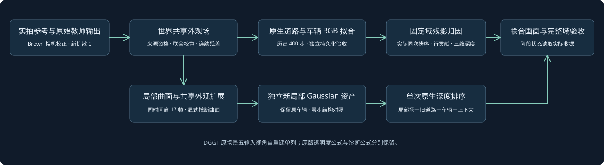

# 道路与车辆联合外观恢复

`ROAD-VEHICLE-JOINT-20261123`：在同一相机、时间和深度排序中，比较原A20车辆、道路外观与局部背景替换。唯一交互报告继续使用[原道路报告](http://127.0.0.1:18765/index.html#road-underbody-local)。

- [实际结果与资源](compact_result.json)：固定评价、来源资格、实际更新和工程开销。
- [交付范围与归档入口](final_delivery.json)：持久资产、完整方法归档、本地取回和最终验收范围。
- [原生来源历史核对](../road_native_source_transfer_20261122/README.md)：保留00／02加工道路来源纠正和独立原生静态对照身份。

免责声明：原版DGGT网络对照、当前原生渲染器联合优化、共享曲面输入验收与最终联合画质分别记录。隐藏区域的推断来源不标成同位置实拍；通过共享输入检查不代表联合画质通过。人工质量结论与问题解决状态保持用户评定。
