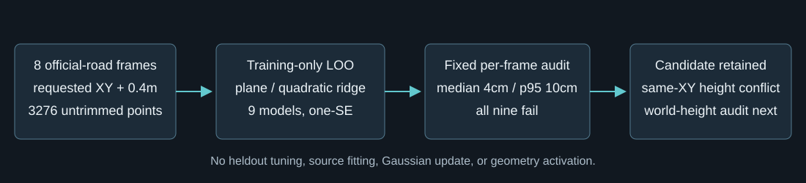

# 扩域几何候选：第一轮模型族未通过

1844几何候选完整性通过，但扩展范围的物理高度资格未通过，不批准零步资产初始化。新目录保留3276个原始官方ROAD18/LANE19训练点、1289个0.1m medoid、全部9模型和8个LOO折，不修改原b5df或1844文件。

训练范围由五视图筛选前允许编辑区域的世界footprint及既定0.2m环确定，再加0.4m小context。八帧原始点数为204、252、334、472、498、510、506、500；只按finite与XY范围取点，不按Z、模型残差、OBB或照片语义预先裁点。实际请求区域内1426点的原分母全部保留。

原模型族和选择规则保持：斜面、8种曲率正则二次曲面，Huber 3cm与IRLS8，按frame留一并评价该frame全部原始点，one-SE偏好低曲率。斜面LOO MAE=0.04356947m；均值最优二次λ=.1为0.04255941m，改善约1.01mm，小于折间标准误约14mm，one-SE仍选斜面。

独立逐点审计使用绝对高度median≤4cm、p95≤10cm。9模型全部不能在所有实际请求frame中通过。斜面LOO实际raw60 median/p95为13.067/14.793cm，raw70为6.460/8.149cm；最优二次仍约13.044/14.688cm、6.560/8.284cm。低平均MAE不能替代逐帧物理门。

同XY≤10cm的跨frame官方点核查还发现raw60相对后续frame高约15.5cm，raw70约8–9.5cm，说明冲突不只是宽padding或空间取样位置不同。下一步应独立核对TOP pixel-pose、时间戳与sensor→ego→world高度链，先不让更高自由度静态曲面吸收帧间冲突。

五张1152×768几何context已独立目视，无明显翻折或粗坐标错误。照片中的原A9是目标场景待移除车辆，网格位于其后方；这类context不证明被遮道路的实际高度。扩展asset有66.5%顶点超出原477拟合点凸包，条件bootstrap SD不包含模型误差。原几何/K/车辆/来源图未改变，当前未打开新expanded heldout3输入，无新增GPU或更新。

关键收据：`expanded_geometry_status.json`、`training_only_CV_selection.json`、`training_fold_original_height_audit.json`。第一轮模型族失败保留，候选与失败不升级为整场景恢复成功。
