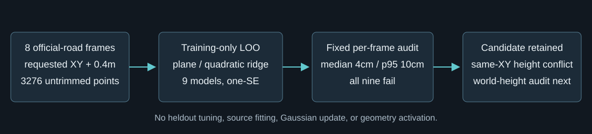

# 扩域几何首轮未通过，高度差原因待核

新增范围的9个斜面/二次曲面模型均未通过逐帧高度门，1844候选不批准零步资产。原选择、原始点、失败收据和全部SHA保持；本页修订原因解释，不修订数值结论。

此前将世界XY≤10cm的跨帧高度差直接称为“帧偏置”过早。curb上沿和下沿也可能相差数cm XY，因此这类近邻证据本身不能排除真实多层路面。

同帧原官方ROAD18/LANE19点在10cm范围内未发现8cm阶跃；同一context的官方CURB17和SIDEWALK22为0，但稀疏点中没有这些标签不能直接排除curb。世界分布图和PCA法线保留在`../same_frame_surface_layers_v1/`，所有原点的label由TOP编码精确回查。

raw60/70及110/145/165的原record CRC、全部6列.bin重解与frame/obs时间绑定均核对一致。独立float64传感器极坐标、extrinsic与SciPy欧拉旋转直接生成TOP worldXYZ，最大XYZ差0.668mm，最大Z差8.7微米，排除了本次导出浮点roundtrip产生15cm的解释；这不证明数据集pose物理精度无偏。原记录官方Front CP已另行导出，用于与Brown投影和原照片对照。

当前原因仍为待定，不能以曲面加自由度、颜色或尺度拟合隐藏冲突。既有source准备可作为颜色诊断保存，当前不新增GPU、不修改原车辆/道路/相机，不使用expanded heldout3选择模型。
