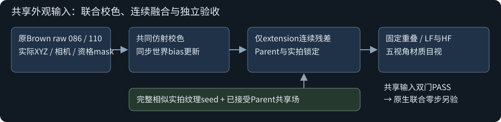

# 局部共享外观输入独立验收

数值门和五视角目视门均为PASS，绑定共享场 `eb86cb6d61b711366d8c30052fd02b823433a6e940b80d6f4e0463685e38a5dd`。验收范围为局部零步对照的共享颜色输入；实际原生联合画面的车底、接地、保护区与最终质量另行验收。

新增12328个extension texel。原parent共享RGB在extension之外逐字节一致，6407个真实观测锁定点的mask与RGB逐字节一致。OpenCV独立Brown投影、先线性化后双线性重采样验证了两张原始raw_model；没有用hard-final作RGB监督。

固定24237个重叠texel、72711个通道样本全部保留：全RGB平均绝对差下降25.0987%，低频σ=.12m下降54.09765%。Parent-extension低频边界p95为.005004225，属于描述性读出，未为追逐.005而模糊纹理或改参数。

2cm/4cm高频相关系数分别为.9999998835/.9999998533，高频变化量与seed高频RMS之比为.000483/.000542。两个视图共同求解仿射校色，世界bias同步更新；反转source轴的仿射重放也通过。Parent是已接受的锁定条件，未将其推断颜色改标为新真实观测；教师影响值仍为非标定proxy。

五张1152×768直接材质图和context图均逐张核验，有效材质内无近黑值、明显宽色块或格线条纹。上方切口处于精确cell_asset_mask之外，域内缺材料像素为0；原照片只作显示context。蓝灰与完整道路范围未由该输入门宣称全覆盖。

入口：`numeric_gate.json`、`visual_gate.json`、`acceptance_contract.json`。全部CPU核验，新增GPU前向、反向、Gaussian更新均0。
