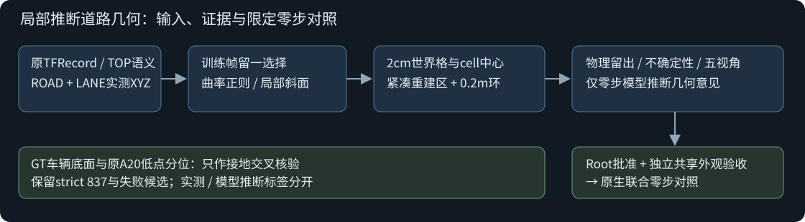

# 局部道路模型推断几何：限定零步对照

独立意见为 `PASS_FOR_LIMITED_ZERO_STEP_MODEL_INFERENCE_CONTROL`，绑定候选 `b5df7c8cb2b99723e1fabf3b2ca4c958c88003d38f4f528bb6dd8f14e97a011a`。候选可进入独立共享外观验收和原生联合零步对照；Root批准另存。全道路几何、蓝灰残影全覆盖和最终恢复质量仍单独验收。

## 点云坐标与物理参考

原TFRecord的86/110/137重解码六列与既有bin逐字节一致；pose、timestamp与观测绑定一致。TOP逐像素运动补偿后已转同帧ego，世界坐标由同帧ego_world恢复。第六列是TOP return/row/column编码，非TOP为-1。P01/P02旧plane点与原点云world重载距离为0，独立局部profile对旧物理plane四角误差最大0.77/1.12cm。

父道路真实XYZ三角法线也存在较大边界差，不能只把stored normal当物理几何。原严格证书837格均位于旧parent已支持范围，新洞实测资格仍0；旧证书和未正则推断候选完整保留。

## 官方道路点与模型选择

官方proto核ROAD=18、LANE_MARKER=19；八个训练帧共1531个局部官方道路点，TOP两return编码、有效/NLZ行与语义逐行精确对齐。原OBB和photo-road0只保留为独立标记，未默认删除官方道路点。其中156点在扩张OBB内，209点在原照片非road0位置；没有点直接落入旧parent缺口。

训练帧LOO对plane与固定曲率正则网格评估全部留出训练点，不裁分母。one-SE规则选择局部斜面，之后才读取134/179/198三帧物理留出检查；三帧高度p95约2.53/3.58/3.70cm，法线p95约13.78/9.92/12.90度。GT底面没有加入拟合。

## 候选范围与接地检查

Vertex上下文为151×334、2cm全局整数UV，共50434个有限假设点。Cell为150×333，中心在UV+.5解析求值。实际asset仅34793个cell：紧凑重建22103，0.2m过渡环12690，面积约13.916m²；全部asset cell是模型推断，未冒称洞内LiDAR观测。条件bootstrap高度标准差在asset内中位约1.8cm，属于模型敏感性，非标定概率。

原GT A20底面对相邻官方road的八训练帧中位偏差约-2.87cm，A9约-1.02cm。候选道路在86/110的A20底面中心上方4.01/4.81cm；原ab4高opacity活跃Gaussian均值z1%在GT底面上方约3.98cm。这支持进入接地零步对照，不能把box底面或Trellis极小Z当稠密地面GT。v1的obs维度严格相等谓词false保留；v2直接使用原TFRecord GT pose/dimensions，另记微米级派生尺寸差。

## 五视角与目标覆盖

五张1152×768原尺寸几何投影已目视核验，无明显翻折或粗坐标错配。固定红块357/357、692/692和紧凑残影1923/1923、3288/3288像素均在asset范围且不属body/K；原蓝灰与全部band只部分覆盖，完整分母和未覆盖计数保留。原照片A9遮挡区的网格仅说明目标地面的投影位置，照片只作context，不能当新的道路RGB监督。

原NPZ的renderable=false保持候选验收状态。限定意见不修改该文件；后续证书以同SHA和cell_asset_mask授权，仍需Root、共享外观及真实原生联合画面各自门控。

关键入口：`candidate_geometry.npz`、`independent_limited_geometry_review.json`、`local_geometry_evidence_index.json`、`five_view_geometry_v1/`。本目录准备和审计全部CPU，新增GPU前向/反向/更新均0。
