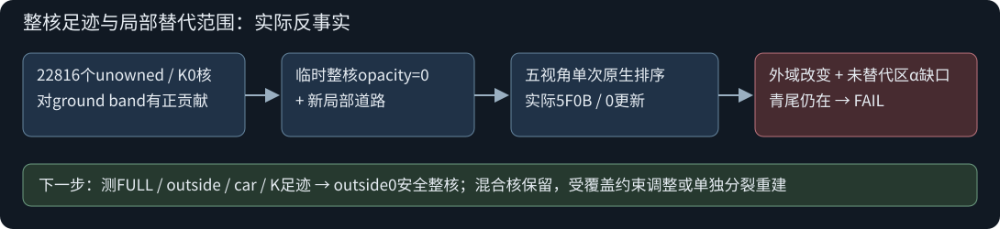

# 整核背景退行反事实：独立结论FAIL

五张1152×768实际联合图和全部float固定分母已独立复核。蓝灰暗团部分减弱，但青亮尾与左侧碎片仍在，外部地面更粗糙。该反事实不作为生产gate，也不批准全22816行无约束微调。

| 固定视角 | 新增完整band α<.95 | 其中原目标未知 | band外RGB变化像素（>1e-6） |
|---|---:|---:|---:|
| 086 | 35 | 12 | 185381 |
| 110 | 100 | 31 | 167538 |
| 134 | 117 | 43 | 169628 |
| 179 | 159 | 55 | 174277 |
| 198 | 171 | 60 | 166093 |

这些新增α缺口全部位于新asset material范围之外，actual new_local_alphaT在缺口像素精确为0。问题是原覆盖被整核退行移除后没有替代，不是新局部道路的σ不足。其他车辆K的RGBA全五帧精确保持；原车strict V与proxy非RGBA精确，平均photo L1微小变化不能替代车体边缘核验。原A20、oldroad400和native21/正owner均未改。

固定红块仍余2/357、33/692，蓝灰仍余2503/3389、3401/4575。固定已知道路MSE反升，未知目标仍未作为零RGB参与评价。整核选择依据是在完整非颜色ground band有正贡献，不代表Gaussian足迹完全包含于局部编辑区域；外域最高RGB变化约.6374直接显示这种混合。

下一步按实际联合的FULL/outside-editROI/car/K逐行支持筛选：仅outside0且保护0的行适合整核操作。若做稀疏opacity微调，应同时约束完整band（含未知区）的α覆盖、外域RGBA和原车真实可见区；混合足迹行保留，必要时进入单独局部核分裂重建。核分裂不天然保持原生α，必须另做identity与联合回放。旧正式400继续计入2000上限，不为耗尽预算盲跑。

本对照实际5F0B/0更新；R10累计25F10B/0新formal。独立审计新增GPU调用0。完整证据见 `independent_review.json`，其测量完整性PASS、质量FAIL分开记录。
